# FaultEvolve · 自演化故障预测智能体

> **一句话介绍**：FaultEvolve 让 AI 智能体自己"做科研"——你描述任务、选好初始解（比如最新 SOTA 论文），它在服务器上自动组合、进化出更好的故障预测算法，在本地用真实设备数据按冻结规则验证，并把验证有效的规律沉淀成可追溯、可迁移的新知识；原始数据始终不出本地。

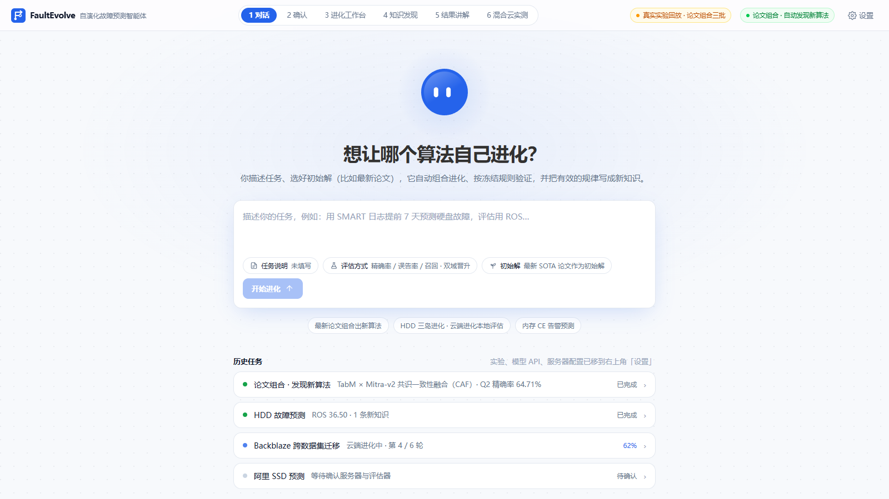

*图 1｜EvoBot 路演首页。用一句话描述任务，选择评估方式与初始解（最新论文 / 已有知识 / 基线 / 上传代码），即可开始进化；下方是历史任务。*

[▶ 观看 20 秒宣传视频（1080p / 60fps）](docs/media/FaultEvolve-1080p60.mp4)

---

## 目录

1. [核心功能](#一核心功能)
2. [核心技术创新](#二核心技术创新)
3. [界面导览（含截图）](#三界面导览)
4. [新知识发现与实验结果](#四新知识发现与实验结果)
5. [本地-云端混合：平板 ↔ 本机 GPU ↔ 远端自进化](#五本地-云端混合平板--本机-gpu--远端自进化)
6. [Agent Skills](#六agent-skills)
7. [使用方式](#七使用方式)
8. [系统架构与技术栈](#八系统架构与技术栈)
9. [仓库结构与常见问题](#九仓库结构与常见问题)

---

## 一、核心功能

| 功能 | 说明 |
|---|---|
| **对话式发起进化** | 一句话描述任务；初始解可选"最新 SOTA 论文 / 注入已有知识 / 基线算法 / 上传代码"，评估方式与预算在确认页一次核对 |
| **多岛自进化工作台** | KGTE 三岛协同进化（HDD 案例）与"多岛论文组合进化"（论文案例）两种画布，实时展示候选生成 → 下发 → 本地评估 → 回传分数 → 反思 |
| **知识发现辩论赛** | 支持方 / 混杂方 / 批评方 / 统计裁判 / 总裁判多 Agent 辩论，配合预注册、BH / e-BH 多重校验给出 CONFIRMED / 候选 / 证伪判级 |
| **结果讲解员** | EvoBot 讲解员按"最终方案 → 提升了什么 → 改进点 / 本质创新 → 新知识 → 可复现性"五步自动讲解，数据全部来自运行制品 |
| **本地-云端混合实测** | 平板机房数字孪生推送 SMART 遥测、接收告警；服务器经跳板机自进化；本机在平板场景上用 GPU 评估候选，只回传白名单分数 |
| **双 LLM 提供方** | 默认 Qwen（DashScope，`qwen3.8-max-0902`），亦可使用本机 Codex CLI 登录态生成候选 |
| **经典工作台** | 任务管理、进化树、代际时间轴、知识证据链、结果与审计导出（`/` 路由），与路演演示共用后端 |

---

## 二、核心技术创新

FaultEvolve 的核心思路是：**把算法进化当作"科学发现"来做**——不只搜索最优代码，而是在搜索过程中回答"什么有效、为什么有效、是否普适"。

### 2.1 知识引导的岛屿群演化（KGTE）

- **多岛并行**：时序特征岛 / 模型集成岛 / 运维阈值岛分别探索不同方向，保持多样性。
- **岛内树演化**：每座岛维护一棵假设树，结合 ERA 知识卡片注入与三层反思（实现层 / 设计层 / 假设层）驱动候选改进。
- **岛间知识交换**：只交换**最佳方案的改进意图**与**失败经验（"此路不通"）**，在进化树上以绿色 / 红色跨岛连线可视化。
- 效果：HDD 验证集上开启知识注入后有效改进率从 30% 提升至 50%。

### 2.2 Jev 引导的噪声感知树搜索（J-PUCT）

低异常事件数据（故障盘 < 4%）单次评估噪声很大。J-PUCT 把 AlphaGo PUCT 的先验 `P(s,a)` 换成 Jev 结构化决策模型给出的"该候选能涨点"的概率，并加上 bootstrap 动态阈值门 τ：

```
a* = argmax_{a : Δ(a) > τ} [ Q(s,a) + c_puct · P_jev(a) · √N(s) / (1 + N(s,a)) ]
```

效果：Jev 预筛跳过 30%–50% 无效评估，假涨点率从 ~15% 降至 ~3%。评分唯一来源始终是本地 `evaluator.py`。

### 2.3 "现象 → 机理 → 原理"三层知识发现（PMP Discovery）

- **现象层（KD1）**：可证伪 claim + 预注册哈希 + bootstrap CI / 排列检验 p 值 / e 值三重门槛 + 新颖性检查。
- **机理层（KD2）**：候选机制在固定赛制中对局，多 Agent 交叉质询，胜者获得否证证书。
- **原理层**：跨时间切片 / 跨数据集外推，通过后才写入可迁移知识库。

### 2.4 论文组合进化：以最新 SOTA 论文为初始解自动发现新算法

- 每篇可运行的论文（TabM、TabICLv2、ModernNCA、Mitra-v2）是一座岛；组合节点长在宿主父算法的岛里，另一父代以跨岛飞线汇入。
- 三种命名融合算子：**ERE** 等权风险集成 `(p+q)/2`、**CAF** 共识一致性融合 `√(pq)`、**ADPF** 自适应分歧惩罚 `σ(αz − λ|Δz|)`。
- 晋升必须同时在两个季度（Q1 / Q2）通过 5 项冻结检查：精确率高于双父、误告不高于双父、误告 ≤ 0.2%、召回保护、告警 ≥ 10 次。

### 2.5 本地-云端混合与数据边界

- **服务器只做生成**：经 SSH 跳板机在 GPU 服务器上运行自进化器，候选程序写到会话目录。
- **评估只在本机**：本机拉取候选，在**平板演示场景**（真实流过平板的遥测）上运行，GPU 上做 10 万次配对 bootstrap。
- **白名单回传**：`boundary.gate` 只放行 ROS、捕获数、误报数、失败类型等标量，原始遥测、标签、逐盘分数一律拦截并记账。

---

## 三、界面导览

前端为 EvoBot 路演外壳（`/demo`），共 6 幕，顶部导航可随时切换；经典工作台保留在 `/`。

### 3.1 对话 → 确认

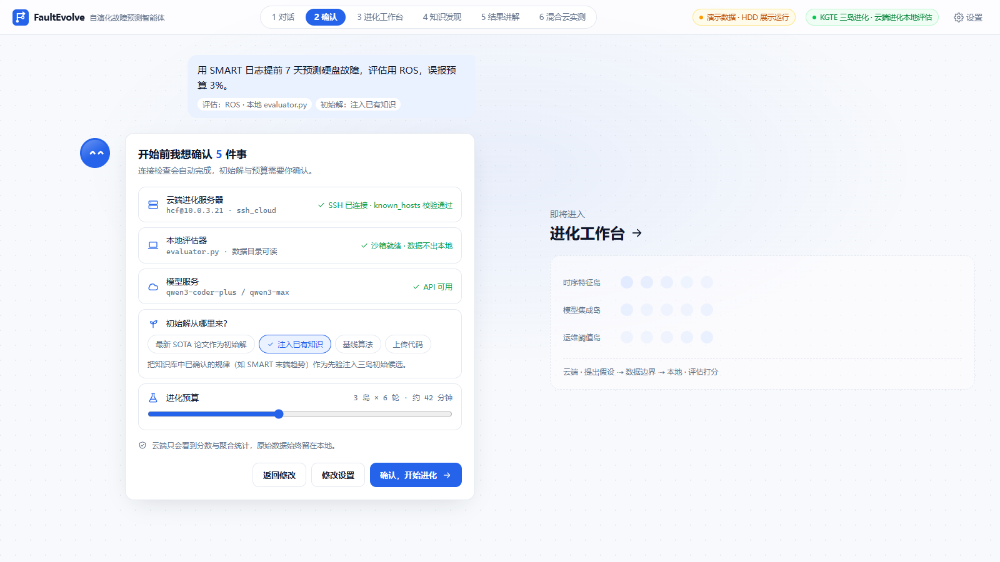

*图 2｜开始前确认 5 件事：云端进化服务器（SSH / known_hosts 校验）、本地评估器（沙箱就绪、数据不出本地）、模型服务、初始解来源、进化预算（3 岛 × 6 轮）。右侧预览即将进入的三岛工作台。*

### 3.2 进化工作台

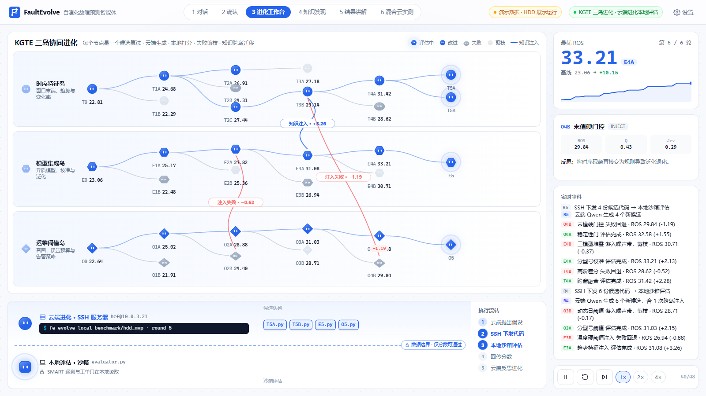

*图 3｜KGTE 三岛协同进化（HDD 案例）。每个节点是一个候选算法；蓝线为知识注入，红线为注入失败回退；下方是"云端生成 → SSH 下发 → 本地沙箱评估 → 回传分数 → 云端反思"的执行流转，右侧是最优 ROS 曲线、选中节点的 Q / Jev 与实时事件。*

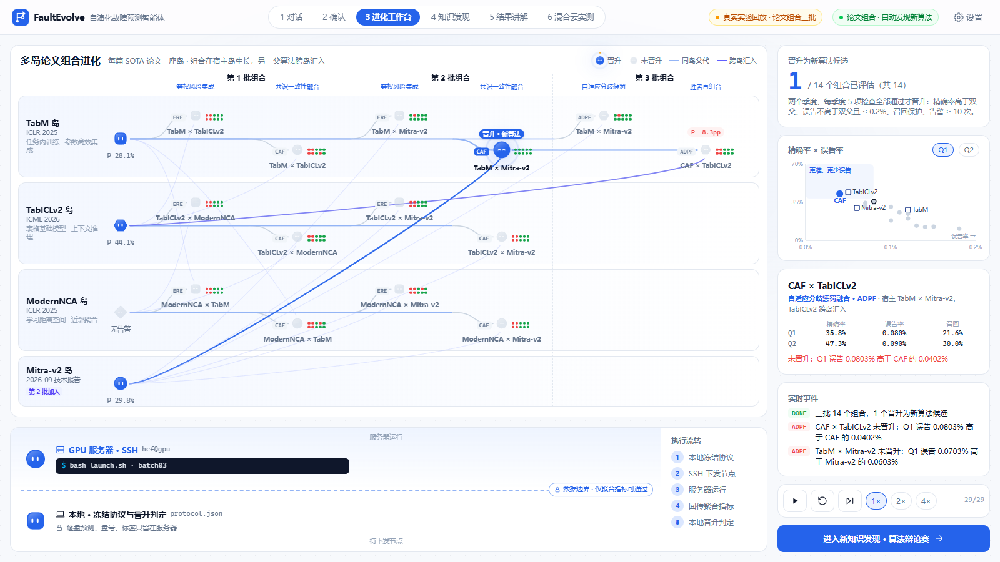

*图 4｜多岛论文组合进化。四篇论文各成一岛，三批组合逐步引入新论文与新算子；右侧"精确率 × 误告率"散点标出晋升候选 CAF，并逐条列出未晋升原因。*

### 3.3 知识发现辩论赛

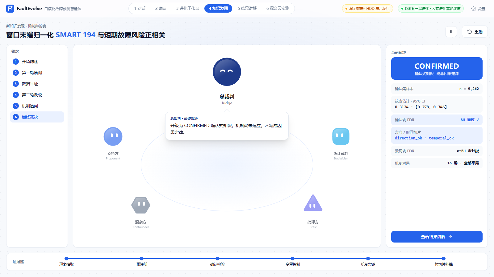

*图 5｜"窗口末端归一化 SMART 194 与短期故障风险正相关"的机制辩论。左侧是 6 轮流程，中间是支持方 / 混杂方 / 批评方 / 统计裁判 / 总裁判，右侧给出确认集样本 n = 9,262、效应 0.3124（95% CI [0.278, 0.346]）、BH 通过、e-BH 未升级、机制对局 16 场全部平局，最终判级 CONFIRMED。*

### 3.4 结果讲解

| HDD 三岛进化 | 论文组合 |
|---|---|
| 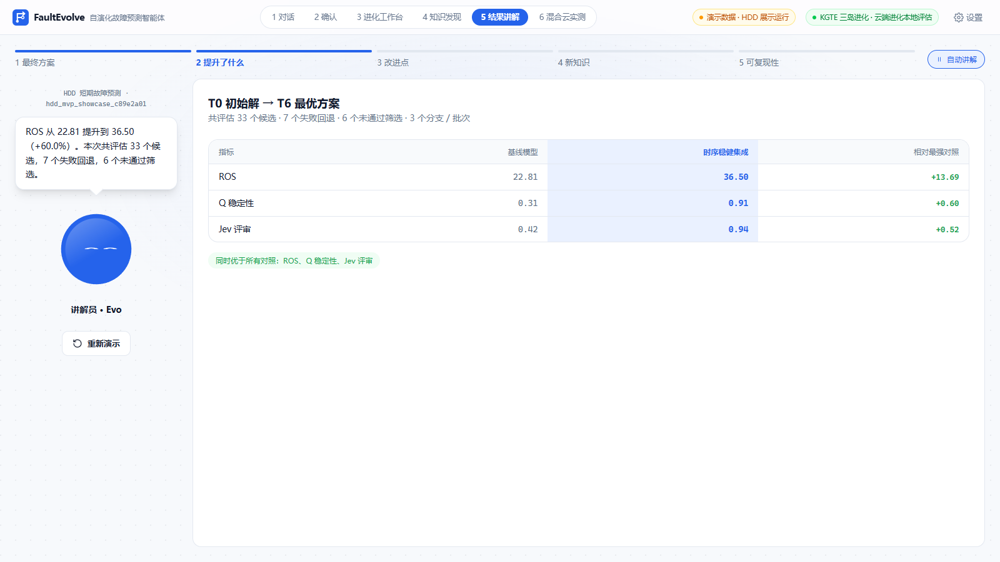 | 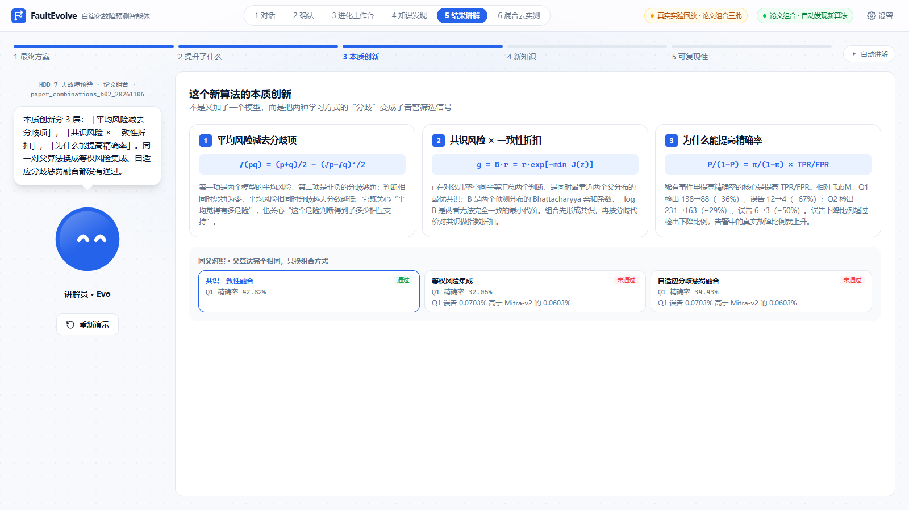 |
| *ROS 22.81 → 36.50（+60.0%），共评估 33 个候选；Q 稳定性 0.31 → 0.91，Jev 评审 0.42 → 0.94。* | *CAF 的本质创新：平均风险减去分歧项、共识风险 × 一致性折扣、为什么能提高精确率。* |

### 3.5 混合云实测（实时，非回放）

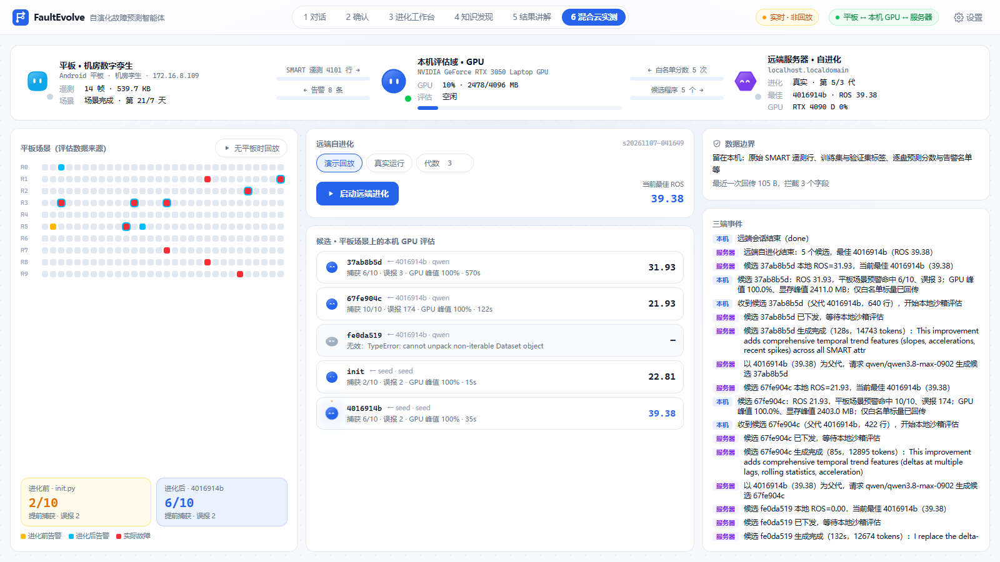

*图 6｜第 6 幕"混合云实测"。上方三端：平板（机房数字孪生，SMART 遥测上行 / 告警下行）、本机评估域（RTX 3050 实时占用）、远端服务器（经跳板机自进化，RTX 4090 D）；中间是远端自进化控制（演示回放 / 真实运行、Qwen / Codex、代数）与候选评估列表；右侧是数据边界与三端事件流。*

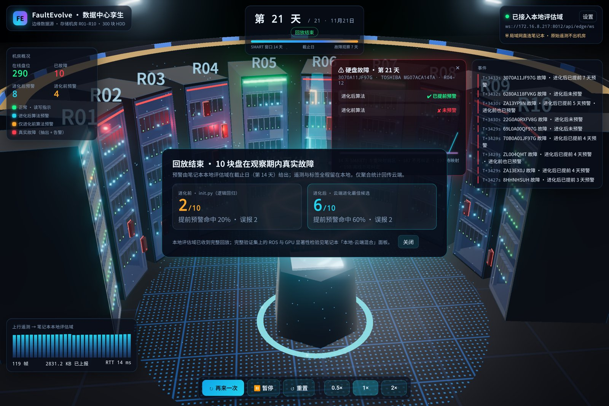

*图 7｜安卓平板 APK（Capacitor）。R01–R10 共 300 块 HDD 的 3D 机房，经局域网 WebSocket 把每日 SMART 遥测推给笔记本；笔记本下发告警，平板标出提前预警。10 块真实故障盘中，进化前算法提前捕获 2 块，进化后 6 块。*

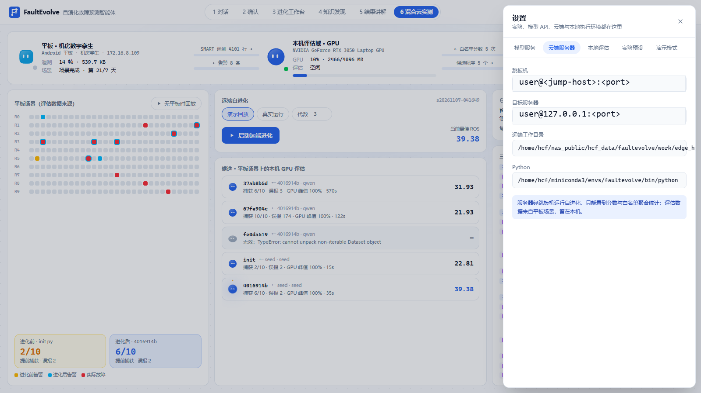

*图 8｜设置面板直接读取后端 `.env` 配置：跳板机、目标服务器、远端工作目录、Python、模型提供方与 Codex 登录状态（密钥不回显）。*

---

## 四、新知识发现与实验结果

### 4.1 新知识一：窗口末端归一化 SMART 194 与短期 HDD 故障正相关（CONFIRMED）

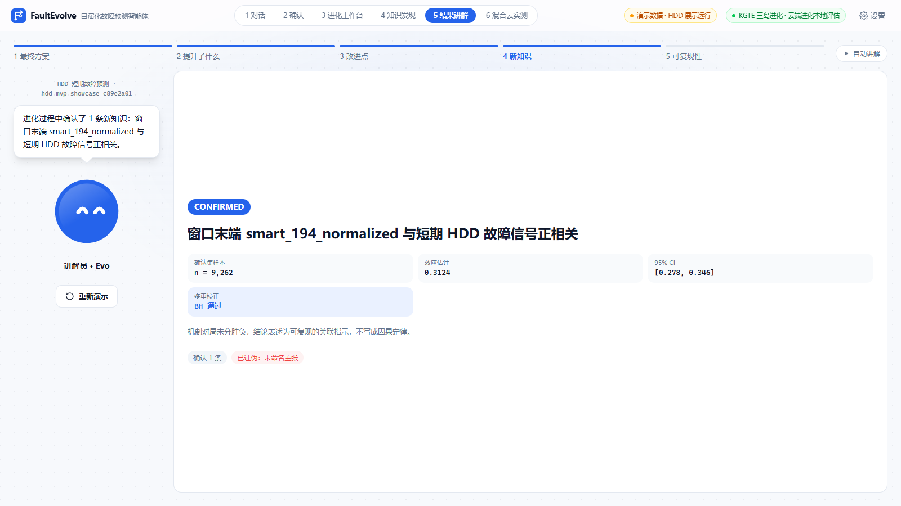

| 层次 | 问题 | 结论 |
|---|---|---|
| 现象层 | 是否存在稳定的数据规律？ | 是，窗口末端 `smart_194_normalized` 与短期失效正相关 |
| 主张层 | 预注册切分上是否仍成立？ | 是，确认集 n = 9,262，效应 0.3124，95% CI [0.278, 0.346]，BH 通过 |
| 推断层 | 关联、近因指示还是机制？ | 近端风险指示器，**不写成因果定律** |
| 证伪层 | 对立机制 / 外推能否打回？ | 机制对局 16 场全部欠功率平局；时间外推符号同向但 CI 含 0 |

结论：知识等级停在 **CONFIRMED**（未达 e-BH 的 DISCOVERED）。系统把"找到一个相关特征"提升为"**带边界、可回放、可升级检验的知识主张**"。

### 4.2 新知识二：共识一致性融合（CAF）可作为稀有故障告警的筛选信号（候选）

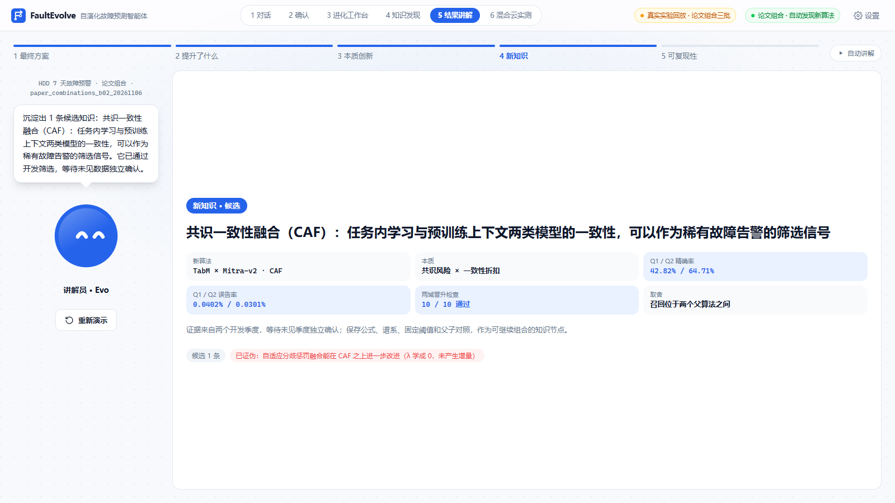

- **新算法**：TabM × Mitra-v2 · CAF，本质为"共识风险 × 一致性折扣"。
- **两季度精确率**：Q1 42.82% / Q2 64.71%；误告率 Q1 0.0402% / Q2 0.0301%；双域晋升检查 10 / 10 通过。
- 14 个组合中只有它晋升；同批"自适应分歧惩罚"在 CAF 之上未再改进，被标记为**已证伪**。
- 当前证据来自两个开发季度，等待未见季度独立确认，因此判级为**候选**。

### 4.3 证伪记忆：避免重复踩坑

运行 `38cb38cf` 中，FE01 + FE03（窗口 delta + onset flag）早期均值增量 +8.22；运行 `f9752fcd` 中同样的卡片变为 **−11.89**。系统通过贝叶斯评分自动降低其检索权重，并作为"此路不通"在岛间传播。

### 4.4 关键结果汇总

| 实验 | 结果 |
|---|---|
| HDD 三岛进化（`hdd_mvp_showcase_c89e2a01`） | ROS 22.81 → **36.50**（+60.0%），33 个候选 |
| HDD 最佳运行（`hdd_mvp_formal2b_20261009`，候选 `4016914b`） | 验证集 ROS **39.38**，超过人工参考 ~33.7 |
| 规则基线 → 最佳 | 12.94 → 39.38 |
| 论文组合（`paper_combinations_b02_20261106`） | 发现 CAF，Q2 精确率 **64.71%**，误告 0.0301% |
| 平板场景（10 块真实故障盘） | 提前捕获 2/10 → **6/10**，误报 2 → 2 |
| SmartMem 内存跨数据集 | 引擎零改动，dev 44.16 / val 34.48 |
| 噪声控制 | 假涨点率 ~15% → ~3%；Jev 预筛节省 30%–50% 评估 |

---

## 五、本地-云端混合：平板 ↔ 本机 GPU ↔ 远端自进化

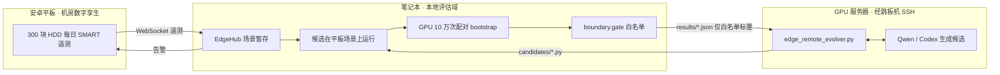

**两种模式**

| 模式 | 服务器端 | 本机端 | 用途 |
|---|---|---|---|
| 演示回放（demo） | 按顺序回放 `rule_baseline`、`4016914b` 等真实候选，不调用 LLM | 真实 GPU 评估 + 白名单回传 | 无密钥、稳定的路演 |
| 真实运行（real） | 以 `init` / `4016914b` 为种子，Qwen 或 Codex 逐代生成新候选 | 同上 | 远端真实自进化 |

**实测记录（2026-11-07）**

| 会话 | 候选 | 平板场景结果 | ROS |
|---|---|---|---|
| demo `s20261107-032448` | init | 捕获 2/10 · 误报 2 | 22.81 |
| | rule_baseline | 捕获 8/10 · 误报 15 | 12.94 |
| | 4016914b | 捕获 6/10 · 误报 2 | **39.38** |
| real（Qwen `qwen3.8-max-0902`）`s20261107-041649` | fe0da519 | 运行失败（TypeError），作为失败类型回传 | — |
| | 67fe904c | 捕获 10/10 · 误报 174 | 21.93 |
| | 37ab8b5d | 捕获 6/10 · 误报 3 | 31.93 |

- 三项验收均通过：**本机 GPU 评估峰值占用 100%**（RTX 3050 Laptop）；**平板 ↔ 笔记本双向通信**（遥测上行、告警下行，ADB 与局域网均验证）；**服务器远端自进化**（2× RTX 4090 D，约 4 万 tokens / 3 代）。
- 真实运行中 LLM 提出的两个新候选都没超过 `4016914b`：一个召回全满但误报 174，一个误报更低但 ROS 更低——系统如实保留最优者，不美化结果。
- 密钥只在本机 `.env` 与服务器 `~/.fe_edge/<session>.env`（600 权限），不进仓库、不写 NAS。

---

## 六、Agent Skills

`skill/` 下 12 个可复用 Agent Skill（每个含 `SKILL.md`，部分附脚本与参考资料），覆盖进化、发现、报告与数据全链路：

| Skill | 用途 |
|---|---|
| `fe-evolve-manager` | 运行、监控、暂停、继续本地进化实验并获取结果 |
| `fe-operators` | 配置召回 / 阈值 / 注入算子与 Beta-Thompson 算子老虎机 |
| `fe-crossover-ensemble` | 启用交叉 / 集成算子，合并不同分支高分程序 |
| `fe-jev-screening` | 配置、验证与排查 Jev 候选预筛和 UCT 先验 |
| `fe-node-value-budget` | 多目标节点价值与 token 预算控制 |
| `fe-knowledge-injection` | 从文献提取 ERA 知识卡片并在进化中注入 |
| `fe-knowledge-discovery` | 运行现象层知识发现（KD1）并核对产物 |
| `fe-error-analysis` | dev 集错例画像，解读 `metric.analysis` 与反思差分 |
| `fe-data-checkup` | 发现前对 train 公开数据做聚合体检 |
| `fe-dataset-adapters` | 准备与校验多数据集任务目录、配置 `task.adapter` |
| `fe-event-data-preparation` | 不规则事件流防泄漏样本准备（窗口、切分、embargo、审计） |
| `fe-report-generation` | 生成与 manifest 数字一致的答辩 / 结果表 |

在 Cursor / Claude Code 等支持 Skills 的 Agent 中，把 `skill/` 目录加入技能路径即可按需加载。

---

## 七、使用方式

### 7.1 环境要求

| 组件 | 版本 |
|---|---|
| Python | 3.12+ |
| Node.js / pnpm | 22+ / 9.15+ |
| GPU（可选，混合模式验收需要） | NVIDIA + CUDA 版 PyTorch |
| 平板（可选） | Android 6+（minSdk 23），与笔记本同一局域网 |

### 7.2 安装

```powershell
python -m venv .venv
.\.venv\Scripts\Activate.ps1
pip install -e ".[web,edge]"
# GPU 评估：安装 CUDA 版 PyTorch（示例为 CUDA 12.6）
pip install torch --index-url https://download.pytorch.org/whl/cu126

cd web
pnpm install --frozen-lockfile
```

Linux / macOS 将激活命令换成 `source .venv/bin/activate`。

### 7.3 启动路演演示（无需密钥）

一键启动（Windows）：

```powershell
powershell -ExecutionPolicy Bypass -File scripts\edge_demo.ps1 -ApiPort 8012
```

或手动启动：

```bash
python scripts/showcase_serve.py --host 0.0.0.0 --port 8012
cd web && VITE_API_PROXY_TARGET=http://127.0.0.1:8012 pnpm dev --port 5180
```

| 地址 | 内容 |
|---|---|
| <http://127.0.0.1:5180/demo> | EvoBot 路演演示（6 幕） |
| <http://127.0.0.1:5180/demo?stage=hybrid> | 直接进入混合云实测 |
| <http://127.0.0.1:5180/> | 经典工作台 |

推荐演示路径：**对话**选"HDD 三岛进化"或"最新论文组合出新算法" → **确认** → **进化工作台**观看进化 → **知识发现**辩论 → **结果讲解** → **混合云实测**。

### 7.4 平板 APK

```powershell
cd edge-tablet
pnpm install
$env:VITE_EDGE_SERVER="<笔记本局域网IP>:8012"; pnpm build
npx cap sync android
cd android; .\gradlew assembleDebug
adb install -r app\build\outputs\apk\debug\app-debug.apk
```

首次运行以管理员放行端口：`New-NetFirewallRule -DisplayName FaultEvolveEdge -Direction Inbound -Protocol TCP -LocalPort 8012 -Action Allow`。没有平板时，混合云实测页的"无平板时回放"按钮会用同一份场景数据代替。

### 7.5 配置远端自进化（真实运行）

复制 `.env.example` 为 `.env`，填写：

```dotenv
DASHSCOPE_API_KEY=你的密钥
FE_LLM_PROVIDER=qwen                 # 或 codex（需先 codex login）
FE_QWEN_MODEL=qwen3.8-max-0902
FE_SSH_JUMP=user@jump.example:22     # 跳板机，可留空直连
FE_SSH_JUMP_PASSWORD=
FE_SSH_TARGET=user@127.0.0.1:22      # 经跳板机看到的目标服务器
FE_SSH_TARGET_PASSWORD=
FE_REMOTE_ROOT=/path/on/server/edge_hybrid
FE_REMOTE_PYTHON=/path/on/server/python
```

重启后端后，在**混合云实测**页选择"真实运行"、提供方与代数，点击"启动远端进化"。也可用 API：

```bash
curl -X POST http://127.0.0.1:8012/api/edge/remote/probe
curl -X POST http://127.0.0.1:8012/api/edge/remote/start -H "Content-Type: application/json" \
     -d '{"mode":"real","provider":"qwen","generations":3}'
```

### 7.6 本地进化任务（CLI）

```bash
fe doctor --task-dir benchmark/hdd_mvp --env-file .env      # 检查
fe evolve local benchmark/hdd_mvp --mock --iterations 5      # 无密钥冒烟
fe evolve local benchmark/hdd_mvp --env-file .env --iterations 10
```

任务目录采用标准四件套 `problem.md` / `prompt.md` / `init.py` / `evaluator.py`；运行制品写入 `.fe/runs/<run-id>/`（`run_summary.json`、`tree.json`、`events.jsonl`、`programs/`、`discovery/`）。

---

## 八、系统架构与技术栈

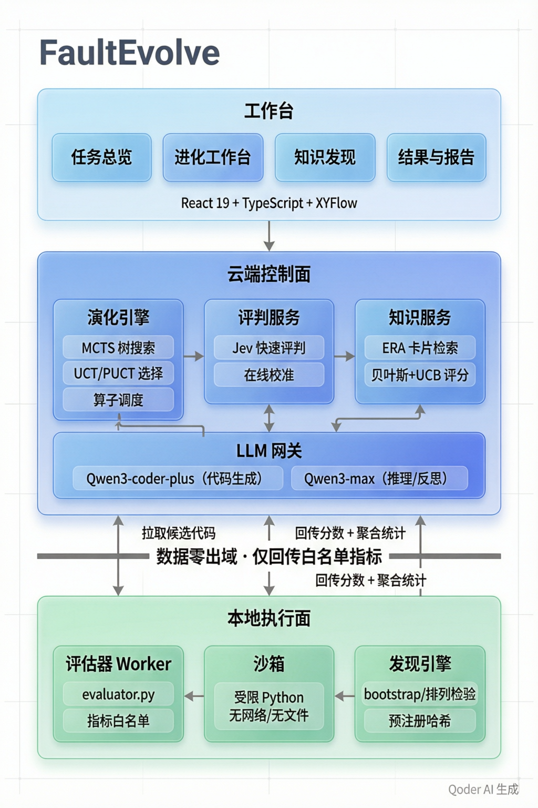

| 层 | 技术 |
|---|---|
| 前端 | React 19、TypeScript、Vite、Tailwind CSS 4、motion（EvoBot 动画）、XYFlow、TanStack Router / Query |
| 平板 | Vite + Three.js 机房孪生，Capacitor 7 打包 APK，WebSocket `/api/edge/ws` |
| 后端 | Python、FastAPI、Pydantic、Typer（`fe` CLI），REST + SSE |
| 远端 | asyncssh（跳板机隧道）、无依赖的 `edge_remote_evolver.py`（文件协议 + STOP 停止） |
| 大模型 | Qwen / DashScope（OpenAI 兼容、流式）、Codex CLI、MiYang Jev |
| 算法与评估 | NumPy、Pandas、scikit-learn、LightGBM、PyTorch CUDA（GPU bootstrap） |

核心原则：**数据零出域**、**指标白名单**、**沙箱隔离**、**评分唯一来源是本地评估器**。

---

## 九、仓库结构与常见问题

```text
FaultEvolve-ResearchAssistant/
├── src/faultevolve/          # 演化引擎、评估、知识发现、Web API、edge（混合模式）
├── web/src/features/evodemo/ # EvoBot 路演前端（6 幕，含 HybridScreen 混合云实测）
├── web/src/features/hybrid/  # /api/edge 接口与混合模式组件
├── edge-tablet/              # 平板机房孪生（网页 + Android 工程）
├── scripts/                  # showcase_serve.py、edge_demo.ps1、edge_remote_evolver.py
├── benchmark/                # HDD / Backblaze / 阿里 SSD / SmartMem 任务
├── skill/                    # 12 个 Agent Skills
├── showcase/                 # 可回放运行制品（runs/、edge/）
└── docs/                     # 截图、宣传视频、交接文档 handoff/edge-hybrid-demo.md
```

**页面显示"本地评估域接口不可用"**：后端需由 `scripts/showcase_serve.py` 启动（含 `/api/edge`），并确认 `VITE_API_PROXY_TARGET` 指向同一端口。

**平板连不上**：确认同一局域网、防火墙已放行端口、APK 构建时 `VITE_EDGE_SERVER` 填的是笔记本 IP；也可以用 `adb reverse tcp:8012 tcp:8012` 走 USB。

**Codex 按钮不可选**：本机需安装 Codex CLI 并执行 `codex login`；未登录时默认使用 Qwen。

**如何核对知识结论**：查看 `showcase/runs/hdd_mvp_showcase_c89e2a01/discovery/` 下的 `phenomena.json`、`preregistration.json`、`tournament_results.json`。

## 许可证

代码采用 MIT License（见 `pyproject.toml`）。比赛数据与第三方依赖遵循各自原始许可。
