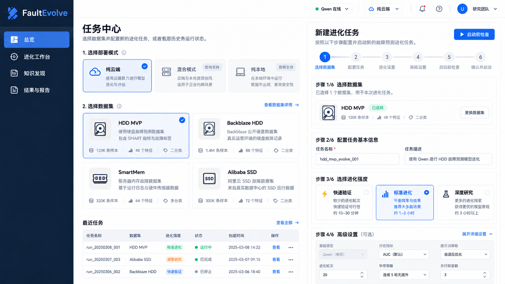
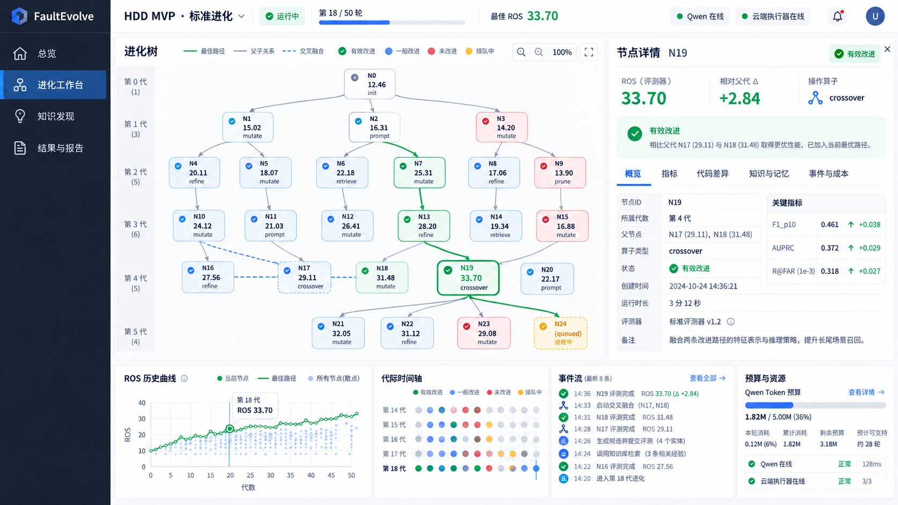
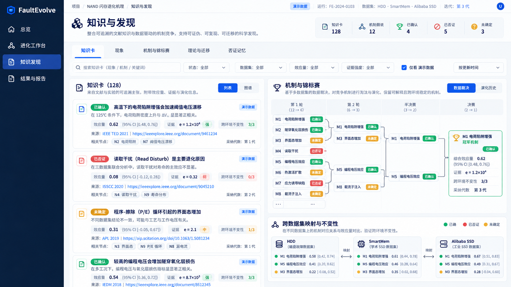
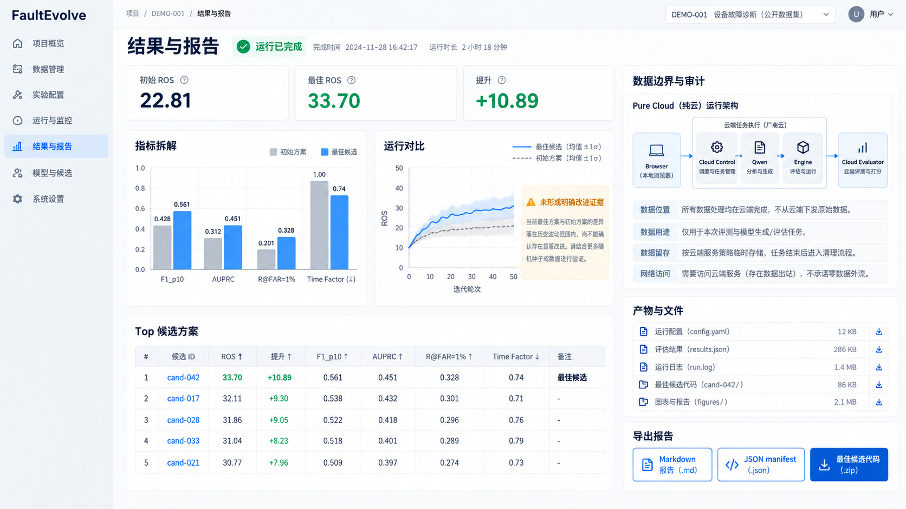

# FaultEvolve WebUI 产品需求文档（PRD）

> 文档版本：v1.0  
> 日期：2026-10-01  
> 产品阶段：比赛演示 MVP  
> 本期实现范围：纯云端模式  
> 设计依据：`docs/dev/MVP开发指南.md`、`docs/design/02-MVP方案-硬盘.md`、`docs/design/01-系统总体设计.md`、PR #20 演示页与 FaultEvolve-ResearchAssistant 设计文档

---

## 1. 产品概述

### 1.1 一句话定位

FaultEvolve WebUI 是一个以 Qwen 为主要智能模型、以本仓库 evaluator 为唯一评分来源的故障预测算法自进化工作台。它面向比赛演示，将任务准备、候选生成、评估、树搜索、知识发现、证伪和结果交付组织成一条可观察、可控制、可复现的流程。

### 1.2 产品目标

1. 让评委在 5～7 分钟内理解 FaultEvolve 如何从初始算法持续产生、评估并筛选更好的候选算法。
2. 真实展示 Qwen 在候选代码生成、反思、知识总结和发现假设中的作用。
3. 完整展示进化树、节点证据、代码差异、知识卡采用、否证记忆和运行成本。
4. 支持 HDD、Backblaze HDD、SmartMem、Alibaba SSD 等多任务示例。
5. 先以纯云端方式跑通完整闭环，同时为混合模式和纯本地模式保留清晰的产品入口与架构边界。
6. 所有分数和结论均可追溯到真实运行制品，不由前端推算或美化。

### 1.3 非目标

本期不实现：

- 混合模式的远端控制面与本地 Worker 联调。
- 纯本地模式的本地 Qwen、离线部署和本地 Web 服务编排。
- 多用户、组织、权限和计费体系。
- 通用 Codex/ChatGPT 对话工作台。
- 开题、论文写作、投稿和 OnlyOffice 等通用科研功能。
- 用户上传任意知识文件或直接修改知识卡权重。
- 浏览器读取原始数据、标签或私有测试集。
- 由前端计算 ROS、补齐缺失事件或修改节点评分。

---

## 2. 核心产品原则

### 2.1 Qwen 是主要智能模型

产品内统一使用“Qwen 生成”“Qwen 反思”“Qwen 知识总结”等表达，不展示 Codex 登录、Codex 模型选择或通用编码对话能力。

Qwen 负责：

- 生成候选代码。
- 根据父节点、错例画像和分支记忆进行改进。
- 进行设计层、实现层和假设层反思。
- 从运行结果中提炼洞察和候选论断。
- 在启用自动发现时提出可证伪的 claim、机制和检验建议。

Qwen 不负责：

- 产生或修改节点分数。
- 判断最终候选是否通过 evaluator。
- 读取私有测试集。
- 替代统计检验或本地 evaluator。

### 2.2 评分唯一来源

所有节点的 `combined_score`、ROS 和分项指标只能来自当前仓库的 evaluator。WebUI 仅展示后端提供的结果。

前端禁止：

- 根据图表数据重新计算 ROS。
- 根据缺失事件推算某轮得分。
- 平滑、补齐或修改历史曲线中的缺口。
- 将 Qwen 或 Jev 的意见显示为正式评分。

### 2.3 真实优先于完整

- 有真实制品时展示真实制品。
- 没有真实数据时可展示内置示例，但必须标注“演示数据”。
- 字段缺失时显示“未记录”，不得显示为 0。
- 事件数量少于 `iterations_done` 时明确显示缺失数量。
- 未实现的控制能力以禁用状态展示，不提供无效按钮。

### 2.4 证据与代码同等重要

每个候选节点不仅展示代码和分数，还应展示：

- 为什么产生它。
- 使用了什么算子和知识卡。
- 相对父节点改了什么。
- 是否超过噪声带。
- 产生了哪些正向或负向洞察。
- 失败、拒绝或放弃的原因。

---

## 3. 用户与场景

### 3.1 主要用户

| 用户 | 目标 | 使用频率 |
|---|---|---|
| 比赛评委 | 快速理解创新点、真实性和系统闭环 | 答辩期间一次性使用 |
| 项目演示者 | 启动预置实验、讲解进化过程和结果 | 答辩前多次排练 |
| 算法研发者 | 查看节点、代码差异、失败原因和知识价值 | 日常调试 |
| 可靠性研究人员 | 理解现象、机制、证据和跨设备迁移 | 结果分析阶段 |

### 3.2 核心用户故事

1. 作为演示者，我希望选择 HDD 示例并用“标准进化”启动一个短运行，让评委看到 Qwen 生成候选和 evaluator 评分的完整闭环。
2. 作为评委，我希望点击进化树节点，看到其父节点、修改意图、代码差异、ROS 变化和知识来源。
3. 作为研发者，我希望快速找到无效节点，理解是静态检查、烟雾测试、性能门还是正式评估失败。
4. 作为研究人员，我希望从知识卡追踪到采用它的节点，再追踪到相应的指标变化和证伪结论。
5. 作为演示者，我希望比较多次运行，但系统必须诚实标注差异是否落在运行波动范围内。

---

## 4. 部署模式

### 4.1 模式定义

| 模式 | 控制面与 Qwen | evaluator 与数据 | 本期状态 |
|---|---|---|---|
| 纯云端 | 云端 | 同一受控云端环境 | 可用，默认 |
| 混合模式 | 远端 | 本地 Worker | 可见但禁用 |
| 纯本地 | 本地或内网 Qwen | 本地 | 可见但禁用 |

### 4.2 本期纯云端模式

纯云端模式下，以下组件位于同一受控云端环境：

- FaultEvolve WebUI。
- Web API 与实时事件服务。
- FaultEvolve 进化引擎。
- Qwen API 网关。
- 任务数据副本。
- evaluator 与候选隔离执行环境。
- SQLite 和运行制品目录。

纯云端不代表由前端评分。候选仍必须由仓库 evaluator 执行和评分。

### 4.3 模式选择交互

首次进入“新建运行”时展示部署模式卡片：

- “纯云端”卡片可选择，带“本期推荐”标记。
- “混合模式”卡片禁用，显示“即将支持：远端生成，本地私有评估”。
- “纯本地”卡片禁用，显示“即将支持：本地 Qwen 与完全离线运行”。
- 点击禁用卡片只打开能力说明弹窗，不改变当前模式。
- 顶部设置抽屉可再次查看三种模式，但本期不能切换到未实现模式。

---

## 5. 信息架构

### 5.1 一级导航

产品采用四个一级模块：

1. 总览
2. 进化工作台
3. 知识发现
4. 结果与报告

左侧栏严格只显示以上四项，不在侧栏追加设置、终端、系统状态、帮助或二级页面。当前运行、Qwen 状态、云端执行器状态和设置入口放在顶部全局栏；帮助与演示说明放在页面右上角帮助弹窗中。

四个模块的职责边界：

| 模块 | 用户要解决的问题 | 主要内容 |
|---|---|---|
| 总览 | 我要用什么任务、数据和环境开始一次进化？ | Demo、自定义任务输入、服务器连接、运行配置、历史任务 |
| 进化工作台 | 算法正在怎样进化，为什么选择或淘汰某个节点？ | 进化树、评估、反思、纠错、噪声驱动、事件与预算 |
| 知识发现 | 系统发现了什么新知识，这些知识是否经得起证伪？ | 知识卡、现象、机制辩论赛、数据裁决、理论迁移、否证记忆 |
| 结果与报告 | 最终得到什么算法、证据和可交付制品？ | 最优候选、指标拆解、运行对比、审计与报告导出 |

### 5.2 路由建议

| 路由 | 页面 | 说明 |
|---|---|---|
| `/` | 总览 | 新任务入口、HDD Demo、历史运行和系统摘要 |
| `/overview/tasks/:taskId` | 任务详情 | 任务输入、任务契约、环境和就绪状态 |
| `/runs/new` | 新建运行 | 部署模式、进化强度和高级设置 |
| `/runs/:runId` | 进化工作台 | 运行总览，默认进入树视图 |
| `/runs/:runId/tree` | 进化树 | 完整树与节点详情 |
| `/runs/:runId/timeline` | 代际时间轴 | 事件、分数和运行阶段 |
| `/runs/:runId/knowledge` | 知识发现 | 知识卡、现象、机制和理论 |
| `/runs/:runId/results` | 结果总览 | 最优候选与指标拆解 |
| `/runs/:runId/audit` | 数据边界与审计 | 数据流和敏感信息检查 |
| `/compare` | 运行对比 | 同任务或跨任务运行对比 |

设置采用顶部齿轮按钮打开全局抽屉，不作为一级路由或侧栏项目。运行内部的树、时间轴、知识和结果路由是深链接，用于刷新恢复和分享，不在左侧栏形成新的导航项。

### 5.3 全局上下文

页面顶部始终显示：

- 当前数据集。
- 当前运行名称和短 ID。
- 运行状态。
- 当前轮次/最大轮次。
- 最佳 ROS。
- 相对初始解提升。
- Qwen 状态。
- 云端执行器状态。

切换运行时，页面保留当前一级模块，并在新运行中打开对应视图。

---

## 6. 概念效果图

以下概念图用于确定最终产品的信息层级、布局密度和交互方向。图中示例数字不替代真实运行制品；正式实现以本 PRD 的四模块导航和字段契约为准。

### 6.1 总览与新任务



### 6.2 进化工作台



### 6.3 知识发现



### 6.4 结果与报告



---

## 7. 总览

### 7.1 页面结构

总览同时承担“开始新任务”和“回到已有运行”两种职责，首屏分为：

1. 开始区域：`使用 HDD 全流程 Demo` 和 `创建自定义任务` 两个主要入口。
2. 最近运行：展示正在运行、暂停、失败和已完成任务。
3. 示例与数据集：HDD、Backblaze HDD、SmartMem、Alibaba SSD 示例。
4. 云端状态摘要：Qwen、控制面、云端执行器和存储状态。

### 7.2 HDD 全流程 Demo

HDD Demo 是比赛演示的默认捷径，必须使用当前仓库已有的 HDD 任务工件、算法和真实运行制品，不重新创造另一套演示算法。

点击“使用 HDD 全流程 Demo”后打开 Demo 确认抽屉，展示：

- 数据集：HDD MVP。
- 评价指标：ROS 及 F1_p10、AUPRC、R@FAR、时间因子。
- evaluator：仓库内置 evaluator，只读。
- 初始算法：仓库内置 `init.py`，显示初始 ROS 约 22.81。
- 知识包：仓库现有 HDD 知识卡。
- 推荐进化强度：标准进化。
- 可选动作：启动短流程、打开完整回放、查看任务契约。

“启动短流程”证明系统可以真实运行；“打开完整回放”直接载入 PR #20 的完整运行样例，用于在有限答辩时间中展示完整进化树、知识发现和结果报告。

### 7.3 自定义任务必填输入

创建自定义任务时，用户必须提供三类核心工件：

#### 数据集

- 数据集名称。
- 任务类型/设备类型。
- 云端数据目录，使用服务器路径选择器或手动输入路径。
- 数据格式和必要文件说明。
- 数据切分说明。
- 可选的数据适配器。

页面只保存路径和任务元信息，不在浏览器预览原始记录、标签或私有测试集。

#### 指标与 evaluator

- evaluator 文件路径或从已注册 evaluator 中选择。
- 主指标名称。
- 目标方向：越大越好或越小越好。
- 目标分数。
- 单候选超时。
- evaluator 契约检查结果。

上传或选择 evaluator 后，后端执行只读验证：可导入性、调用签名、返回字段、超时和禁止访问检查。前端不得提供修改评分结果的功能。

#### 初始算法

- `init.py` 文件路径、上传文件或从已有基线选择。
- 初始算法说明。
- 启动参数。
- 静态检查结果。
- 可选基线试跑。

基线试跑完成后展示真实初始分数；尚未试跑时显示“待评估”，不得显示假定分数。

### 7.4 纯云端服务器与目录配置

虽然本期只实现纯云端，仍需让用户配置实际运行服务器。服务器配置区包括：

- 连接名称。
- 主机地址。
- SSH 端口。
- 用户名。
- 认证方式状态；密码或密钥内容不回显、不写入运行制品。
- FaultEvolve 仓库目录。
- 数据目录。
- 运行数据库目录。
- 大型制品目录。
- 日志目录。

交互规则：

1. 用户选择已有服务器配置或新建连接。
2. 点击“测试连接”，后端返回连通性、操作系统、Python 和磁盘信息。
3. 连接成功后才能使用服务器路径选择器。
4. 路径检查分别显示存在、可读、可写和剩余空间。
5. 数据目录只能做存在性和契约检查，不能把原始数据返回浏览器。

### 7.5 运行环境与补充信息

提供结构化字段和一个自由文本框。

结构化字段包括：

- Conda 环境名或 Python 可执行文件。
- Python 版本。
- CPU 核数限制。
- GPU 数量与可见设备编号。
- GPU 型号，仅作为期望或检测结果展示。
- 内存限制。
- 并发候选数。
- 单候选超时。
- 环境变量状态，只显示是否已配置。

自由文本框名称为“运行环境补充说明”，示例占位文案：

> 例如：使用 conda 环境 faultevolve；只使用 GPU 0、1；数据位于 /data/hdd；运行前先执行指定初始化脚本；不要占用其他训练任务使用的显卡。

补充说明在启动前由后端保存为运行备注，并可作为受控的环境准备提示；它不能直接拼接为未经审查的 Shell 命令。涉及执行的内容必须转换为明确字段或经用户确认的命令。

### 7.6 可选知识注入

用户不上传任意知识文件，而是在已注册知识源中选择：

- 不使用知识注入。
- 使用当前任务默认知识包。
- 选择若干知识类别或知识簇。
- 启用运行中自动检索。
- 启用停滞时追加检索。
- 启用专家提示文本，作为高级可选项。

选择知识包时展示来源数量、卡片数量、最近更新时间和适用任务；不允许直接修改卡片统计效用。

### 7.7 数据集与运行卡片

数据集卡片规范如下：

本期至少提供以下示例：

| 数据集 | 状态 | 页面定位 |
|---|---|---|
| HDD MVP | 完整可运行 | 默认比赛演示 |
| Backblaze HDD | 示例/按实际就绪状态 | 大规模硬盘任务 |
| SmartMem | 示例/按实际就绪状态 | 跨设备迁移 |
| Alibaba SSD | 示例/按实际就绪状态 | SSD 任务适配 |

每张数据集卡片展示：

- 数据集名称、设备类型和简介。
- 任务适配器名称。
- 指标名称和目标分数。
- 初始基线分数。
- 数据准备状态。
- evaluator 检查状态。
- 知识卡数量。
- 最近一次运行及其最佳分数。

### 7.8 任务详情

页面分为四个区域：

1. 任务说明：展示 `problem.md` 的安全摘要。
2. 评价契约：展示 ROS 公式、分项指标和时间预算。
3. 就绪检查：展示数据、evaluator、init、prompt、知识卡和 Qwen 状态。
4. 历史运行：展示该任务的运行列表和最佳结果。

不得展示或提供下载：

- `holdout*` 内容。
- 原始标签内容。
- 原始 SMART 记录。
- 可能泄露序列号的错误文本。

### 7.9 运行列表

列表字段：

- 运行名称。
- 数据集。
- 部署模式。
- 进化强度。
- 状态。
- 轮次。
- 最佳 ROS。
- 初始 ROS。
- Qwen Token。
- 开始时间和持续时间。

支持筛选：

- 数据集。
- 状态。
- 进化强度。
- 是否为演示数据。

支持操作：

- 打开运行。
- 恢复中断运行。
- 复制配置创建新运行。
- 查看产物。

删除运行不纳入本期 MVP。

---

## 8. 新建运行

### 8.1 六步流程

#### 第一步：选择入口与任务工件

- 选择 HDD 全流程 Demo、已有任务或创建自定义任务。
- 自定义任务必须完成数据集、evaluator 和初始算法三项输入。
- 展示基线、目标指标和预计资源。
- 未通过工件契约检查的任务不能继续。

#### 第二步：选择部署与服务器

- 默认选择纯云端。
- 混合模式和纯本地模式禁用。
- 展示纯云端数据流向说明。
- 选择或新建远程服务器连接。
- 确认仓库、数据、数据库、制品和日志目录。
- 测试连接和目录权限。

#### 第三步：选择进化强度

| 档位 | 目标 | 默认倾向 |
|---|---|---|
| 快速验证 | 验证链路和基础改进 | 少量轮次，关闭昂贵发现 |
| 标准进化 | 默认比赛演示 | 完整主流程，平衡成本与效果 |
| 深度研究 | 长运行和知识发现 | 更多轮次，启用发现与锦标赛 |

档位是配置模板，不是新的引擎模式。

#### 第四步：环境、知识与高级设置

高级设置默认折叠，分组如下：

1. 进化预算：最大轮次、目标分数、Token 预算、最大时长、随机种子。
2. Qwen：代码模型、反思模型、温度、最大输出、重试和并发。
3. 选择策略：价值模式、噪声惩罚、渐进加宽和停止条件。
4. 算子：启用算子列表、探索比例、crossover 参数。
5. 知识发现：知识注入、自动检索、发现频率、每轮 claim 上限、锦标赛。
6. 评估：超时、烟雾测试、性能门和错例画像。
7. Jev：关闭、预筛、先验和审计比例；明确标注为可选辅助判断。
8. 运行环境：Conda/Python、GPU、CPU、内存、并发和环境补充说明。

用户修改任一模板值后显示“已自定义”徽章，并提供“恢复档位默认值”。

#### 第五步：启动前检查

检查项目：

- Qwen 服务可用。
- 云端执行器可用。
- 远程服务器连接成功。
- Conda/Python 环境可用。
- GPU 配置与服务器实际资源一致，或已确认使用 CPU。
- 任务数据存在。
- evaluator 可导入。
- init 代码通过静态检查。
- 配置合法。
- 运行目录可写。
- 预算不超过管理员限制。

每项显示“通过/警告/失败”。失败项阻止启动；警告项需要用户确认。

#### 第六步：确认并启动

展示最终摘要：

- 数据集与任务。
- 部署模式。
- 远程服务器与运行目录。
- Conda/Python 和 GPU 配置。
- 进化强度。
- 核心预算。
- Qwen 模型。
- 启用算子。
- 知识和发现设置。
- 预计运行成本。

点击“启动运行”后：

1. 按钮进入加载状态，防止重复提交。
2. 后端创建运行并返回 `runId`。
3. 页面跳转到进化工作台。
4. 工作台显示初始化阶段。

### 8.2 端到端交互逻辑

#### 流程 A：使用 HDD Demo 快速演示

1. 用户在左侧栏进入“总览”。
2. 点击“使用 HDD 全流程 Demo”。
3. 确认抽屉展示内置数据集、ROS evaluator、初始算法、知识包和初始分数。
4. 用户选择“启动短流程”或“打开完整回放”。
5. 启动短流程时，系统执行服务器与环境检查，通过后创建真实运行。
6. 打开完整回放时，系统载入已有 manifest、树和事件，不创建新的评分结果。
7. 页面自动进入“进化工作台”；左侧栏仍只有四个模块。
8. 用户可依次进入“知识发现”和“结果与报告”，三个页面共享同一个 `runId`。

#### 流程 B：创建自定义任务

1. 用户在总览点击“创建自定义任务”。
2. 依次填写数据集、evaluator 和初始算法；任一核心工件缺失时不能进入启动确认。
3. 选择纯云端部署，配置远程服务器和目录。
4. 测试服务器连接；失败时停留当前步骤并显示可操作的错误原因。
5. 配置 Conda/Python、GPU、CPU、内存和补充说明。
6. 选择进化强度和可选知识注入。
7. 系统执行数据契约、evaluator、初始算法、Qwen、目录和资源检查。
8. 用户在确认页核对最终配置后启动。
9. 创建成功后进入进化工作台；创建失败时保留全部表单内容供修正。

#### 流程 C：运行中的跨模块联动

1. 进化工作台收到新节点事件后更新树、时间轴、排行榜和预算，但不打断用户当前查看位置。
2. 用户点击节点后，右侧详情抽屉展示指标、代码 diff、反思、纠错、噪声证据和知识来源。
3. 点击节点中的知识卡或 claim，切换到“知识发现”并定位对应卡片。
4. 从知识卡点击“查看采用节点”，返回进化工作台并高亮相关路径。
5. 运行完成事件到达后，顶部状态更新，并提示用户进入“结果与报告”；不强制跳转。

#### 流程 D：异常与恢复

1. Qwen 暂时不可用时，运行显示“生成暂停”，保留已完成评估，不将服务异常记为节点低分。
2. evaluator 失败时，节点进入对应失败状态，并展示脱敏错误和是否可修复。
3. WebSocket 断开时前端保留当前快照，重连后按最后事件 ID 补拉。
4. 服务器失联时禁止继续提交控制操作，但允许浏览已缓存的只读内容。
5. 可恢复运行在总览的最近运行中显示“恢复”按钮；恢复前重新进行服务器和环境检查。

---

## 9. 进化工作台

### 9.1 页面布局

桌面端采用三层布局：

1. 顶部运行状态条。
2. 中部主视图与节点详情抽屉。
3. 底部时间轴、指标和事件区域。

主视图标签：

- 进化树
- 代际时间轴
- 排行榜
- 事件流
- 预算与资源

### 9.2 运行生命周期

统一状态：

| 状态 | 含义 | 允许操作 |
|---|---|---|
| `created` | 已创建，尚未启动 | 启动、取消 |
| `initializing` | 检查环境和初始节点 | 查看日志、取消 |
| `running` | 正在进化 | 暂停、取消 |
| `pausing` | 等待当前安全点暂停 | 取消 |
| `paused` | 已暂停 | 恢复、取消 |
| `finishing` | 正在写出制品 | 仅查看 |
| `completed` | 正常完成 | 查看、对比、导出、复制运行 |
| `failed` | 异常终止 | 查看错误、恢复或复制运行 |
| `cancelled` | 用户取消 | 查看已有制品、复制运行 |

状态变更必须由后端确认。前端不能仅因用户点击就直接显示最终状态。

### 9.3 控制操作

#### 暂停

- 只在 `running` 状态可用。
- 点击后提示“系统将在当前候选完成或到达安全点后暂停”。
- 状态先变为 `pausing`，收到后端事件后变为 `paused`。

#### 恢复

- 只在 `paused` 或可恢复的 `failed` 状态可用。
- 恢复前展示剩余预算和上次中断位置。

#### 继续追加轮次

- 只对 `completed` 且未因安全错误结束的运行开放。
- 用户输入追加轮次和追加 Token 预算。
- 确认后生成继续运行记录，不篡改原始完成摘要。

#### 取消

- 二次确认。
- 明确说明已完成节点和制品将保留。
- 进入 `cancelled` 前必须等待后端确认。

### 9.4 实时刷新

- WebSocket 为主要更新方式。
- 断线后自动重连，并用最后事件序号补拉事件。
- 重连期间显示“正在重新连接”，但保留已有内容。
- 多次收到同一事件时按事件 ID 去重。
- WebSocket 不可用时降级为轮询。
- 运行完成后切换到稳定的制品/数据库快照视图。

### 9.5 工作台能力分区

进化工作台不再通过增加侧栏入口承载复杂功能，而是在同一运行上下文中组织五个工作区：

| 工作区 | 默认内容 | 与其他工作区的联动 |
|---|---|---|
| 进化树 | 节点、父子关系、双亲关系、最优路径 | 点击节点同步筛选评价、反思和事件 |
| 评价与噪声 | ROS、分项指标、误差、波动和显著性 | 点击某次评价在树中定位节点 |
| 反思与纠错 | 三层反思、失败分类、修复尝试 | 点击修复节点高亮原失败节点与 repair 边 |
| 代际与事件 | 每轮账本、系统事件、Qwen 与 evaluator 状态 | 点击事件打开节点或调用详情 |
| 预算与算力 | Token、时间、并发、CPU/GPU 和队列 | 预算告警联动暂停/继续控制 |

桌面大屏可同时显示“进化树 + 节点抽屉 + 底部分析区”；窄屏通过页内标签切换，但左侧栏仍保持四个模块。

### 9.6 单节点评价—反思—纠错闭环

每个候选节点都按以下状态链展示，不允许把多个阶段压缩成一个笼统的“运行中”：

```text
Qwen 生成候选
  → 静态检查
  → 烟雾测试/性能门
  → evaluator 正式评价
  → 噪声与显著性判断
  → 三层反思
  → 洞察/否证记忆
  → 接受、修复、延后或放弃
```

#### 候选生成

- 展示所选父节点、算子、生成意图和使用的知识卡。
- Qwen 生成过程中节点显示“生成中”，不提前出现在排行榜。
- 生成失败显示模型错误和重试次数，不产生虚假 0 分节点。

#### 预检查

- 静态检查失败：展示语法、禁止 API 或契约问题。
- 烟雾测试失败：展示脱敏错误和失败阶段。
- 性能门失败：展示耗时或资源超限原因。
- 未进入正式 evaluator 的候选必须标记“未评分”，不能显示 ROS=0 来冒充评价结果。

#### evaluator 评价

- 正式评价开始后显示排队、执行中、已完成或超时。
- 完成后一次性写入 evaluator 返回的分数和白名单指标。
- 评价详情明确显示“评分来源：仓库 evaluator”。
- 评分完成前禁止 Qwen/Jev 输出占据正式分数字段。

#### 三层反思

反思面板按层展示：

1. 实现层：代码是否正确、依赖是否兼容、是否需要 repair。
2. 设计层：本次算子和方法改动为什么有效或无效。
3. 假设层：原假设被支持、否证还是证据不足。

反思结论必须链接到相应评价、指标或错误，不允许只展示无证据的总结文本。

#### 自动纠错与修复

- 可修复错误触发 repair 节点，并用独立边连接原失败节点。
- 展示修复次数、最大次数和每次修复改动摘要。
- 修复成功后仍需重新通过全部预检查和 evaluator，不能继承原节点分数。
- 超过修复上限后标记“修复耗尽”，写入负向记忆，避免其他分支重复。
- 用户可查看修复过程，但本期不直接编辑修复代码。

### 9.7 噪声驱动交互

工作台必须将“分数更高”和“形成可信改进”区分开。

#### 噪声带展示

- 每个已评分节点展示父节点分数、当前分数、原始 Δ、噪声阈值 δ 和净改进。
- ROS 曲线可切换“原始分数”和“带噪声区间”。
- 落在噪声带内的节点标记为“差异不足”，不能使用绿色“有效改进”。
- 缺少 bootstrap 标准差时明确显示采用的回退阈值。

#### 决策解释

节点详情给出可读解释：

- “有效改进”：Δ 超过噪声阈值，进入候选最优路径。
- “差异不足”：分数上升但仍在噪声范围内，不提取正向洞察。
- “显著退化”：下降超过噪声阈值，提取负向洞察或触发反思。
- “无法判断”：缺少必要指标或评价未完成。

#### 对搜索的影响

- 树中节点大小或边框可以表现搜索价值，但不得改写原始 ROS。
- 选择价值、J-PUCT 先验、虚拟损失和多样性惩罚在“搜索解释”折叠区展示。
- Jev 结果只显示为预筛/先验，不与 evaluator 分数混合。
- 被噪声判为无明确收益的改动，不自动传播为成功经验。

### 9.8 算子、分支记忆与跨枝传播

#### 算子观察

- 按 refine、recall_focus、threshold_calibrate、inject、transplant、crossover、repair 统计调用次数、有效率、平均 Δ 和成本。
- 点击算子后筛选树中相关节点。
- 算子统计属于搜索辅助信息，不替代候选排行榜。

#### 分支记忆

- 展示当前分支的正向洞察、负向洞察和已否证假设。
- 每条记忆链接到来源节点和证据。
- 显示哪些记忆被下一代 Qwen prompt 使用。

#### 跨枝传播

- transplant 节点展示经验来源分支和目标分支。
- crossover 节点展示两个父节点及各自贡献摘要。
- 树上使用不同线型区分普通父子边、crossover 第二父边和 repair 边。

### 9.9 工作台人工操作边界

运行中允许：

- 暂停、恢复和取消。
- 查看并筛选节点、事件和证据。
- 调整视图，不影响运行状态。
- 在允许追加运行时增加轮次或预算。

本期不允许：

- 手动修改任意历史节点分数。
- 绕过 evaluator 将节点标记为成功。
- 直接改写分支记忆或知识卡统计效用。
- 在页面中编辑候选代码后覆盖原节点。
- 删除失败节点以美化进化树。

---

## 10. 进化树完整交互

### 10.1 节点视觉信息

每个节点至少显示：

- 节点短 ID。
- ROS。
- 相对父节点的 Δ。
- 算子。
- 状态图标。
- 是否当前最优。
- 是否包含第二父节点。
- 知识卡数量。

节点状态不能只依赖颜色，必须同时使用文字或图标。

### 10.2 树操作

- 鼠标滚轮缩放。
- 拖动画布。
- 自动适配视野。
- 展开/折叠子树。
- 搜索节点 ID、算子或意图。
- 按状态、算子、分支和分数范围筛选。
- 高亮当前最优路径。
- 高亮知识卡传播路径。
- 高亮 crossover 的双亲路径。
- 点击节点打开详情。
- Shift/勾选两个节点进入对比。
- 点击时间轴事件时在树中定位节点。
- 点击排行榜条目时在树中定位节点。

### 10.3 节点详情抽屉

详情分为以下标签：

#### 概览

- 节点完整 ID。
- 状态和状态原因。
- 父节点、第二父节点和分支。
- 创建轮次、深度和算子。
- 候选意图和假设。
- ROS、Δ、噪声带及显著性解释。

#### 指标

- validity。
- combined_score/ROS。
- F1、F1_p10、AUPRC、R@FAR。
- precision、recall、误告率、漏告率。
- 运行时间和时间因子。
- bootstrap 波动。
- evaluator 返回的其他白名单指标。

缺少的指标显示“未记录”，不显示为 0。

#### 代码与差异

- 当前候选代码，只读。
- 与主父节点的 diff。
- crossover 节点可分别查看与两个父节点的 diff。
- 支持复制和下载当前节点代码。
- 禁止在页面直接编辑并覆盖节点代码。

#### 知识与记忆

- 使用的知识卡。
- 已采纳和被否证卡片。
- 正向与负向洞察。
- 分支记忆摘要。
- 被否证假设。
- 三层反思记录。

#### 事件与成本

- 与节点相关的事件。
- Qwen 调用次数、模型、Token 和延迟。
- Jev 调用与结果，如启用。
- 评估时长和失败重试。

### 10.4 节点对比

对比面板展示：

- 基本信息并排对比。
- 指标差异。
- 代码 diff。
- 算子和知识卡差异。
- 错例画像差异。
- 运行成本差异。

系统只描述差异，不自动声称“更优”；是否显著应依据噪声带或已有统计证据。

### 10.5 大树性能

- 默认仅渲染可视区域和必要标签。
- 节点过多时默认折叠低价值子树。
- 筛选只影响显示，不修改底层树。
- 提供“显示全部”并提示性能影响。

---

## 11. 代际时间轴与事件流

### 11.1 代际时间轴

每一代展示：

- 代数。
- 节点。
- 算子。
- 结果状态。
- ROS 和 Δ。
- 运行耗时。
- 采用的知识卡。
- 同期关键事件。

没有记录 Δ 的代显示“×/未记录”，不得把相邻代数据平均或补齐。

如果 `iteration_complete` 事件数量少于摘要中的完成轮次，页面顶部显示：

> 摘要记录完成 N 轮，但事件流仅包含 M 轮；缺失的 N-M 轮未在制品中记录，本页面不进行推算。

### 11.2 事件流

支持：

- 按类型筛选。
- 按节点筛选。
- 错误事件优先显示。
- 展开查看脱敏 payload。
- 复制事件 ID。
- 自动跟随最新事件，可手动关闭。

错误文本必须经过后端脱敏，前端不得请求未经处理的原始错误日志。

---

## 12. 知识发现

### 12.1 总体原则

- 默认由系统使用预构建知识卡或自动检索能力。
- 本期不要求用户上传知识库。
- 真实发现为空时解释为什么为空。
- 多数据集可以使用不同的知识包，但采用同一展示契约。

### 12.2 知识卡

列表字段：

- 卡片 ID。
- 标题和类别。
- 核心 claim。
- 来源类型和来源链接。
- 适用条件。
- 先验或统计效用。
- 提供次数、采纳次数和平均 Δ。
- 被否证次数。

交互：

- 搜索和分类筛选。
- 查看来源和证据摘要。
- 查看该卡在哪些节点、哪些代被采用。
- 从卡片跳转到树节点。
- “信任/存疑/排除”仅作为浏览器或用户界面标记，并明确“不影响真实运行”。

### 12.3 现象层

每张现象卡展示：

- 条件。
- 特征。
- 结果。
- 效应量和置信区间。
- 适用范围。
- 可证伪条件。
- 当前判级：confirmed/revised/refuted/undetermined。
- 沙箱或检验错误。

### 12.4 机制层、辩论赛与数据裁决

展示：

- 主机制与对手机制。
- Qwen 正方与反方的结构化论点；论点只用于形成待检验假设，不直接决定胜负。
- 对阵关系。
- 判别检验。
- 跨环境不变性结果。
- e 值、Elo 和比赛结果。
- 证书状态。

辩论赛交互分为“提出主张—生成对手—双方质询—登记判别检验—数据裁决—沉淀记忆”六步。最终胜负只能由预注册检验和 evaluator/统计证据决定。Elo 只展示为配对调度信息，不能替代证据判级。

### 12.5 理论与跨数据集迁移

展示：

- 理论摘要。
- 支持它的机制和证书。
- 对新数据集的事前预测。
- 当前验证状态。
- HDD、SmartMem、SSD 间的适用范围。

没有真实跨数据集结果时使用演示卡片，并标记“演示数据”。

---

## 13. 结果与报告

### 13.1 结果总览

核心指标：

- 初始 ROS。
- 最佳 ROS。
- 绝对提升。
- 相对提升。
- 最佳节点。
- 完成轮次。
- 有效节点率。
- 总 Token 和总耗时。

分项展示：

- F1_p10。
- AUPRC。
- R@FAR。
- 时间因子。
- precision、recall、误告率和漏告率。

### 13.2 最优候选

- 展示 Top-K 节点。
- 查看和下载候选代码。
- 查看每个候选的完整指标与复现信息。
- 标记最终推荐候选，但不删除其他候选。
- 私有 test 裁决不在普通运行过程中触发。

### 13.3 运行对比

支持：

- 同一任务的多次运行对比。
- 不同进化强度对比。
- 不同随机种子对比。
- 多数据集只比较共有指标，并明确任务不可直接横向排名。

展示：

- 最佳 ROS。
- 初始到最佳提升。
- 分数分布或波动带。
- 达到目标所需轮次和时间。
- Token 成本。
- 算子采用和成功率。
- 知识卡采用情况。
- 发现与证书数量。

当两次运行差异落在已知波动范围内，应显示“未形成明确改进证据”。

### 13.4 数据边界与审计

展示：

- 当前部署模式。
- 数据、evaluator、Qwen 和制品所在区域。
- 发送给 Qwen 的信息类型。
- evaluator 输出白名单。
- 错误信息脱敏状态。
- 是否检测到禁止字段。
- test 是否被调用。

本期纯云端模式下，不宣称“零数据出域”；应表述为“数据位于受控云端环境，浏览器不直接访问原始数据”。

### 13.5 报告导出

本期至少支持：

- Markdown 报告。
- JSON manifest。
- 最佳候选代码。
- 运行配置快照。

PDF/Word 可作为 P1，或复用现有报告工具实现。

报告中的每个数字应能追溯到：

- `run_summary.json`。
- `tree.json`。
- `events.jsonl`。
- `fe.db`。
- discovery 制品。

---

## 14. 顶部设置与系统状态

设置与系统状态不占用左侧栏。用户点击顶部齿轮或状态徽章后打开抽屉。

### 14.1 Qwen 设置

展示和配置：

- Provider：DashScope 或兼容服务。
- 代码生成模型。
- 反思/总结模型。
- Base URL。
- API Key 状态，仅显示已配置/未配置和掩码。
- 连通性测试。
- 最近延迟和错误。
- Token 用量。

密钥必须来自后端环境变量，不进入前端持久化、日志或运行制品。

### 14.2 服务状态

系统状态抽屉展示：

- Web API。
- WebSocket。
- FaultEvolve 引擎。
- Qwen 服务。
- 云端执行器。
- SQLite。
- 运行制品目录。
- 可用任务适配器。

### 14.3 外观与演示

- 浅色/深色主题。
- 演示模式：隐藏研发调试字段，放大核心指标和说明。
- 专家模式：显示事件 payload、配置键和完整节点字段。
- 主题切换不得导致图表颜色语义变化。

---

## 15. 全局状态与反馈

### 15.1 加载状态

- 首次加载使用骨架屏。
- 节点详情加载不清空树。
- 图表刷新保留上一次数据，并显示轻量更新标志。

### 15.2 空状态

空状态必须说明原因和下一步，例如：

- 尚未运行。
- 当前模式未启用知识发现。
- 运行产生了 claim，但全部在沙箱阶段失败。
- 制品版本不包含该字段。
- 当前数据集没有可用示例。

### 15.3 错误状态

错误信息包括：

- 用户可理解的摘要。
- 稳定错误码。
- 是否可重试。
- 建议处理方式。
- 技术详情折叠区。

禁止将完整本地路径、密钥、序列号或未经脱敏的 traceback 返回前端。

### 15.4 通知

使用非阻塞通知展示：

- 运行已创建。
- 暂停请求已发送。
- 运行已暂停/恢复/完成。
- Qwen 服务降级。
- WebSocket 已断开或恢复。
- 报告导出完成。

取消运行和追加预算使用确认对话框。

---

## 16. 后端能力需求

本节定义前端所需能力，不代表当前仓库已经实现这些接口。

### 16.1 REST API 分组

#### 系统

- 获取系统健康状态。
- 获取 Qwen 状态。
- 获取可用任务和适配器。
- 获取部署模式及可用性。

#### 任务

- 获取任务列表。
- 获取任务详情。
- 执行只读就绪检查。
- 获取任务历史运行。

#### 运行

- 创建运行。
- 获取运行列表和详情。
- 暂停、恢复、取消和追加轮次。
- 获取运行配置和摘要。

#### 树与节点

- 获取树快照。
- 获取节点详情。
- 获取节点代码和父子 diff。
- 获取排行榜。

#### 事件与指标

- 分页获取事件。
- 按事件序号增量获取。
- 获取分数历史。
- 获取预算与资源统计。

#### 知识发现

- 获取知识卡及溯源。
- 获取洞察和分支记忆。
- 获取 claim、机制、比赛和证书。

#### 报告与制品

- 获取可下载制品清单。
- 生成报告。
- 下载允许公开的代码和报告。

### 16.2 WebSocket 事件

至少覆盖：

- 运行状态改变。
- 初始化完成。
- 节点创建。
- 节点状态改变。
- 评估开始和完成。
- 迭代完成。
- 最佳节点改变。
- Qwen 调用状态。
- 洞察提取。
- claim/机制/锦标赛更新。
- 预算更新。
- 运行完成或失败。

每个事件必须包含：

- 唯一事件 ID。
- `runId`。
- 时间戳。
- 类型。
- 脱敏 payload。

### 16.3 数据一致性

- REST 快照和 WebSocket 事件使用同一运行 ID 与节点 ID。
- 前端断线重连后可以按最后事件 ID 补拉。
- 运行完成后以稳定制品/数据库结果为准。
- 同一事件重复投递不会产生重复节点或重复轮次。

---

## 17. 权限与安全

### 17.1 本期权限

比赛 MVP 可采用单用户部署，不实现完整账户体系，但仍应区分：

- 只读展示操作。
- 运行控制操作。
- 高风险操作。

### 17.2 高风险操作

以下操作必须二次确认：

- 取消运行。
- 追加预算。
- 触发最终 test 裁决。
- 下载包含完整候选代码的制品。

最终 test 裁决建议不在普通 WebUI 中开放；如比赛流程确需使用，应由单独受控入口执行，并且不显示或传输 holdout 内容。

### 17.3 内容安全

- Markdown 使用安全渲染。
- 代码只读显示。
- 外部来源链接使用安全跳转。
- 错误文本和事件 payload 由后端脱敏。
- 前端不得保存任何 API Key。

---

## 18. 响应式与可访问性

### 18.1 屏幕策略

| 宽度 | 行为 |
|---|---|
| 大于 1280px | 完整侧栏、树和节点详情并排 |
| 768～1280px | 侧栏折叠为图标，节点详情使用抽屉 |
| 小于 768px | 支持总览、列表和报告；进化树提示横屏查看 |

比赛演示以 1440×900 和 1920×1080 为重点适配尺寸。

### 18.2 可访问性

- 正文和关键文本对比度至少 4.5:1。
- 状态不只依赖颜色。
- 所有主要操作支持键盘焦点。
- 图表提供文本摘要。
- 动画支持减少动态效果设置。

---

## 19. Navivisor 与 PR #20 复用策略

### 19.1 可复用

从 Navivisor WebUI 复用或改造：

- React/Vite/TypeScript/Tailwind 工程框架。
- 布局、侧栏、主题和响应式结构。
- Radix UI 基础组件。
- TanStack Router/Query。
- Zustand 状态管理模式。
- OpenAPI 类型生成。
- Monaco/Shiki 代码和 diff 展示。
- Markdown、PDF、表格和文件预览。
- Socket.IO 客户端基础设施。
- xterm 终端组件，作为专家调试入口。
- React Flow 和 D3 依赖。

### 19.2 不复用

- Codex 登录和通用对话。
- 开题、写作、投稿业务。
- 演示用科研创新点和模拟训练日志。
- OnlyOffice。
- 与 FaultEvolve 数据契约无关的状态模型。

### 19.3 PR #20 映射

| PR #20 视图 | 正式 WebUI 位置 |
|---|---|
| 新建运行/断点恢复 | 总览、新建运行 |
| 运行总览 | 进化工作台 |
| 代际时间轴/干预台 | 进化工作台 |
| 证据强度 | 知识发现 |
| 进化树 | 进化工作台 |
| 知识卡 | 知识发现 |
| 记忆面板 | 知识发现 |
| 数据边界与审计 | 结果与报告 |
| 对照与稳健性 | 结果与报告 |
| 运行对比 | 结果与报告 |

PR #20 的静态数据方式只用于离线演示和回归样例；正式 WebUI 使用 REST 快照与 WebSocket 增量事件。

---

## 20. 比赛演示流程

推荐演示脚本：

1. 打开总览，确认左侧只有四个模块，并展示四个数据集示例。
2. 点击“使用 HDD 全流程 Demo”，展示任务契约、evaluator、初始算法和初始 ROS。
3. 创建运行，展示三种部署模式，并说明本期使用纯云端。
4. 选择“标准进化”，展开高级设置，强调 Qwen 模型、算子和评估预算。
5. 启动预置短运行，进入进化工作台。
6. 展示 Qwen 生成候选、云端 evaluator 评分和树节点实时增加。
7. 点击成功节点和失败节点，展示代码 diff、指标和失败原因。
8. 展示 crossover 双亲、知识卡采用和否证记忆。
9. 打开知识发现，展示现象、机制辩论赛和数据裁决。
10. 打开运行对比，说明分数差异是否超过波动范围。
11. 打开数据边界与审计，说明评分来源和数据位置。
12. 切换 SmartMem 示例，展示同一套 Skill 和交互如何迁移到其他设备。

演示使用真实短运行与预置完整回放相结合：短运行证明系统可工作，完整回放证明长流程结果。

---

## 21. 分期计划

### P0：比赛 MVP

- 独立 WebUI 工程。
- 纯云端部署模式。
- Qwen 配置与健康状态。
- 多数据集总览和自定义任务输入。
- 三档进化强度和高级设置。
- 运行创建与生命周期控制。
- 实时进化树、时间轴、排行榜和事件流。
- 节点详情、代码 diff 和节点对比。
- 知识卡、洞察、claim 和机制展示。
- 结果总览、运行对比和数据边界审计。
- Markdown/JSON/代码制品导出。
- PR #20 真实制品回放样例。

### P1：演示增强

- PDF/Word 报告。
- 机制锦标赛高级可视化。
- 更完整的跨数据集理论展示。
- 终端和专家诊断页。
- 大树虚拟化和高级筛选。

### P2：混合模式

- 本地 Worker 注册、心跳和租约。
- 远端候选下发。
- 本地 evaluator 执行。
- 白名单结果回传。
- Worker 离线与重试处理。

### P3：纯本地模式

- 本地 Qwen 服务发现。
- 离线安装和更新。
- 无外网运行。
- 本地 Web 服务和引擎编排。

---

## 22. MVP 验收标准

### 22.1 功能验收

1. 左侧栏始终只有总览、进化工作台、知识发现、结果与报告四个模块。
2. 用户可以一键选择 HDD Demo，也可以输入自定义数据集、evaluator 和初始算法。
3. 用户可以配置远程服务器、数据/运行/制品目录、Conda/Python、GPU 和补充说明。
4. 用户可以选择任务默认知识包、自动检索或不使用知识注入。
5. 用户可以通过六步流程创建纯云端运行。
6. 快速验证、标准进化和深度研究三档可正确生成配置摘要。
7. 高级设置修改后显示自定义状态，并能恢复模板默认值。
8. 运行状态与后端一致，支持暂停、恢复和取消。
9. 进化树能展示真实节点及父子关系，crossover 能展示第二父节点。
10. 节点详情能展示代码、diff、指标、算子、知识卡、反思、纠错、噪声证据和事件。
11. 时间轴不补齐缺失事件，并能明确说明制品缺口。
12. 结果页的数字与运行制品一致，前端不重新计算 ROS。
13. 知识发现为空时展示原因，不出现无解释空白页。
14. 机制辩论赛的 Qwen 论点与数据裁决结果明确分离。
15. 多数据集示例可以切换，并明确区分真实可运行和演示数据。
16. 混合模式和纯本地模式可见但不可选择，且说明未来能力。
17. Qwen、引擎和云端执行器状态可以独立展示。

### 22.2 安全验收

1. 前端和 API 响应中不出现 API Key。
2. 不提供 holdout 内容读取或下载入口。
3. 错误信息中不出现绝对路径和设备序列号。
4. 节点分数只来自 evaluator 结果。
5. 前端无法编辑历史节点代码或修改历史分数。

### 22.3 演示验收

1. 1440×900 和 1920×1080 下核心页面无横向溢出。
2. 浅色和深色主题文本对比度合格。
3. 使用预置回放数据时，所有页面不出现 `undefined`、`NaN` 或无法解释的空白。
4. WebSocket 断开后页面可重连并补拉事件。
5. 完整答辩路径可以在 7 分钟内走完。

---

## 23. 待产品确认项

以下问题不阻塞本 PRD 的纯云端 MVP，但进入视觉稿或开发前需要确定：

1. 纯云端运行使用团队服务器的固定工作目录，还是允许用户选择服务器上的任务目录。
2. 比赛演示是否开放“取消运行”和“追加预算”，还是仅在专家模式显示。
3. 深度研究档的默认最大轮次和 Token 预算。
4. 本期报告是否必须导出 Word/PDF，还是 Markdown 足够。
5. Alibaba SSD 与 SmartMem 在答辩时使用真实运行还是演示制品。
6. 是否需要在 P0 中保留只读终端，还是完全隐藏终端入口。

