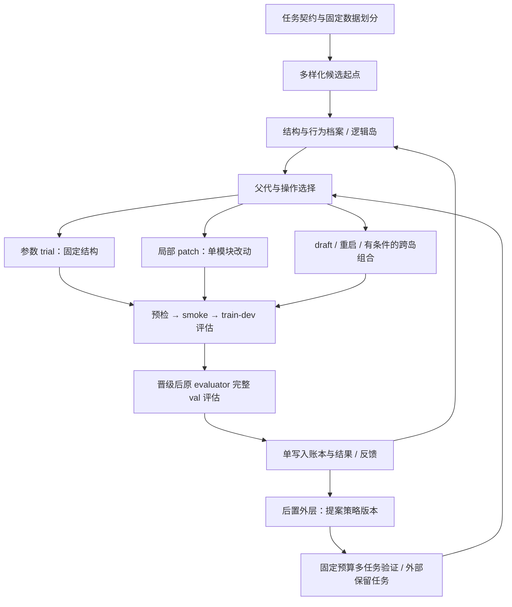

# 自动调优与进化搜索改进设计

> 入库说明：本文来自 2026-10-04 服务器检出（原文件名 `04-autotune-design.md`）。`docs/design/04-*` 在 main 上已被占用，故入库编号为 06。正文决策未改动，仅修正配套链接。

日期：2026-10-04（北京时间）。状态：待实施设计。本次核查基线为本地 Git `9a3643f`，并参考 NAS 的 `work/code_aligned` 与运行产物。研究检索截至 2026-10-04；本文中的新模块、配置和预算都是建议，不代表已经实现或执行。

配套执行清单：[自动调优与进化 TODO](../plans/AUTOTUNE_EVOLUTION_TODO_2026-10-04.md)。知识发现后续路线：[KD 下一步建议](../plans/KD_NEXT_STEP_RECOMMENDATION_2026-10-04.md)（背景调查另见 [KD_WHY_NO_KNOWLEDGE](../plans/KD_WHY_NO_KNOWLEDGE.md)）。

## 1. 决策：先增强自动调优，再恢复新知识发现

优先修复并验证“产生有效候选 → 正确评估 → 保存多样性 → 用有限预算持续提分”这条主链。当前不宜把机制锦标赛或自主修改整个引擎作为主线。

**现有分数不证明我们比官方低很多。** 仓库同任务人工参考 ROS 为 33.70；已有历史最优为 38.14，最近一次真实 run 为 35.03。FM Agent 论文报告的是不同任务的指标，不能拿 MLE-Bench 奖牌比例、ALE 分数或 KernelBench 加速比与 HDD ROS 直接比较。已检查的伐谋对照方案结果表仍为空，未发现本轮可核对的同任务官方分数。[FM Agent 原论文](https://arxiv.org/abs/2510.26144)

但我们的搜索能力确实有改进空间：最近两次真实运行候选有效率均为 0.50；运行效果差异大；主线仍偏向单起点、串行、整文件 REFINE；缺乏明确的结构化超参数搜索。高分单次运行证明存在可优化空间，不证明搜索稳定、样本高效或已得到新的科学知识。

自动调优不足与知识发现不足并非严格的因果关系。新知识还要求原子假设、独立确认和增量证据。把调优做扎实能提供更可信的强基线、轨迹和消融证据，但调优提分不会自动成为新知识。

## 2. 已核查的现状

| 真实实验 | 最优 val ROS | 主循环轮数 | 产物 `valid_rate` | tokens | 墙钟 |
|---|---:|---:|---:|---:|---:|
| `final_A/1e46aef0` | 37.79 | 10 | 0.80 | 130,336 | 3,907 s |
| `final_B/f9752fcd` | 38.14 | 10 | 0.50 | 146,415 | 2,113 s |
| `demo_real/42a3f6df` | 22.96 | 8 | 0.50 | 89,422 | 5,310 s |
| `demo_real2/38cb38cf` | 35.03 | 10 | 0.50 | 169,400 | 6,130 s |

来源：`/home/hcf/nas_hcf_data/faultevolve/runs/<上述路径>/run_summary.json`。这些运行的代码、开关、seed 和预算不同，不能据此声称某特性必然增益或退化。汇总有效率也不等于“首次生成即有效”，需要重建细分口径。

当前能力与缺口：

| 层 | 已有 | 缺口或限制 |
|---|---|---|
| 超参数 | LLM 能修改程序中的参数，另有阈值算子 | 没有独立的参数空间、trial、搜索器和受控训练预算 |
| 算法搜索 | UCT 树、反思、Repair、分支记忆 | 局部改动仍要求输出完整程序；结构变异与数值调参混在一起 |
| 算子 | refine/recall_focus/threshold_calibrate/inject、可选 crossover | `bandit=false` 固定选 REFINE；开关存在不等于被有效验证 |
| 多样性 | 分支、跨枝经验、rank/threshold 精英列表 | 没有完整的多起点种群、行为多样性分组和岛间迁移 |
| 评估 | 本地 evaluator、预检、性能门、smoke、可选错例画像 | 主循环同步评估；最近真实 run 的 analysis_calls=0；大量细节未进入反馈 |
| 成本 | token 分账与部分预算门 | iterations 不涵盖全部评估和内部搜索，不足以公平比较 |
| 可复现 | 代码/结果制品、实验数据库 | 本地主仓库与 NAS aligned 的关键实现不同，历史指标不能直接做当前基线 |

`llm.max_concurrency=4` 不代表当前主循环同时生成或评估四个子节点。必须从实际任务队列和耗时确认并行度。

## 3. 可借鉴的方法及取舍

下表只概括论文/作者项目的机制；具体映射到 FaultEvolve 是本文设计判断。没有把外部报告的增益移植为本项目承诺。

| 来源 | 可借鉴机制 | 本项目取舍 |
|---|---|---|
| [FM Agent](https://arxiv.org/html/2510.26144v1) | 多样化冷启动、岛屿种群、自适应采样、生成与评估异步 | 先做 2～3 个本地逻辑岛，再评估并行收益；暂不引入大集群 |
| [MLE-STAR](https://arxiv.org/abs/2506.15692) | 用消融定位有影响的代码块，再定向改进 | 优先级最高：模块化候选、目标明确的小改动与组消融 |
| [AlphaEvolve](https://arxiv.org/html/2506.13131v1) | SEARCH/REPLACE 局部编辑、分阶段评估、候选档案 | 先实现受控 patch；保留完整重写作 draft；低成本评估结果不得冒充完整分数 |
| [ShinkaEvolve](https://arxiv.org/abs/2509.19349) | 父代采样、代码新颖性去重、按表现选择生成模型 | 先做结构哈希及行为去重，再考虑付费 embedding 和多模型路由 |
| [GEPA](https://arxiv.org/abs/2507.19457) | 读取轨迹作定向反思，保存不同任务上的优势候选 | 改进反馈合同和策略提示；不把它当纯数值 HPO 的替代品 |
| [autoresearch 作者项目](https://github.com/karpathy/autoresearch) | 固定单次实验预算、结果账本、保留/回退循环 | 借鉴小而完整的循环；其单 GPU 训练设置不直接移植到 HDD |
| [Darwin Gödel Machine](https://arxiv.org/abs/2505.22954) | 经验验证 agent 修改、保留 agent 档案 | 后置为策略版本档案，避免边运行边改计分引擎 |
| [Mendel Gödel Machine](https://arxiv.org/abs/2608.07645)，2026-08-07 | 同一 agent 跨任务、不同 agent 同任务的对照轨迹 | 保存成对诊断证据，帮助外层判断是策略问题还是任务问题 |
| [AIDE² / RSI](https://arxiv.org/abs/2609.26457)，2026-09-22 | 内层优化任务代码，外层改 agent；固定预算、隐藏评分、外部任务验证 | 小范围策略自改放在最后阶段；自改成功必须有独立任务证据 |
| [PCPO](https://arxiv.org/abs/2609.38757)，2026-09-30 | 从优质、多样的算法种群作参数化策略学习 | 最新预印本，关注但暂缓；需要训练底座与数据，目前 API 闭环更合适 |

补充实现参考：[OpenEvolve 官方仓库](https://github.com/algorithmicsuperintelligence/openevolve)。可考察档案、岛屿和 checkpoint 的实现，但必须钉住具体提交、核对许可证与接口后再引入，不整体替换当前树及审计模型。

最重要的取舍：**当前最缺的是有限预算内的有效实验，优先级为结构化调参、局部编辑、可用反馈，再是岛屿和并行，最后才是 RSI。**

## 4. 目标架构：内层调参、中层结构进化、外层策略改进

这里的三个层次优化不同对象：

- **内层 HPO：**模型超参数、窗口开关、训练参数和阈值规则；结构保持固定。
- **中层 evolution：**特征计算、模型家族、训练或校准模块；每次尽量改变一个可定位因素。
- **外层 RSI：**如何选父代、构造反馈、分配操作预算、管理记忆；不改变任务评估标准。

三层必须分别有版本、账本和评估预算。早期只实现前两层。

## 5. 参数搜索：先补最确定的短板

### 5.1 候选表示

为新生成候选提供可选 `CandidateSpec`：`family_id`、`source_hash`、特征组、模型参数、训练参数、校准策略、seed、editable blocks。编译为自包含 Python 文件后再交给现有 adapter。原始 `init.py` 和历史自由程序仍可原样评估，不能为结构化搜索强行改保护文件。

HDD 的模板与参数空间放在任务专属模块；通用搜索器只处理参数类型、约束、trial 和结果，不硬编码 SMART/型号。

初版选两个模型家族：加权逻辑回归、LightGBM。可配置搜索正则化、树复杂度、学习率/迭代数、采样、类别处理与阈值规则。连续参数用合适的对数或线性空间；条件参数及跨参数约束显式校验。权重与 class weight 的组合必须核对，避免重复补偿类别比例。

### 5.2 搜索策略和预算

第一版使用 seeded random search 作为可解释基线；trial 接口允许后续接入 TPE。没有证据前不再加一种搜索算法。每个结构给予小型固定 trial 预算，只有训练内部 dev 表现和结构多样性都值得保留时才追加。

LLM 定义结构或建议合理空间，数值 trial 由确定性调度器提出，避免每调一个数都重写程序并支付一次生成成本。

### 5.3 数据与阈值

在 `public/train_*` 内建立显式时间阻断的 train/dev；以设备隔离、标签时间窗口隔离为约束，预处理只 fit 在训练部分。阈值和校准从训练内部 dev/OOF 选择；禁止候选程序读取验证标签或私有测试。

已反复使用的原 val 是工程搜索/对比信号，不是独立新知识确认集。所有 HPO 模型拟合、dev 预测、完整 evaluator 调用都计成本；不能把每个候选内部的几十次训练藏在一次“迭代”里。

## 6. 结构进化：从整文件重写改为可归因修改

新建可选 `operators.edit_mode=patch`。patch 包含父文件哈希、唯一匹配的 SEARCH/REPLACE 块或统一 diff、目标模块和假设。应用时验证父版本、匹配数量、语法及静态规则；失败记 `patch_rejected`，不能静默切换为全文件重写。

完整输出保留给 draft、真正的跨家族变更和显式 fallback。同一候选原则上只改一个模块：feature、model、train、calibration。参数 trial、改特征和换模型不能混在一个未标注变更中。

局部消融仅在固定的训练内部 dev 上，用于定位优化瓶颈和候选因子作用；每次组移除/替换都计评估预算。它与“每个 PR 多种子大规模消融”不同，初版不做完整特性组合网格。

反馈记录父子共同样本上的差异、分项指标、错误类别、聚合 FN/FP 群体、运行热点、改动范围和成本。`analysis_calls=0` 时明确标“画像未计算”，不能仍要求模型针对不存在的画像改进。

## 7. 多样化冷启动与轻量岛屿

### 7.1 先从 2～3 个独立方向开始

建议冷启动方向：线性与校准、趋势树模型、型号/缺失处理。原 init 是共同任务起点，但各方向生成并评估一个不同的完整结构。所有种子生成、调参和评估计入同一总预算；不能在与伐谋比较时额外免费提供历史 best。

树继续作为血统和审计结构；`island_id` 与种群成员关系放在旁路表，不覆盖 `parent_id`。迁移复制成员关系并引用既有候选，避免伪造一次新评估。

### 7.2 以行为差异补充代码相似度

exact source hash 去完全重复；AST/模块摘要识别结构；train-dev 的预测秩、告警集合和错误群体衡量行为。AST hash 不能用过度归一化抹掉不同数值参数；参数变体通过独立 config hash 区分。

高分且同质的重复方案不长期占据所有槽位；略低分但不同结构/错误模式的候选保留有限探索配额。LLM 新颖性和代码 embedding 只作辅助，不决定分数。

初版每岛保留约 4～6 个候选，2～3 岛即可；按累计完整评估次数触发迁移和停滞判断，具体配额在第一轮冻结。种群小于可辨认结构数时不启用复杂聚类。

### 7.3 有条件交叉

先迁移结构/经验，再做确定性 rank blend 作为集成基线。学习 blend 权重或 stacking 只能使用 OOF 预测，避免在 val 上训练集成器。训练/执行两份模型的成本全部计入。

只有父代预测互补、剩余时间预算允许、参数/特征接口兼容时才允许 crossover。保留 existing crossover，但增加这些资格和对照，不能仅因两份代码分属不同枝就交叉。

## 8. 选择、反馈和预算

### 8.1 分开“是否有效”“是否值得保存”“下一步扩谁”

一次修改比父代差，可以保留为有差异的探索候选；不能混同于最终冠军替换。全局 best 只由完整 evaluator 分数产生。局部或低保真 dev 值存独立表，不能回填正式 `combined_score`。

建议操作顺序：参数调优、局部 patch、draft/restart，再按证据开放 crossover。初版采用固定配额；后续再比较按单位成本收益调整预算的调度。现有 Beta-Thompson 可作为对照，但不能只用“能运行”作为算法收益奖励。

优化收益记录为父子相对增益及成本。探索配额独立保留，不能因少数早期胜负就锁死搜索。不同保真度的奖励不可直接混排。

### 8.2 不用 F1 bootstrap 波动直接判 ROS 增益

当前 evaluator 的 F1 bootstrap 标准差不是父子 ROS 差的置信区间。关键晋级/归因使用相同样本预测的成对差异或训练内部 dev 重采样；多次完全相同的 deterministic evaluator 调用不增加统计证据。

若候选训练随机，固定训练 seed、线程和环境；必要的少量重复仅用于确认接近噪声的冠军差异，先冻结规则，不挑 seed 最优结果。

### 8.3 总预算是多维账本

至少记录：生成请求数、所有 LLM token/费用、model_fit_count、各阶段 evaluator 调用数、CPU-seconds、峰值 RSS、墙钟、失败/超时、唯一候选数、队列等待。Repair、自修复、cold start、crossover、消融、元策略试验均占预算。

`iterations` 继续用于兼容 CLI，但不能作为唯一公平性指标。并发运行还需在提交工作前预留预算，完成或失败后结算；已经花掉的 token/算力不因候选失败而退款。

## 9. 本地异步：先测资源，再加并行

先记录 generation/evaluation/analysis/repair 的耗时与峰值内存，确定瓶颈。评估开始建议并发 1，生成并发 2；只有资源测量支持时提升评估并发。固定 LightGBM/BLAS 的线程上限，避免每个候选用满所有 CPU。

单调度进程为 SQLite 唯一 writer；生成和评估 worker 返回结果，通过队列入账。候选使用独立工作目录，任务只读；队列任务有 attempt、lease、幂等结果键和重启恢复。异步完成顺序会影响搜索，记录提交与完成序列；调试模式保留同步确定性执行。

缓存键包含实际 code/config、数据版本、evaluator、保真度、seed、依赖/运行环境和线程设置。缓存命中不增加新样本；改变任何关键条件须重评。共享特征缓存只在可信预处理层实现，导出的候选仍满足原基准接口。

Ray 和多机放到本地有吞吐证据之后。不能把 wall time 降低直接描述为样本效率提高。

## 10. 外层 RSI：条件满足后才实施

采用受限的策略提案版本，不让运行中的系统修改自身计分标准。可改对象先限定为父代选择、提示模板、上下文压缩、操作配额和局部编辑策略；核心 evaluator、数据划分、预算核算、测试预期和最终基准隔离规则固定。

初版外层有三个数据层：元开发任务用于反馈；元选择任务用于接受提案；独立保留任务只用于阶段结束评估。元选择反复使用后也会过拟合，不能等同于最终外部泛化。禁止把 HDD 私有 test 填进外层循环。

每个策略版本使用相同任务预算与模型，比较标准化 best-so-far 轨迹面积、终分、有效候选和总成本；跨任务标准化基准在实验前冻结。单纯减少实验次数却降低结果质量不能算改进。

第一批最多 3～5 个元策略提案；至少涵盖多个可运行的独立任务或时间变体，加上 repair/预算/恢复专项回归。SSD/SmartMem stub 不算可运行泛化任务。没有合格元任务集就暂停外层，实现轨迹档案即可。

一个有益的策略 patch 是“agent 优化”证据；持续 RSI 还需多次接受后的新 agent 确实参与后续提案，且收益在未参与选择的任务保留。AIDE² 报告的外层自改能力比较仍有噪声与成本限制，本项目不提前承诺持续递归提升。[研究范围与限制](https://arxiv.org/html/2609.26457v1)

## 11. 公平评估和阶段验收

### 11.1 比较组

冻结四种概念组，分阶段实施而非立即跑满网格：A 当前可复现 REFINE 基线；B 纯结构化随机 HPO；C HPO + patch；D C + 冷启动/逻辑岛。RSI 单列后续组。

与 FM 平台对比同时给出两张视图：原协议同迭代/同工件（注明其计数差异），以及尽可能同完整评估调用和计算/token/墙钟预算。平台不暴露模型或成本时明确不可对齐项，结论只及已观测结果。

### 11.2 先看曲线与可靠性，再看冠军

记录 best ROS 对完整评估次数、累计费用和墙钟的三条曲线；达到 33.70/35/38 的成本；初次有效率、修复后有效率、正向增益率、唯一结构数、单次成本及返回冠军的复现情况。38.14 是历史观察点，不是新系统保证值或上限。

建议工程目标（待测目标，非已有结果）：新小改动链最终有效率 ≥80%；同预算相对当前基线取得更好的曲线或可靠性，并不明显损失终分；ROI 先从故障/重写成本下降证明。至少一次固定协议真实比较只证明功能和单次效益；没有多次独立重复时不声称稳定优越。

若纯 HPO 已达到结构进化同等结果且更便宜，应采用 HPO 为默认，不为复杂架构保留没有收益的功能。若 patch 有效而岛屿无增益，交付 C 即可。

### 11.3 恢复知识发现的条件

可复现强基线、可归因变更和成对预测档案已具备；原子因子验证链已按 KD 文档修正；新确认数据协议已冻结。之后从真实单模块增益提取现象因子，明确与固定强基线比较，KD2 仍需单独证明其价值。

## 12. 建议代码边界与兼容性

拟新增：`optimization/{candidate_spec,parameter_space,trials,search,patching,archive,scheduler,feedback}.py`；HDD 模板放 `tasks/`；外层后续放 `meta/`。这些路径是规划名，实施时可在同等边界下合并文件。

主要接点：`config.py`、`cloud/{engine,operators,selection,store}.py`、`tasks/protocol.py` 和 `worker/runner.py`。保留现有 Node ID、tree parent、CLI 八个命令和旧制品；新的 trial/岛屿/策略版本表使用增量迁移。新增配置默认关闭，历史 `fe evolve local ...` 不应意外变成多 trial、高并发或付费外层运行。

Web 初期只补报告与兼容展示，不先重做页面；没有完整评估的候选清晰显示阶段，避免 dev proxy 看成冠军分。SQLite 放本地盘，数据和大产物放 NAS。受保护基准文件不改，秘密只通过环境传入。

实施次序与每项可检查产物以配套 TODO 为准。以上路线的目标是用更少无效实验取得可信改进，然后让知识发现建立在可验证的优化证据上。
