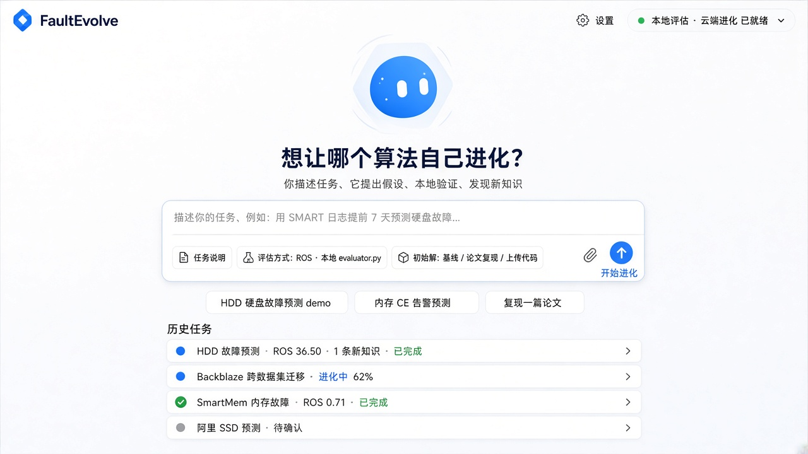
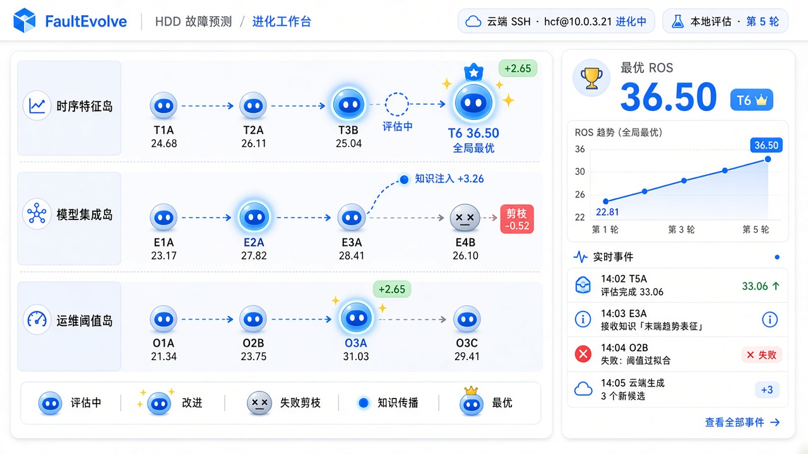
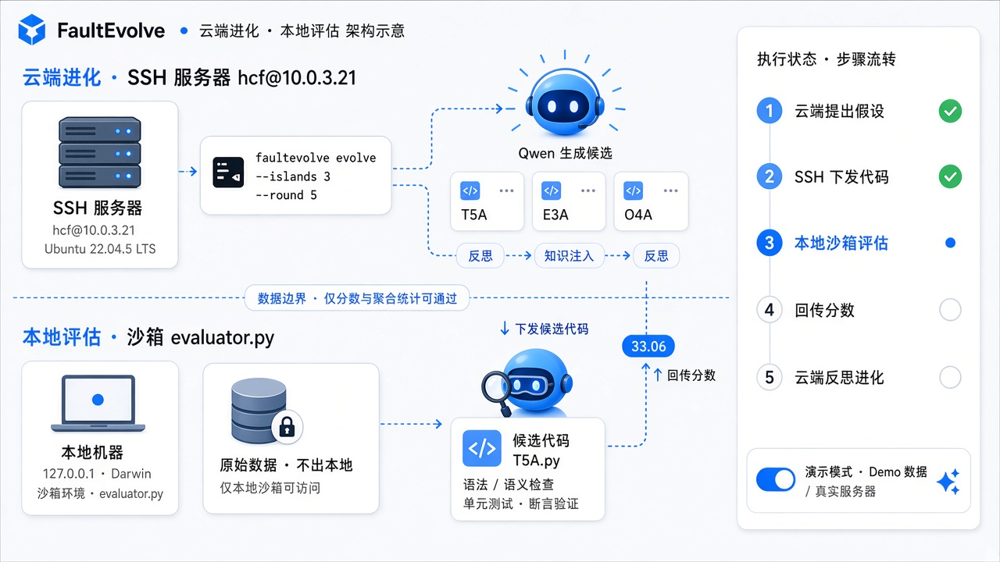

# FaultEvolve 前端重构规划：对话入口 + 几何 Bot 动效

目标：天猫 AI 黑客松路演可完整演示。浅色、蓝色为核心，几何极简的 Bot 贯穿全流程；默认用 demo 数据稳定演示，保留真实后端接入。

概念图在 [`concepts/`](concepts/)，下文按页面引用。概念图是 AI 生成的示意，Bot 画风不统一（02、05、06 被画成了 3D 机器人），**实现统一采用 01、03 的扁平几何风格**。

---

## 0. 视觉基线（替代 `visual-system.md` 的深色方案）

| Token | 值 | 用途 |
|---|---|---|
| `--fe-canvas` | `#F7F9FC` | 页面背景，中心可叠一层极淡蓝色径向光 |
| `--fe-surface` | `#FFFFFF` | 卡片 |
| `--fe-border` | `#E3E8F0` | 1px 边框 |
| `--fe-fg` / `--fe-fg-muted` | `#0F172A` / `#64748B` | 文字 |
| `--fe-brand` | `#2563EB` | 核心蓝：Bot 本体、主按钮、激活态 |
| `--fe-brand-50` / `-100` | `#EAF1FF` / `#DBE7FF` | 选中、高亮底色 |
| `--fe-success` / `--fe-danger` / `--fe-warn` | `#16A34A` / `#EF4444` / `#F59E0B` | 只用于小标签、小圆点 |

圆角 12px（卡片）/ 20px（对话框）/ 999px（标签）；去掉 Fluent 阴影和毛玻璃；字号正文 14px。

---

## 1. Bot 动效：调研结论

“gorkbot” 即 x.ai 的 Grok Bot（x.ai/bot）：一个实心几何体 + 两只白色眼睛，靠形状插值、视线漂移和眨眼表现“活着”。GitHub 上的开源复刻：

| 项目 | 技术 | 许可 | 可借鉴 | 能否直接用 |
|---|---|---|---|---|
| [jeremy-prt/bloub](https://github.com/jeremy-prt/bloub) | Vue 3 + SVG，14 种状态，约 1.9k star | MIT（仅代码） | 逐帧测量的动效参数：本体是正圆、过渡用指数 ease-out 不回弹、静止时不漂浮，只靠视线漂移和眨眼 | 代码可用；README 明确 MIT 不覆盖它模仿的 xAI 设计 |
| [ShunquanWang/bloub-react](https://github.com/ShunquanWang/bloub-react) | React 版 bloub，`engine.sample(t)` 纯函数 | MIT | 时间可寻址的引擎，适合 demo 回放和截图 | 与本项目 React 19 技术栈一致，最易接入 |
| [TyCoding/grok-ball](https://github.com/TyCoding/grok-ball) | 纯 SVG，32 种表情，含“思考中、检索资料、任务完成”等 Agent 状态 | MIT，声明代码原创 | `setEmotion()` 对接 Agent 输出的思路 | 可用 |
| [nasawz/GrokBot](https://github.com/nasawz/GrokBot) / [Coiggahou2002/grokbot-web](https://github.com/Coiggahou2002/grokbot-web) | Flutter / Canvas 2D，18 形状、39 状态、48 点环插值、弹簧、球面转头 | BSD-3 | 状态表设计最完整：`thinking`、`searching`、`working`、`orbit`、`radar`、`celebrate` | 可用，但几何数据来自 Grok |
| [iduu/grokbot-animation](https://github.com/iduu/grokbot-animation) | SVG Web Component + 时间线编辑器 | 未授予第三方素材许可 | 状态生命周期 `ENTER → HOLD → EXIT` | **不建议**：仓库自述含从 x.ai 前端提取的几何数据 |

**决策：自研 `EvoBot` 组件，只借鉴算法思路，不拷贝 Grok 的形状和表情数据。**

- 路演是公开场合，直接用 Grok 外形有侵权和“抄袭”观感风险；
- 我们需要的状态（评估中、剪枝、知识注入、辩论角色）现成库里没有，反正要扩展；
- 技术上只需三件事：48 点闭合环插值做变形、视线 + 眨眼、状态机，约 300–400 行 TS。

### 1.1 `EvoBot` 设计

- **本体**：蓝色 `#2563EB` 实心几何体，两只白色竖胶囊眼。形状集与品牌和三岛对应：圆（默认/时序特征岛）、六边形（模型集成岛）、菱形（运维阈值岛）、圆角方（统计裁判）、三角（批评方）。
- **运动原则**（取自 bloub 的测量结论）：静止不漂浮；“活着”只靠视线漂移 + 随机眨眼（320ms，闭眼快于睁眼）；形变用 `cubic-bezier(0.16, 1, 0.3, 1)` 指数缓出，不回弹；跨页面移动才用弹簧。
- **实现**：SVG + `requestAnimationFrame`，引擎做成 `sample(state, t)` 纯函数（学 bloub-react），demo 回放可以 seek，Playwright 截图可冻结帧；尊重 `prefers-reduced-motion`。
- **跨页面跳跃**：引入 `motion`（Framer Motion）的 `layoutId` 共享布局动画，首页 Bot 和工作台中央 Bot 用同一个 `layoutId`，路由切换时自动飞过去。

### 1.2 Bot 状态表（与引擎事件对应）

事件细名取自 `web/src/features/workbench/event-taxonomy.ts`，保证 demo 和真实数据走同一套映射。

| Bot 状态 | 视觉 | 触发 |
|---|---|---|
| `idle` | 视线缓慢漂移、眨眼，每 4–6s 变一次形状 | 首页静置 |
| `curious` | 视线跟随鼠标，打字时看向输入框 | 首页输入中 |
| `asking` | 头微歪、眼睛变大 | 确认对话 |
| `leap` | 压扁 → 弹起 → 飞到中央 → 落地回弹 | 点击“确认，开始进化” |
| `thinking` | 眼睛左右扫，外圈细环旋转 | `operator_selected`、`patch_proposed`（云端生成中） |
| `evaluating` | 发光蓝 + 呼吸 + 眼睛快速四处看 | 节点已下发、等待 `iteration_complete` |
| `improved` | 弹跳一次 + 星形粒子 + 绿色 `+Δ` 标签上浮 | `iteration_complete` 分数高于父节点 |
| `failed` | 变灰、压扁、眼睛变 `× ×`，连线变虚线 | `repair_failed`、`perf_rejected`、`smoke_failed`、`patch_rejected` |
| `repairing` | 眼睛眯起、轻微抖动 | `precheck_fix`、`repair_success` |
| `inject` | 发出一个蓝色光点沿跨岛曲线飞到目标节点，目标 Bot 眨眼“接收” | `crossover_parents`、`insight_extracted` |
| `best` | 放大 1.2 倍、头顶小星、外圈扩散一次 | `iteration_complete` 载荷中 `best_node_id` 变化 |
| `debate:*` | 不同形状的角色 Bot 轮流说话，说话者放大、其余变淡 | `tournament_round_finished`、知识页回放 |
| `narrating` | 大号 Bot + 指示棒，嘴型随字幕节奏 | 结果讲解页 |

---

## 2. 页面规划

### 2.1 首页：只保留对话框 + 历史任务



- 顶栏只有 Logo、`设置`、一个就绪状态标签（本地评估 / 云端进化 是否连通）。
- 中央 Bot（`idle` / `curious`）+ 标题“想让哪个算法自己进化？”。
- 对话框一个文本区 + 三个结构化字段：**任务说明**、**评估方式**（指标 + 本地 `evaluator.py`）、**初始解**（基线 / 注入已有知识 / 检索论文复现 / 上传代码）。字段以“芯片”形式放在输入框底部，点开是小弹层。
- 下方三个示例芯片（HDD demo、内存 CE 告警、复现一篇论文），点一下填充对话框。
- 历史任务列表：任务名、最优分数、新知识数、状态（已完成 / 进化中 x% / 待确认），点击进入对应运行。

**迁移到设置页**（现有组件直接搬）：`QwenRuntimeConfig`（模型 API）、`ServerProfileForm`（服务器与目录）、`EnvConfigForm`（执行环境）、`DeploymentModeCards`（本地 / 云端模式）、`PresetSelector`（实验预设）、`PathProbeList`。`SettingsDrawer` 从抽屉升级为 `/settings` 页面，分“模型服务 / 云端服务器 / 本地评估 / 实验预设 / 演示模式”五个标签。

改动文件：`routes/OverviewPage.tsx` 重写；`routes/NewRunPage.tsx` 的表单拆散到首页对话框和确认卡；`app/shell/RailNav.tsx` 首页隐藏侧栏。

### 2.2 确认对话 → 跳入进化工作台


点击发送后不直接启动，Bot 转为 `asking`，以对话形式反问确认：

| 确认项 | 数据来源 | 状态 |
|---|---|---|
| 云端进化服务器 + SSH 连通 | `POST /api/servers/{id}/probe` | 已有接口 |
| 本地评估器 + 数据路径 | `POST /api/servers/{id}/check-path`、`GET /api/tasks/{id}/readiness` | 已有接口 |
| 初始解：基线 / 注入已有知识 / 检索论文复现 | 基线、知识注入复用 `KnowledgeInjectionForm`；**论文复现后端没有**，先只在 demo 中演示 | 部分新增 |
| 进化预算：岛数 × 轮数、预计耗时、token | `preflight-logic.ts`、`BudgetPanel` | 已有逻辑 |

点“确认，开始进化”→ `POST /api/runs` → Bot `leap` 动画飞到工作台中央 → 落地后分裂成三棵树的根节点。

### 2.3 进化工作台：每个节点都是一个 Bot



- 左侧画布：三条岛泳道，节点 = 小号 `EvoBot`（形状按岛区分），下方标编号和分数。沿用 `@xyflow/react` + `tree-adapter.ts`，只替换 `TreeNodeCard` 为 Bot 节点。
- 状态动效见 1.2 节。同屏同时“动”的 Bot 限制在 ≤ 6 个（正在评估的 + 刚变化的），其余冻结帧，保证 60fps。
- 右侧：最优分数大数字 + 趋势线（`ScoreTimeline`）+ 实时事件流（`EventStream`），事件行带对应的迷你 Bot 图标。
- 节点点击仍打开 `NodeDrawer`。

### 2.4 云端进化 / 本地评估分离演示



工作台顶部加一个可展开的“架构视图”（路演时可全屏）：

- 上半区“云端进化 · SSH 服务器”：服务器卡、正在执行的命令、戴耳机的 Bot 生成候选代码卡。
- 中间一条虚线“数据边界 · 仅分数与聚合统计可通过”。
- 下半区“本地评估 · 沙箱”：本地机器、带锁的原始数据、拿放大镜的 Bot 评估候选。
- 动画循环：代码卡从上方**落下**穿过边界 → 本地 Bot 检查 → 只有一颗写着分数的蓝色胶囊**升回**上方 → 云端 Bot 反思后生成下一批。
- 右侧五步状态：云端提出假设 → SSH 下发代码 → 本地沙箱评估 → 回传分数 → 云端反思进化。

真实模式下数据来自 `SSHCloudExecutionBackend`（`webapi/execution_backend.py`，基于 asyncssh）和 `worker/runner.py`；demo 模式由脚本驱动。

### 2.5 新知识发现：Bot 辩论锦标赛


- 舞台中央 5 个角色 Bot：支持方（圆）、混杂方（六边形）、统计裁判（圆角方）、批评方（三角）、裁判（上方大号）。
- 左侧 6 轮进度（开场陈述 → 第一轮质询 → 数据举证 → 第二轮反驳 → 机制追问 → 最终裁决），自动播放，每轮说话者放大并弹出气泡，台词取自现有机制辩论记录。
- 右侧裁决卡：CONFIRMED / DISCOVERED、n、增量效应、BH / e-BH、机制对局。
- 底部六步证据链逐个点亮。
- 数据复用 `features/discovery/*`（`tournament-logic.ts`、`MechanismTournament.tsx`、`claim-logic.ts`），只换展示层。

### 2.6 结果讲解：讲解员 Bot


- 讲解员 Bot（`narrating`）+ 字幕气泡，五章自动播放，可暂停、跳章：
  1. 最终框架：方案结构图逐块出现，新知识注入的模块高亮；
  2. 提升了什么：ROS 22.81 → 36.50 等指标数字滚动；
  3. 创新点：知识引导三岛演化、云端生成与本地评估分离、可审计的知识发现；
  4. 新知识：跳回锦标赛裁决卡的缩略版；
  5. 可复现性：运行 manifest、代码下载、报告导出（`ReportManifest`）。
- 讲解稿来自 `run_summary.json` + `reports/final_algorithm_README.md` 的模板化拼接；没有数据的章节自动跳过，不编数字。

---

## 3. Demo 数据与真实数据

核心：**一个数据源接口，两种实现**，页面不感知来源。

```ts
interface RunDataSource {
  listRuns(): Promise<RunSummary[]>;
  getTree(runId: string): Promise<Tree>;
  subscribeEvents(runId: string, onEvent: (e: RunEvent) => void): () => void;
  getDiscovery(runId: string): Promise<Discovery>;
  probeServer(id: string): Promise<ProbeResult>;
  startRun(spec: RunSpec): Promise<{ runId: string }>;
}
```

- **`LiveDataSource`**：包一层现有 `generated/api` SDK 和 `use-event-stream.ts`（SSE `/api/runs/{id}/stream`）。
- **`DemoDataSource`**：读取 `showcase/runs/hdd_mvp_showcase_c89e2a01/`（`events.jsonl`、`tree.json`、`run_summary.json`、`discovery/*`）和 `features/showcase/hdd-showcase-data.ts`，按时间戳回放事件；支持 1× / 4× / 跳到某一幕；SSH 探测、启动运行返回固定成功结果。
- 切换：设置页“演示模式”开关 + URL 参数 `?demo=1`；顶栏显示“演示数据”标签，避免评委误以为是实时运行。
- 路演脚本：demo 回放做成确定性时间线（同一次点击序列每次结果一致），总时长约 3 分钟，与 PPT 讲解节奏对齐。

---

## 4. 实施阶段

| 阶段 | 内容 | 产出 | 预估 |
|---|---|---|---|
| P0 | 浅色蓝色 token 重写 `theme.css`；清理 38 处硬编码色值 | 全站换肤 | 1 天 |
| P1 | `EvoBot` 组件 + 状态机 + 组件预览页 `/dev/bot` | 可独立调试的 Bot | 2 天 |
| P2 | `RunDataSource` 抽象 + `DemoDataSource` 回放器 | demo 可跑通全流程 | 1.5 天 |
| P3 | 首页对话入口 + 设置页迁移 + 确认对话 + `leap` 转场 | 2.1、2.2 | 2 天 |
| P4 | 工作台 Bot 节点 + 事件动效 + 云端 / 本地架构视图 | 2.3、2.4 | 2.5 天 |
| P5 | 锦标赛辩论页 + 结果讲解页 | 2.5、2.6 | 2 天 |
| P6 | 真实后端联调（SSH 服务器 + 本地评估）、性能和降级、Playwright 截图回归 | 可真跑 | 1.5 天 |

PPT 和宣传片在 P4 之后用真实界面录屏制作。

## 5. 风险

- **版权**：Bot 外形必须自研，不使用 Grok 的形状 / 表情点集；宣传材料不出现 “Grok” 字样。
- **性能**：树节点多时只让活跃 Bot 跑动画，其余冻结；动画只改 `transform` / `opacity`。
- **后端缺口**：自然语言任务描述 → 任务配置、论文检索复现，目前后端都没有。路演先用 demo 脚本演示，真实模式下这两项显示“即将支持”。
- **演示稳定性**：路演默认 demo 模式，真实服务器断连不影响演示；真实模式作为“我们真的能跑”的附加环节。
