# FaultEvolve 操作指南：Demo 演示与完整真实运行

本指南分两部分：

- **A. Demo 演示**：不需要服务器、密钥和平板，一台笔记本即可，适合路演与讲解。
- **B. 完整真实运行**：安卓平板（机房数字孪生）+ 笔记本 GPU（本地评估域）+ GPU 服务器（经跳板机远端自进化，Qwen / Codex），三端实时协作。
- **D. 真实运行实录**：一次完整真实会话的截图、平板通信、服务器日志与本机 GPU 占用曲线。

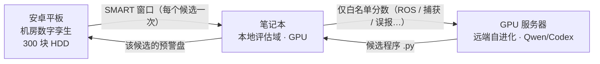

原始遥测、标签、逐盘预测只在平板与笔记本之间流动，服务器永远只拿到分数。

---

## 0. 一次性准备（两种模式都需要）

### 0.1 安装

在仓库根目录 `FaultEvolve-ResearchAssistant/` 下：

```powershell
python -m venv .venv
.\.venv\Scripts\Activate.ps1
pip install -e ".[web,edge]"
pip install torch --index-url https://download.pytorch.org/whl/cu126   # 本机 GPU 评估用
cd web; pnpm install --frozen-lockfile; cd ..
```

检查 GPU：

```powershell
.\.venv\Scripts\python.exe -c "import torch; print(torch.cuda.is_available(), torch.cuda.get_device_name(0))"
```

### 0.2 启动

开两个终端：

```powershell
# 终端 1：后端（API + 平板 WebSocket + 远端会话），端口 8012
$env:PYTHONUTF8='1'; .\.venv\Scripts\python.exe scripts/showcase_serve.py --host 0.0.0.0 --port 8012

# 终端 2：前端，端口 5180
cd web; $env:VITE_API_PROXY_TARGET="http://127.0.0.1:8012"; pnpm dev --host 0.0.0.0 --port 5180
```

或一键启动：`powershell -ExecutionPolicy Bypass -File scripts\edge_demo.ps1 -ApiPort 8012`（脚本会打印平板应填写的笔记本地址）。

浏览器打开 **<http://127.0.0.1:5180/>**。

| 地址 | 内容 |
|---|---|
| `http://127.0.0.1:5180/` | EvoBot 路演前端（5 幕） |
| `http://127.0.0.1:5180/?stage=hybrid` | 直接进入进化工作台的混合云模式 |
| `http://127.0.0.1:5180/?stage=results` 等 | 直达某一幕（`home` / `confirm` / `workbench` / `tournament` / `results`） |
| `http://127.0.0.1:5180/overview` | 经典工作台（任务、进化树、证据链、审计） |

页面顶部是 5 幕导航，可随时点击跳转：**1 对话 → 2 确认 → 3 进化工作台 → 4 知识发现 → 5 结果讲解**。

---

## A. Demo 演示（离线即可）

Demo 回放的是**真实跑过的实验**（HDD 三岛 KGTE 进化 `hdd_mvp_showcase_c89e2a01`、论文组合实验），所有数字来自真实运行记录。

### A1. 对话：选择任务

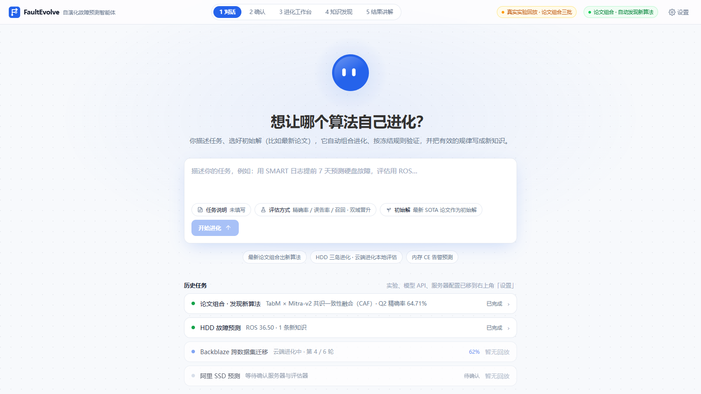

点下方建议之一：

- **HDD 三岛进化 · 云端进化本地评估**：三个岛（时序特征 / 模型集成 / 运维阈值）协同进化，ROS 22.81 → 36.50。
- **最新论文组合出新算法**：把近两年 SOTA 表格模型组合成新算法（CAF）。

点了之后输入框自动填好任务描述，评估方式与初始解也会带上：

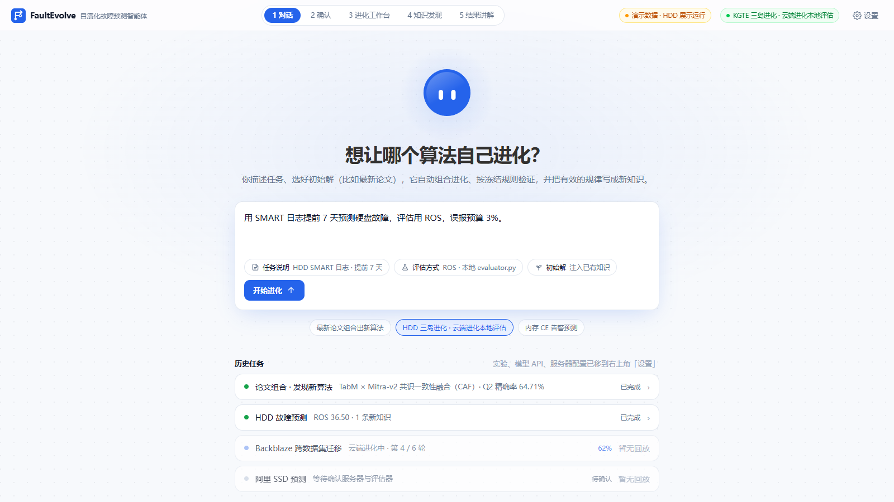

点 **开始进化**。

> 下方"历史任务"里带 › 的可以直接看结果讲解；标"暂无回放"的没有录制好的实验。
> "内存 CE 告警预测"这类没有录制实验的任务，确认页会提示演示将回放哪个案例。

### A2. 确认：选择"回放真实实验"

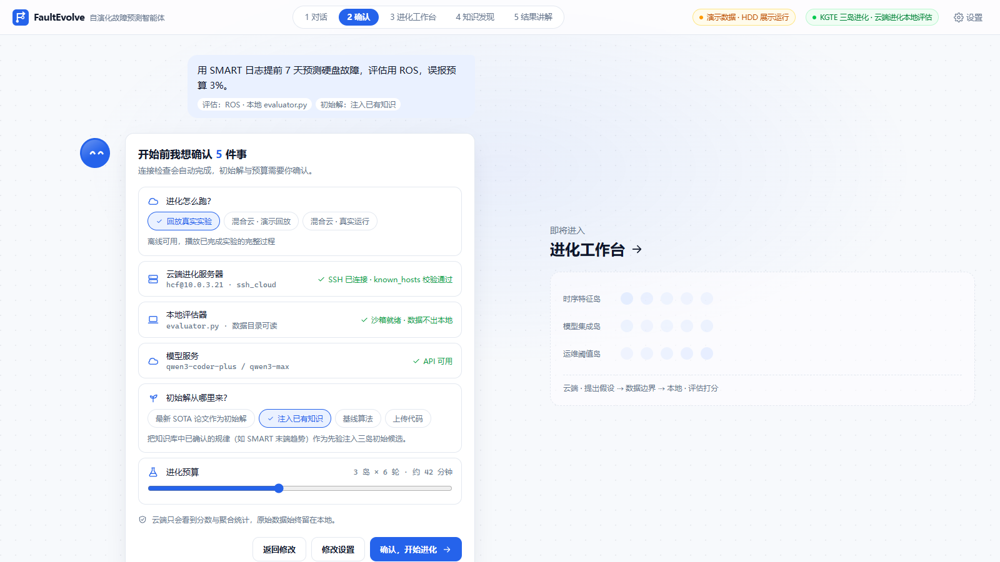

1. **进化怎么跑？** 选 **回放真实实验**（默认）。
2. 下面三项（云端服务器、本地评估器、模型服务）是录制实验时的配置，自动打勾。
3. **初始解从哪里来？** 与 **进化预算** 可调。
4. 点 **确认，开始进化**。

### A3. 进化工作台（回放）

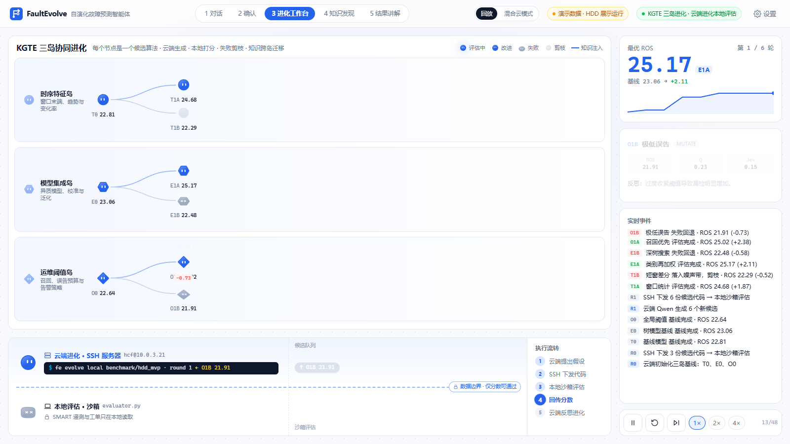

- 左侧是三个岛的进化树，节点颜色：蓝 = 改进、灰 = 失败 / 剪枝，虚线 = 跨岛知识注入。
- 右上是最佳 ROS 曲线；右侧"实时事件"逐条记录 SSH 下发、云端生成、本地评估、回传分数。
- 底部是"云端进化 ↔ 本地评估"的执行流程与数据边界。
- 右下角控制：暂停 / 重播 / 跳到结尾 / 1×–4× 倍速。
- 右上角 **回放 | 混合云模式** 可随时切换（混合云见 B 部分）。

播放结束点 **进入新知识发现**，或直接点顶部"4 知识发现"。

### A4. 知识发现：机制辩论赛

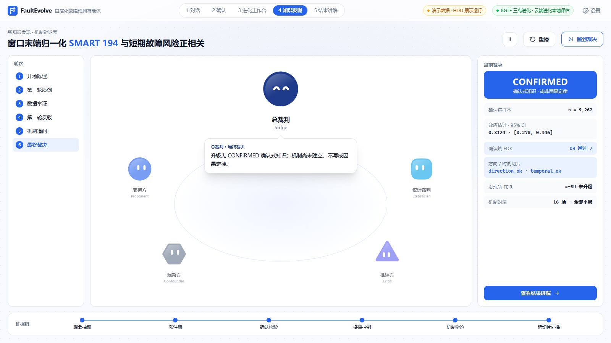

多个 Agent 对"为什么有效"提出机制假设并互相反驳，最后由统计检验裁决（CONFIRMED / CANDIDATE / 被证伪）。点 **跳到裁决** 可直接看结论，点 **重播** 重新开始。

### A5. 结果讲解与导出

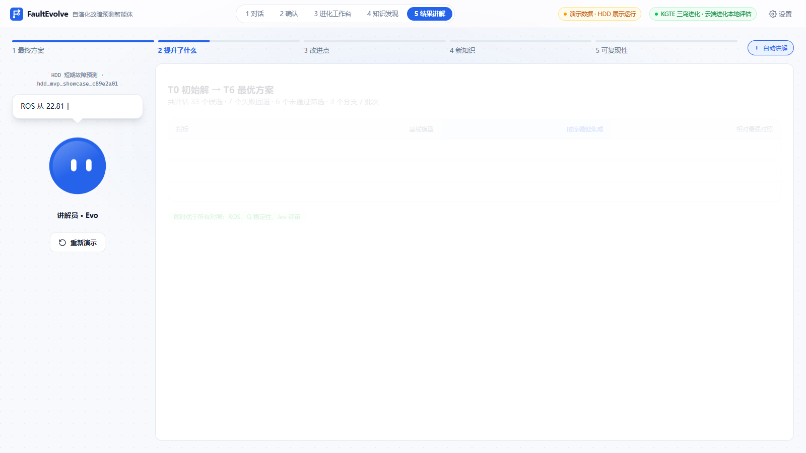

EvoBot 讲解员按五章讲：最终方案 → 提升了什么 → 改进点（论文案例为"本质创新"）→ 新知识 → 可复现性。可点顶部进度条跳转；右上角 **自动讲解** 可关掉，改为手动翻页。

在 **5 可复现性** 章节：

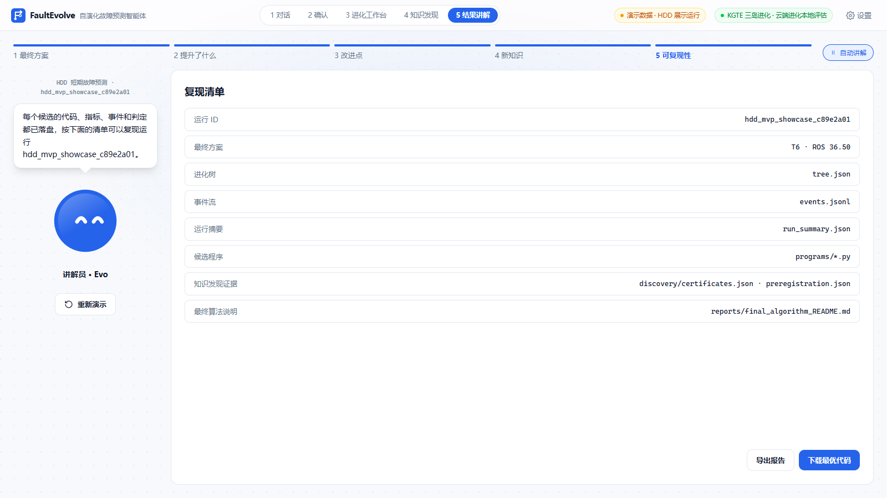

- **导出报告**：下载 Markdown 报告（`<runId>_report.md`，含指标对照、各章讲解、知识主张与反证标准）。
- **下载最优代码**：KGTE 案例下载真实最优程序 `.py`；论文组合案例导出最优方案定义 `.json`。

### A6. Demo 讲解建议（约 5 分钟）

1. 对话页点"HDD 三岛进化" → 开始进化（30 s）。
2. 确认页说明"云端只看分数，数据留本地"（30 s）。
3. 工作台 2× 倍速播放，讲三岛与跨岛注入（2 min）。
4. 知识发现点"跳到裁决"，讲 CONFIRMED 的新知识（1 min）。
5. 结果讲解停在"改进点 / 本质创新"和"可复现性"，导出报告（1 min）。
6. （可选）右上角切到"混合云模式"展示真实三端协作（见 B）。

---

## B. 完整真实运行（平板 + 本机 GPU + 服务器）

### B1. 配置 `.env`（仓库根目录，已被 git 忽略，切勿提交）

```dotenv
DASHSCOPE_API_KEY=sk-...                    # Qwen 密钥
FE_LLM_PROVIDER=qwen                        # 或 codex
FE_QWEN_MODEL=qwen3.8-max-0902
FE_SSH_JUMP=lt@<跳板机域名>:<端口>
FE_SSH_JUMP_PASSWORD=...
FE_SSH_TARGET=hcf@127.0.0.1:<隧道端口>       # 从跳板机看到的服务器地址
FE_SSH_TARGET_PASSWORD=...
FE_REMOTE_ROOT=/home/hcf/nas_public/hcf_data/faultevolve/work/edge_hybrid
FE_REMOTE_PYTHON=/home/hcf/miniconda3/envs/faultevolve/bin/python
```

- 服务器只需 Python 3.10+ 标准库；Qwen 密钥在会话启动时写到服务器 `~/.fe_edge/<session>.env`（权限 600），不写 NAS。
- 用 Codex：本机 `npm i -g @openai/codex && codex login`，页面里 Codex 按钮会变为可选。
- 改完 `.env` 需重启后端。

### B2. 平板（机房数字孪生 APK）

**构建并安装**（`<笔记本IP>` 填笔记本局域网 IP，例如 `172.16.8.217`）：

```powershell
cd edge-tablet; pnpm install
$env:VITE_EDGE_SERVER="<笔记本IP>:8012"; pnpm build; npx cap sync android
cd android; .\gradlew assembleDebug; cd ..
adb install -r android\app\build\outputs\apk\debug\app-debug.apk
```

**放行端口**（管理员 PowerShell，首次一次）：

```powershell
New-NetFirewallRule -DisplayName FaultEvolveEdge -Direction Inbound -Protocol TCP -LocalPort 8012 -Action Allow
```

没有共同局域网时可走 USB：`adb reverse tcp:8012 tcp:8012`，APK 地址填 `127.0.0.1:8012`（平板右上"设置"可改地址）。

**连上后**：平板右上角显示绿点 **已接入本地评估域**。点底部 **开始回放**，平板按天推送 300 块盘的 SMART 遥测（14 天窗口 + 7 天观察），笔记本在第 14 天打分并把预警下发，平板在 3D 机房里标出预警与真实故障：

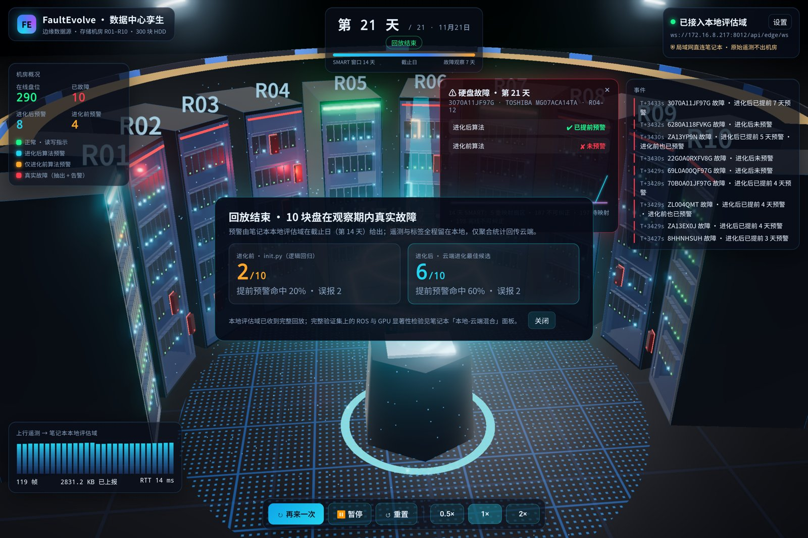

> 初始回放不是必须的：混合云进化时每个候选都会让平板重新上报一次窗口（见 B5）。

**机房布局切换**：底部控制栏右侧 **◎ 环形 / ☰ 平行**，机柜会动画重排，选择会被记住（也可用 URL 参数 `?layout=rows`）。

- **环形**：10 个机柜围绕本地评估节点，适合讲解"数据只在本地域流动"。
- **平行**：贴近真实机房排布。R01–R05 为 A 列、R06–R10 为 B 列，两列正面相对，中间是封闭冷通道（玻璃顶、端门、地板送风孔，冷气从通道地面上升），两列背后是热通道，机柜上方是走线架，远端墙边是两台精密空调（CRAC）。

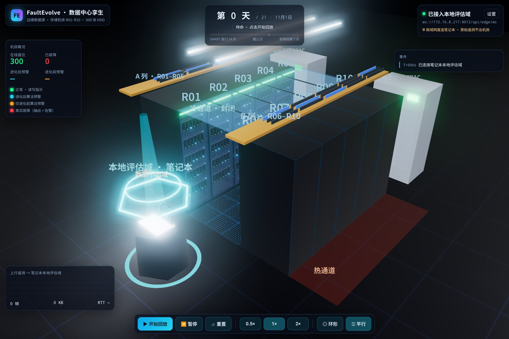

平行布局下硬盘故障时，镜头进入冷通道贴近故障盘，故障盘抽出并红色告警：

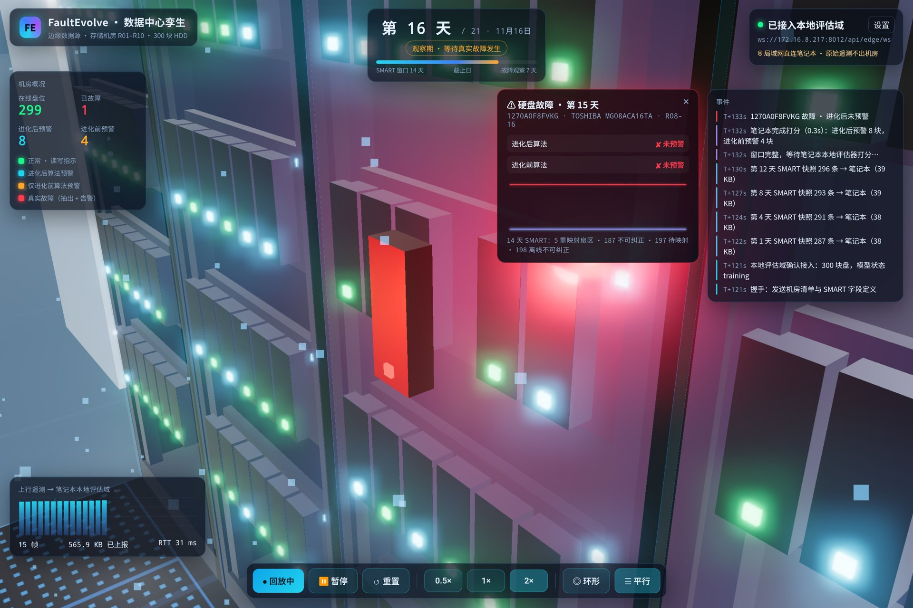

### B3. 自检三端

```powershell
Invoke-RestMethod http://127.0.0.1:8012/api/edge/state | Select tablet_linked, device   # 平板 tablet_linked=True
Invoke-RestMethod http://127.0.0.1:8012/api/edge/gpu                                    # 本机 GPU
Invoke-RestMethod http://127.0.0.1:8012/api/edge/llm                                    # Qwen key_present / Codex 登录
Invoke-RestMethod -Method Post http://127.0.0.1:8012/api/edge/remote/probe              # 服务器 ok=true
```

### B4. 确认页：选"混合云 · 真实运行"

对话页选 **HDD 三岛进化** → 开始进化 → 确认页 **进化怎么跑？** 选 **混合云 · 真实运行**：

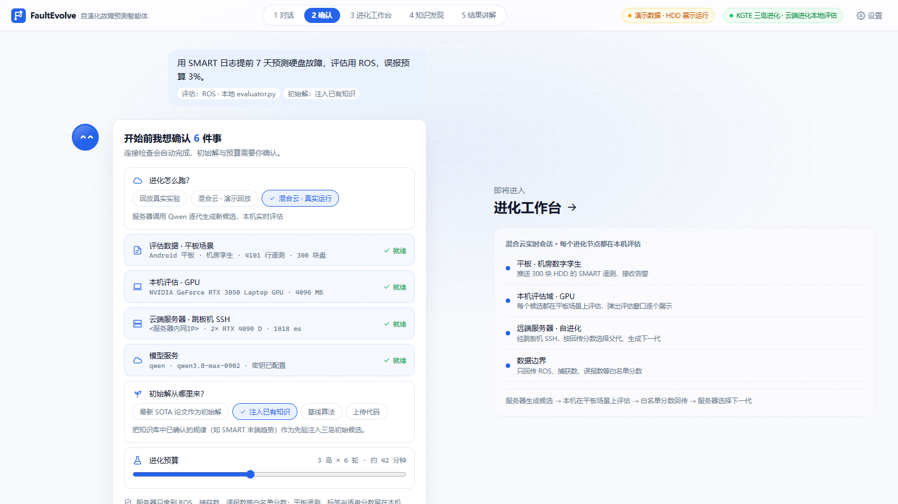

页面会实时检查四项，全部"就绪"再继续：

| 检查项 | 含义 | 不通过时 |
|---|---|---|
| 评估数据 · 平板场景 | 平板在线、行数与盘数 | 检查平板连接 / 防火墙 |
| 本机评估 · GPU | 本机 GPU 型号与显存 | 检查 CUDA 版 torch |
| 云端服务器 · 跳板机 SSH | 实际 SSH 探测，显示服务器 GPU 与延迟 | 见排障表（隧道） |
| 模型服务 | Qwen 密钥 / Codex 登录 | 检查 `.env` |

点 **确认，接入混合云开始进化**，工作台会**自动启动远端进化**。

> "混合云 · 演示回放"走同样的三端链路，但服务器按顺序回放真实候选、不调用大模型（不耗 token），本机依然对每个节点做真实 GPU 评估、平板依然参与交互。适合没有密钥或想快速演示时使用。

### B5. 进化工作台（混合云模式）

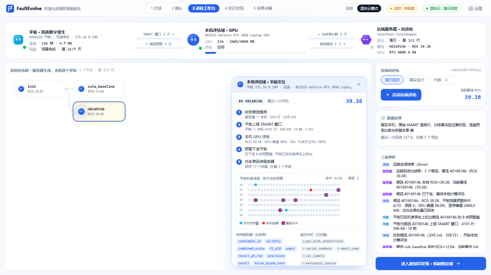

- **顶部三端**：平板（机房孪生，在线绿点）↔ 本机评估域（GPU 实时占用）↔ 远端服务器（第 N/M 代、最佳 ROS、服务器 GPU）。连线上的流光表示正在传输，计数为"SMART 窗口 N 次 / 候选预警 N 次 / 白名单分数 N 次"。
- **左侧实时进化树**：服务器每写出一个候选就长出一个节点；正在评估的节点有闪烁的"评估"角标、连线为虚线；金色为当前最优。
- **"本地评估域 · 平板交互"子窗口**（可拖动、可收起）跟着节点走，展示该节点的五步：
  1. **收到候选程序**：服务器 → 本机，行数与父代。
  2. **平板上报 SMART 窗口**：本机请求，平板现场上报 14 天窗口（约 4101 行 · 566 KB · 16 帧）。
  3. **本机 GPU 评估**：沙箱运行 + 完整验证集 + GPU 配对 bootstrap，显示 ROS、GPU 峰值、P(优于父代)。
  4. **预警下发平板**：该候选预警的盘发给平板，平板在 3D 机房上标出并回 ACK。
  5. **白名单回传服务器**：只回传 16–17 个标量，拦截逐盘预测、序列号、SMART 行、标签、评估器源码。
- 子窗口下方的机房格子：蓝 = 该节点预警，红 = 实际故障，红底蓝圈 = 提前命中。
- **右侧**：远端自进化控制（演示回放 / 真实运行、Qwen / Codex、代数、启动 / 停止）与三端事件流（平板 / 本机 / 服务器标签）。

点树上任一节点可回看它的评估，子窗口右上 **跟随最新** 恢复同步：

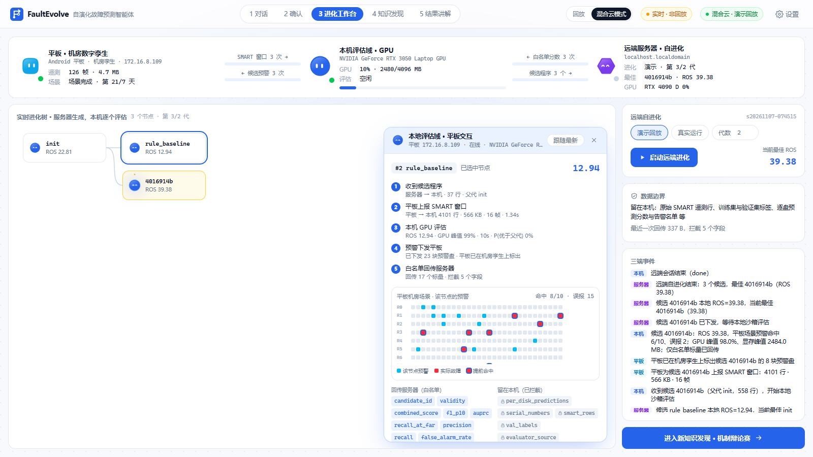

**同一时刻平板上看到的**：顶部卡片显示当前云端候选（例如 #3 4016914b：ROS 39.38 · 预警 8 块 · 提前命中 6/10 · 误报 2），右侧事件逐条记录"本地评估域请求 SMART 窗口 → 上报 540 KB → 预警下发"，机房里青色为该候选的预警盘、红色为故障盘：

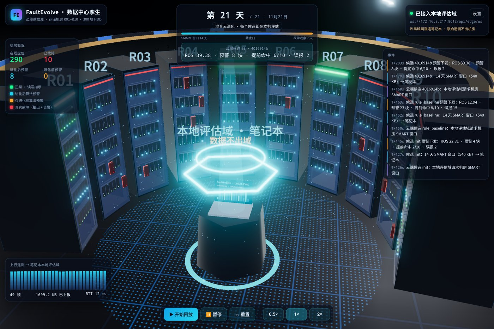

全部代数完成后，右下出现 **进入新知识发现 · 机制辩论赛**，后续两幕与 Demo 相同。

### B6. 一次会话内部发生了什么

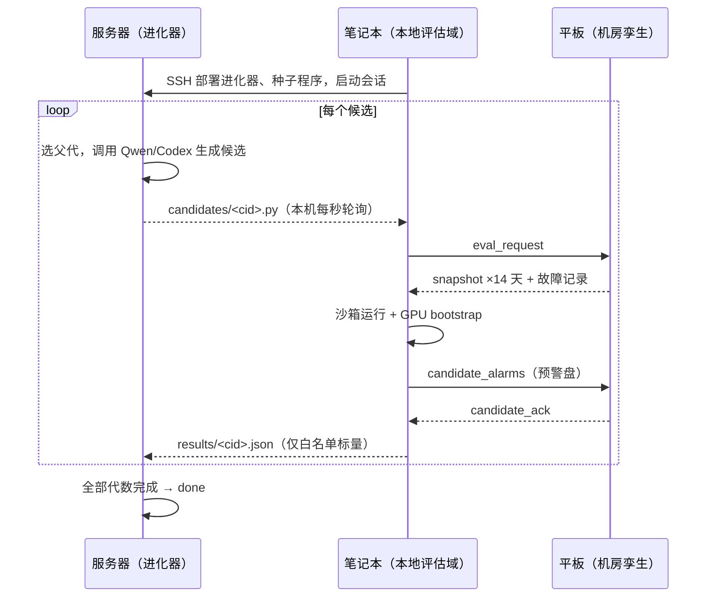

### B7. 也可以用 API 操作

```powershell
# 启动（mode=real 真实 / demo 演示回放；provider=qwen|codex；generations=代数）
Invoke-RestMethod -Method Post http://127.0.0.1:8012/api/edge/remote/start -ContentType 'application/json' `
  -Body '{"mode":"real","provider":"qwen","generations":2}'

# 轮询：每个候选的状态、ROS、平板交互（tablet.rows / bytes / acked）
Invoke-RestMethod http://127.0.0.1:8012/api/edge/remote | Select -Expand candidates

# 停止（写 STOP，当前步骤完成后退出）
Invoke-RestMethod -Method Post http://127.0.0.1:8012/api/edge/remote/stop
```

### B8. 验收标准

| 验收点 | 看哪里 | 通过标准 |
|---|---|---|
| 平板双向交互 | 子窗口第 2、4 步；平板顶部候选卡片与事件；`/api/edge/remote` 中 `tablet.acked` | 每个候选都有上报（约 566 KB）与 ACK |
| 本机 GPU 占用 | 顶部"本机评估域 · GPU"进度条；子窗口"GPU 峰值"；`nvidia-smi -l 1` | 评估期间峰值接近 100% |
| 服务器远端自进化 | 顶部服务器卡片"第 N/M 代"；事件中"服务器"条目 | 新候选逐个出现并被评估，最终 `done` |
| 数据边界 | 子窗口"回传服务器 / 留在本机"；右侧"数据边界"卡片 | 逐盘预测、序列号、SMART 行、标签、评估器源码被拦截 |

实测参考（2026-11-07，真实 Qwen 2 代）：最优 ROS 39.38 → **41.78**，本机 GPU 峰值 99%，共 27,407 tokens，约 11 分钟。详见 [REAL_RUN.md](../REAL_RUN.md)。

### B9. 设置面板

右上角 **设置** 可查看当前生效的模型、服务器、本地评估与演示模式配置（来自 `.env`）：

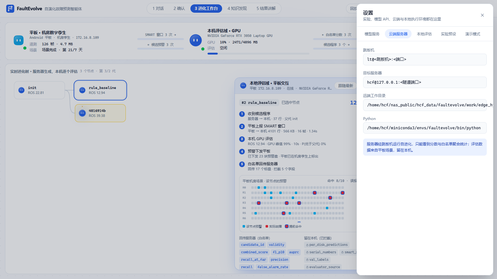

---

## C. 常见问题

| 现象 | 原因与处理 |
|---|---|
| 服务器检查报 `ChannelOpenError: Connection refused` | 跳板机能登录，但服务器到跳板机的反向隧道断了。在服务器上重启 frpc / `ssh -R`，跳板机 `ss -ltn` 能看到隧道端口后重新探测 |
| SSH 超时或认证失败 | 检查 `.env` 的 `FE_SSH_JUMP*` / `FE_SSH_TARGET*` |
| 页面提示"本地评估域接口不可用" | 后端不是 `showcase_serve.py` 或端口不一致，检查 `VITE_API_PROXY_TARGET` |
| 平板显示"未连接" | 同一局域网？防火墙放行 8012？APK 的 `VITE_EDGE_SERVER` 是否是笔记本 IP？或改用 `adb reverse` |
| 子窗口第 2 步显示"平板未连接" | 平板未在线时自动改用本机已有场景评估，流程照常；连上平板后下一个候选起恢复交互 |
| 子窗口第 2 步"平板 30s 未响应" | 平板 App 在后台或旧版本，请重装本版本 APK 并保持前台 |
| 候选很久不出现 | Qwen 思考模式（`FE_QWEN_THINKING=1`）很慢；查看服务器 `<session>/evolver.log` |
| 想中止 | 右侧"停止"，或 `POST /api/edge/remote/stop` |

---

## D. 真实运行实录（会话 `s20261107-111600`）

2026-11-07 按 B 部分完整跑了一次：`mode=real`，`provider=qwen`（`qwen3.8-max-0902`），2 代，全程约 15.5 分钟，Qwen 共消耗 25,833 tokens。

| 端 | 设备 | 本次状态 |
|---|---|---|
| 平板 | Lenovo TB522FU，局域网 WebSocket 直连笔记本 `:8012` | 在线，RTT ≈ 10 ms |
| 笔记本 | RTX 3050 Laptop 4 GB | 本地评估域，CUDA 可用 |
| 服务器 | 2× RTX 4090 D，经跳板机 | 探测成功，延迟 884 ms，Python 3.12.14 |

### D1. 结果一览

| 候选 | 父代 | 来源 | ROS | 提前命中 | 误报 | 本机评估耗时 | 备注 |
|---|---|---|---|---|---|---|---|
| `4016914b` | — | 种子 | **39.38** | 6/10 | 2 | 34.7 s | 本次最佳 |
| `init` | — | 种子 | 22.81 | 2/10 | 2 | 18.1 s | 基线 |
| `79cba9a7` | `4016914b` | Qwen 生成（82 s，12,496 tokens） | 38.69 | 5/10 | 1 | 77 s | 把 delta 方差阈值改成直接按 bootstrap P10 F1 选阈值；误报少 1，但漏 1 块，比父代低 0.69 |
| `1cda104a` | `4016914b` | Qwen 生成（292 s，13,337 tokens，首次请求超时后重试成功） | 无效 | — | — | 235 s | 加了更多 SMART 趋势特征，但 LightGBM 开启 early stopping 却没给验证集，抛 `ValueError`，判为无效 |

结论如实记录：**这两代没有超过种子最佳（39.38）**。`79cba9a7` 的差值 −0.69 在噪声带（±4.27）内，`p_improve=0.23`，门控判定不晋升；`1cda104a` 因代码错误直接无效。代数太少（2 代）是主要原因，正式实验建议 8 代以上。

### D2. 服务器连接：远端自进化

启动后，服务器端在 NAS 上建立会话目录，按"下发候选 → 等本地分数 → 选父代 → 调 Qwen 生成"循环。工作台初始化完成、服务器正在调用 Qwen 生成候选时：

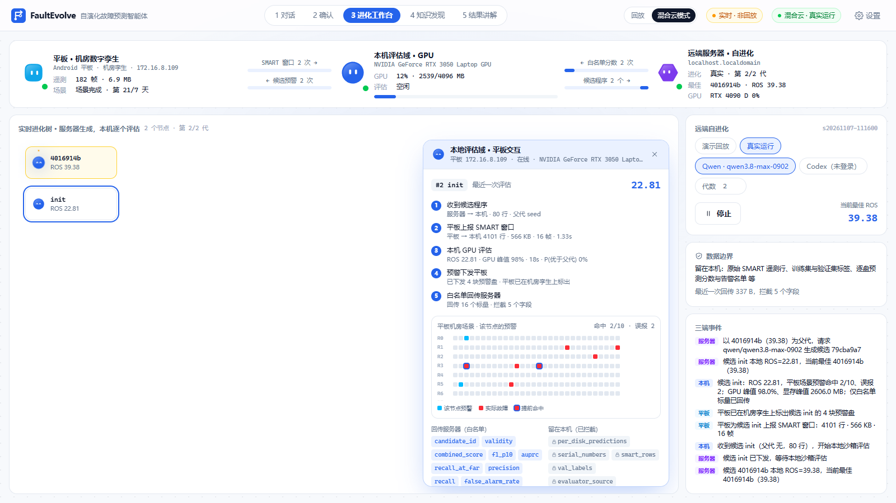

服务器端会话目录（`ls <会话>/`）和 `evolver.log` 原文（服务器只看到本地回传的分数）：

```text
candidates/  config.json  events.jsonl  evolver.log  evolver.py  llm_requests/
llm_responses/  programs/  replay/  results/  seeds/  status.json  task/

[11:16:20] start: 远端自进化启动：mode=real provider=qwen generations=2
[11:16:20] submit: 候选 4016914b 已下发，等待本地沙箱评估
[11:17:17] result: 候选 4016914b 本地 ROS=39.38，当前最佳 4016914b（39.38）
[11:17:17] submit: 候选 init 已下发，等待本地沙箱评估
[11:18:02] result: 候选 init 本地 ROS=22.81，当前最佳 4016914b（39.38）
[11:18:02] llm: 以 4016914b（39.38）为父代，请求 qwen/qwen3.8-max-0902 生成候选 79cba9a7
[11:19:24] llm: 候选 79cba9a7 生成完成（82s，12496 tokens）：This improvement replaces the complex delta-variance threshold ...
[11:19:24] submit: 候选 79cba9a7 已下发，等待本地沙箱评估
[11:20:53] result: 候选 79cba9a7 本地 ROS=38.69，当前最佳 4016914b（39.38）
[11:20:53] llm: 以 4016914b（39.38）为父代，请求 qwen/qwen3.8-max-0902 生成候选 1cda104a
[11:23:55] llm: Qwen 请求第 1 次失败：The read operation timed out，重试
[11:25:45] llm: 候选 1cda104a 生成完成（292s，13337 tokens）：This improvement adds richer temporal trend features ...
[11:25:45] submit: 候选 1cda104a 已下发，等待本地沙箱评估
[11:30:03] result: 候选 1cda104a 本地 ROS=0.00，当前最佳 4016914b（39.38）
[11:30:03] done: 远端自进化结束：4 个候选，最佳 4016914b（ROS 39.38）
```

服务器收到的 `results/79cba9a7.json` 全文，只有白名单标量，没有任何逐盘数据：

```json
{"candidate_id": "79cba9a7", "validity": 1, "combined_score": 38.6896, "f1_p10": 0.36541,
 "auprc": 0.3817, "recall_at_far": 0.44841, "precision": 0.29903, "recall": 0.55688,
 "false_alarm_rate": 0.00327, "run_time_s": 36.27, "noise_band": 4.266, "p_improve": 0.2277,
 "disks_monitored": 300, "failures_observed": 10, "caught": 5, "false_alarms": 1,
 "delta_vs_parent": -0.6909}
```

服务器 GPU 在本模式下不参与评估（结束后两张 4090 D 均为 0%），它只负责 LLM 调用与进化调度；评估全部在本机完成。

### D3. 平板通信：每个候选一次往返

每个候选进入本地评估时，笔记本向平板发 `eval_request`，平板上报 14 天 SMART 窗口（本次每次 **4101 行、约 566 KB、16 帧、约 1.3 s**），笔记本评估完把该候选的预警盘下发平板，平板回 ACK。4 个候选全部完成了这一往返。

工作台子窗口，`79cba9a7` 正在本机 GPU 评估（第 2 步显示平板已上报 4101 行 / 566 KB / 1.32 s）：

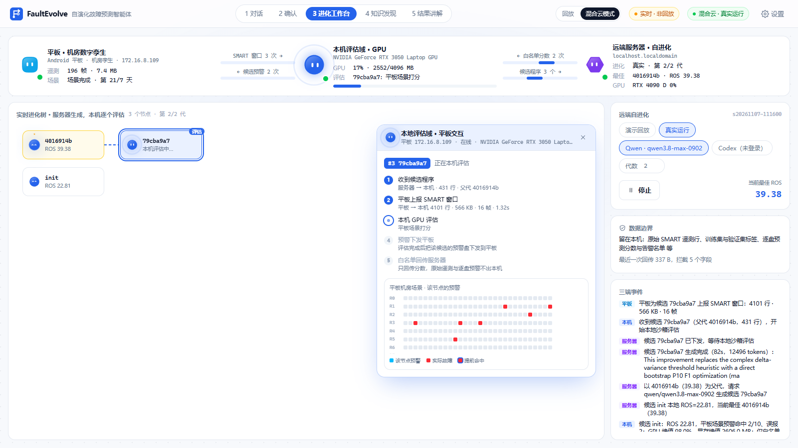

同一时刻平板画面：卡片显示"已上报 14 天窗口 · 笔记本 GPU 评估中"，左上角累计帧数与流量、RTT 10 ms：

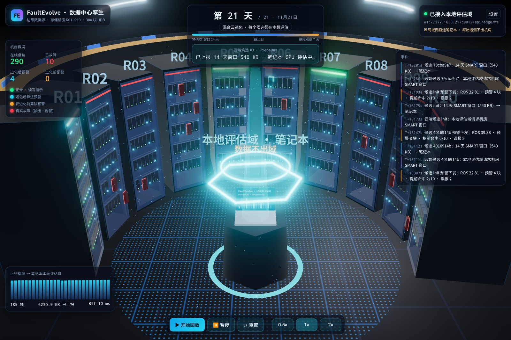

`79cba9a7` 评估完成，5 步全部打勾，ROS 38.69，预警盘已下发平板并收到 ACK：

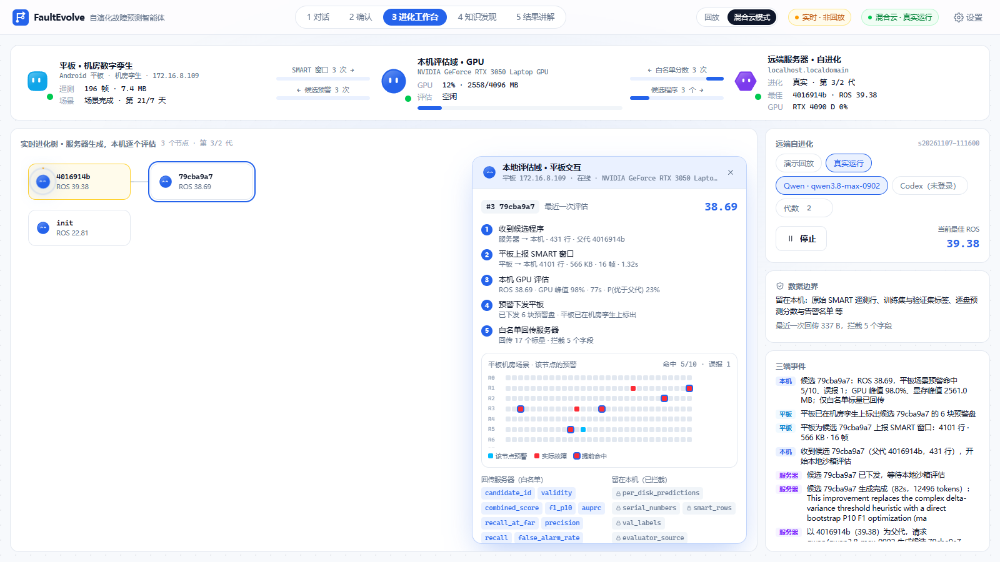

平板收到该候选的预警：蓝色为预警盘，红色为实际故障盘，卡片显示"ROS 38.69 · 预警 6 块 · 提前命中 5/10 · 误报 1"：

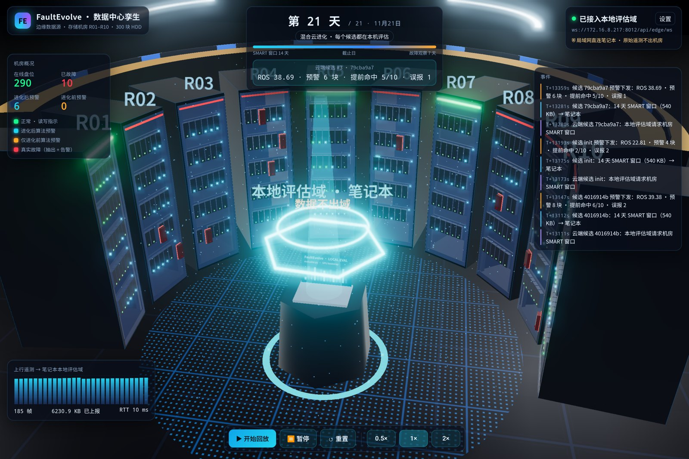

会话结束时的进化树（4 个节点，`1cda104a` 标为无效并显示错误类型）与平板最终画面：

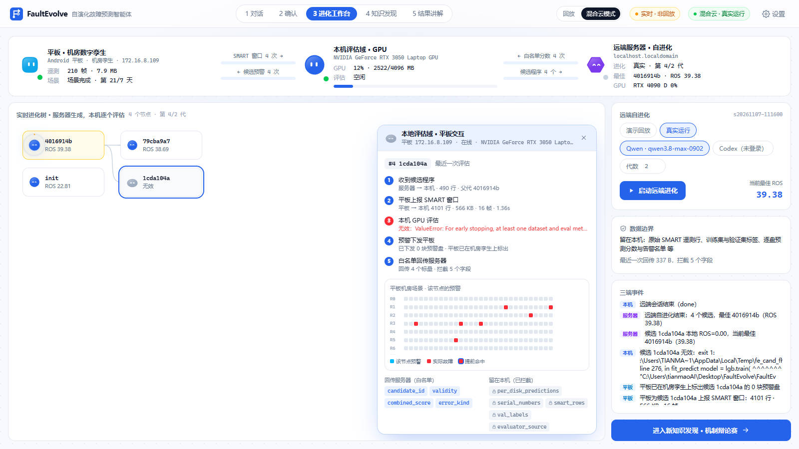

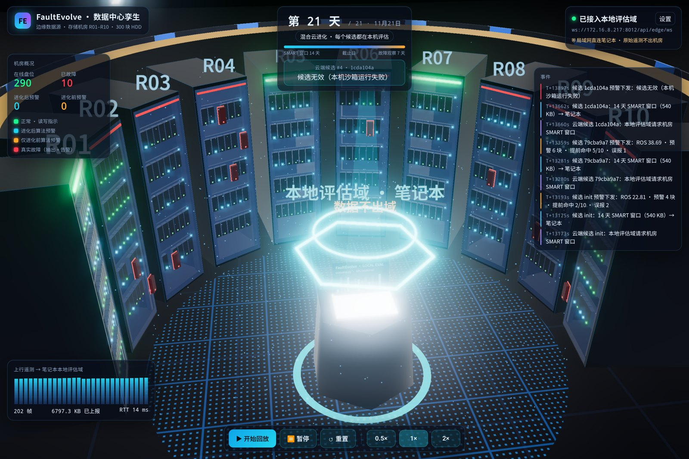

### D4. 本机 GPU 占用

评估期间用 `nvidia-smi` 每 0.5 s 采样，按会话事件时间线着色（蓝 = 本机评估某个候选，紫 = 服务器调用 Qwen 生成）：

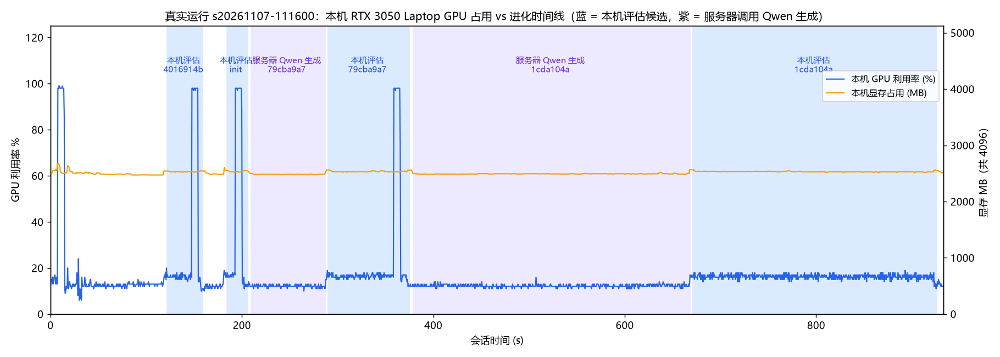

读图要点：

- **评估前段（构建场景、跑候选程序的特征与 LightGBM 训练）主要吃 CPU**，GPU 利用率约 15%，与空闲时（约 12%，桌面与浏览器渲染）差别不大。
- **评估末段的 GPU bootstrap 置信区间计算把 GPU 打满到 98–99%**，持续几秒到十几秒：`4016914b`、`init`、`79cba9a7` 各一次尖峰。
- `1cda104a` 在训练阶段就抛错，没走到 bootstrap，所以整段没有尖峰。
- 显存稳定在 2.5–2.7 GB / 4 GB，4 GB 笔记本 GPU 足够。
- 等待服务器 Qwen 生成的紫色区间里，本机 GPU 空闲，这段时间是整轮耗时的大头（82 s 和 292 s）。
- 约 10 s 处的尖峰发生在第一个候选下发之前，不对应任何候选评估（推测是启动阶段的 CUDA 初始化或自检）。
