# FaultEvolve 技术文档

**自演化故障预测智能体：云端进化 · 本地评估 · 边缘数字孪生**

| 项 | 内容 |
|---|---|
| 作品名称 | FaultEvolve · 自演化故障预测智能体 |
| 代码仓库 | <https://github.com/houchenfeng/FaultEvolve-ResearchAssistant>（`main` 分支） |
| 运行形态 | Web 前端（EvoBot 路演 + 经典工作台）、Python 后端（FastAPI + `fe` CLI）、远端自进化器（GPU 服务器）、安卓平板 APK（机房数字孪生） |
| 主要场景 | 数据中心硬盘（HDD）故障提前预警；同一引擎可迁移到 SSD、内存（SmartMem）等低异常事件预测任务 |
| 配套文档 | 操作指南 `docs/guide/README.md`、真实运行手册 `docs/REAL_RUN.md`、交接文档 `docs/handoff/edge-hybrid-demo.md` |

---

## 目录

1. [作品概述](#1-作品概述)
2. [创新点](#2-创新点)
3. [总体架构](#3-总体架构)
4. [模块详解：功能与交互](#4-模块详解功能与交互)
5. [模型说明](#5-模型说明)
6. [接口与协议](#6-接口与协议)
7. [评估体系与实验结果](#7-评估体系与实验结果)
8. [安全与数据边界](#8-安全与数据边界)
9. [部署与运行](#9-部署与运行)
10. [局限与展望](#10-局限与展望)

---

## 1. 作品概述

### 1.1 要解决的问题

数据中心每天有大量硬盘、内存、SSD 发生故障，提前预警能避免数据丢失与业务中断。但这类任务有三个难点：

1. **样本极不均衡、评估噪声大**：故障盘不足 4%，同一算法换一次随机种子分数就会波动几个点，"涨点"很可能只是运气。
2. **算法迭代依赖专家经验**：特征、模型、阈值、告警策略的组合空间巨大，人工调参慢，且经验难以沉淀和迁移。
3. **数据不能出域**：真实设备遥测与故障标签属于敏感运维数据，不能上传到云端大模型或第三方平台。

### 1.2 作品做了什么

FaultEvolve 把"算法改进"当作"科学发现"来做：

- **云端自进化**：大模型（Qwen / Codex）在 GPU 服务器上不断提出候选算法（完整可运行的 Python 程序），由进化引擎组织成进化树，按噪声感知的方式选择下一步扩展哪个节点。
- **本地评估**：每个候选都下发到本地，用冻结的 `evaluator.py` 在本地数据上打分；只有白名单里的标量分数回传云端，原始数据、标签、逐盘预测一律不出域。
- **边缘数字孪生**：安卓平板模拟 300 块盘的机房，每个候选评估前都由平板实时上报 14 天 SMART 窗口，评估后把该候选的预警盘下发平板显示，形成"设备 → 本地 → 云端 → 本地 → 设备"的闭环。
- **知识发现**：在进化过程中提出"什么有效、为什么有效"的可证伪假设，经预注册、统计检验、多 Agent 机制辩论后判级（CONFIRMED / 候选 / 证伪），沉淀成可追溯、可迁移的知识。
- **可解释交付**：EvoBot 讲解员把最终方案、提升幅度、改进点、新知识和复现清单按五步讲清楚，并能一键导出报告与最优代码。

### 1.3 核心结果一览

| 实验 | 结果 |
|---|---|
| HDD 三岛进化（`hdd_mvp_showcase_c89e2a01`） | ROS 22.81 → **36.50**（+60.0%），评估 33 个候选 |
| HDD 最佳候选（`hdd_mvp_formal2b_20261009` / `4016914b`） | 验证集 ROS **39.38**，超过人工参考约 33.7；规则基线仅 12.94 |
| 混合云真实自进化（`s20261107-062614` / `52055201`） | 服务器调用 Qwen 两代，ROS 39.38 → **41.78**（+2.40），全程数据不出本地 |
| 平板机房场景（10 块真实故障盘） | 提前捕获 2/10 → **6/10**，误报 2 → 2 |
| 论文组合进化（`paper_combinations_b02_20261106`） | 发现 CAF 融合算子，Q2 精确率 **64.71%**、误告率 0.0301% |
| 新知识 | "窗口末端归一化 SMART 194 与短期故障正相关"判级 **CONFIRMED**（n = 9,262，效应 0.3124，95% CI [0.278, 0.346]） |
| 噪声控制 | 假涨点率约 15% → 约 3%；Jev 预筛节省 30%–50% 无效评估 |
| 混合云实测 | 服务器 2× RTX 4090 D 经跳板机自进化；笔记本 RTX 3050 评估峰值 98–100%；平板每个候选一次双向交换（4101 行 / 约 566 KB / 约 1.3 s） |

---

## 2. 创新点

### 创新点 1：知识引导的岛屿群演化（KGTE）

- **多岛并行，保持多样性**：时序特征岛、模型集成岛、运维阈值岛各自沿不同方向探索，避免所有候选挤在同一个局部最优。
- **岛内树演化 + 三层反思**：每座岛维护一棵假设树。每次扩展后，引擎比较父子差异，在实现层（代码哪里错了）、设计层（方法是否合适）、假设层（方向是否成立）三个层次反思，并写入分支记忆（`cloud/insights.py`）。
- **知识卡片注入（ERA）**：从文献与专家经验抽取知识卡片，按先验优先级、标签匹配、采纳后分数增量的贝叶斯均值和 UCB 探索奖励检索（`knowledge/retriever.py`），同一类别最多注入 2 张，本分支已证伪的卡片不再推荐。
- **岛间只交换"意图"和"教训"**：最佳方案的改进意图、失败经验（"此路不通"）在岛间传播，前端用绿 / 红跨岛连线可视化。
- **效果**：开启知识注入后，有效改进率从 30% 提升到 50%。

### 创新点 2：Jev 引导的噪声感知树搜索（J-PUCT）

低异常事件数据上，单次评估噪声大，传统 UCT 容易被"运气好"的候选带偏。J-PUCT 做了两处改动：

```text
a* = argmax_{a : Δ(a) > τ} [ Q(s,a) + c_puct · P_jev(a) · √N(s) / (1 + N(s,a)) ]
```

- **先验换成 Jev 结构化评审**：`P_jev(a)` 是 Jev 模型判断"该候选能涨点"的概率（`cloud/judge.py`、`cloud/jev_client.py`），评审失败时自动退化为均匀先验（fail-open），不阻塞进化。
- **bootstrap 动态阈值门 τ**：只有相对父代的增量超过噪声带（由 F1 bootstrap 标准差估计，`tasks/hdd_adapter.py`）才视为真实改进。
- **渐进加宽 + max-backup**：控制树的宽度，把子树最好分数向上传播（`cloud/selection.py`、`cloud/tree.py`）。
- **效果**：Jev 预筛跳过 30%–50% 的无效评估；假涨点率从约 15% 降到约 3%。评分唯一来源始终是本地 `evaluator.py`。

### 创新点 3："现象 → 机理 → 原理"三层知识发现（PMP Discovery）

| 层次 | 做法 | 代码 |
|---|---|---|
| 现象层（KD1） | 提出可证伪主张；先写预注册哈希再看数据；bootstrap 置信区间、排列检验 p 值、e 值三重门槛；新颖性检查（不能是文献已知结论） | `discovery/claims.py`、`stats.py`、`novelty.py`、`pipeline.py` |
| 机理层（KD2） | 候选机制在固定赛制中两两对局，由数据裁决；支持方、混杂方、批评方、统计裁判、总裁判多 Agent 交叉质询；胜者获得否证证书 | `discovery/tournament.py`、`certificates.py`、`mechanisms.py` |
| 原理层 | 跨时间切片、跨数据集外推，通过后才写入可迁移知识库；BH / e-BH 双轨多重检验控制错误发现率 | `discovery/promotion.py`、`grading.py`、`replay.py` |

系统把"找到一个相关特征"提升为"带边界、可回放、可升级检验的知识主张"，并且不夸大：证据只到相关性时，结论就写成"近端风险指示器"，不写成因果定律。

### 创新点 4：论文组合进化（以最新 SOTA 论文为初始解）

- 每篇可运行的论文（TabM、TabICLv2、ModernNCA、Mitra-v2）是一座岛；组合节点长在宿主父算法的岛里，另一父代以跨岛飞线汇入。
- 三种命名融合算子：**ERE** 等权风险集成 `(p+q)/2`、**CAF** 共识一致性融合 `√(pq)`、**ADPF** 自适应分歧惩罚 `σ(αz − λ|Δz|)`。
- 晋升必须在两个季度（Q1 / Q2）同时通过 5 项冻结检查：精确率高于双父、误告不高于双父、误告 ≤ 0.2%、召回保护、告警 ≥ 10 次。14 个组合中只有 TabM × Mitra-v2 · CAF 晋升。

### 创新点 5：云-本地-边缘三域混合，数据零出域

- **服务器只做生成**：经 SSH 跳板机在 GPU 服务器上运行无依赖的自进化器，只拿到代码和分数。
- **评估只在本机**：笔记本在平板实时上报的机房场景和完整验证集上评估候选，GPU 做 10 万次配对 bootstrap 给出噪声带和提升概率。
- **白名单闸门**：`edge/boundary.py` 的 `gate()` 是本地到云端的唯一出口，只放行 18 个标量字段，其余一律拦截并在界面上逐项列出被拦截的字段。
- **边缘设备参与每一个候选**：每个候选评估前向平板请求窗口，评估后把预警盘下发平板并等待 ACK，进化与设备数据同步。

### 创新点 6：可解释、可复现的交付

- **讲解员按证据讲**：结果讲解的每一句都来自运行制品（`tree.json`、`run_summary.json`、`discovery/*.json`），回放服务从不重算或编造分数（`webapi/replay_service.py`）。
- **一键复现**：导出 Markdown 报告、下载最优代码，复现清单列出数据版本、评估器、种子、命令。
- **12 个 Agent Skills**：进化、发现、报告、数据准备全链路能力以 `SKILL.md` 形式开放，可被 Cursor / Claude Code 等 Agent 直接调用。

---

## 3. 总体架构

### 3.1 系统架构图

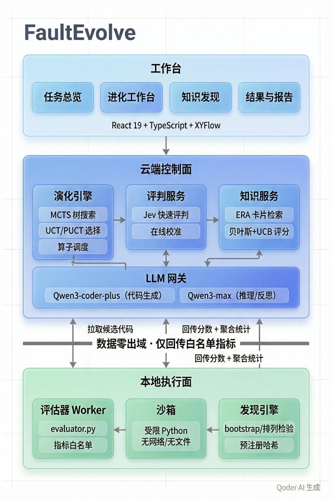

### 3.2 三域部署拓扑

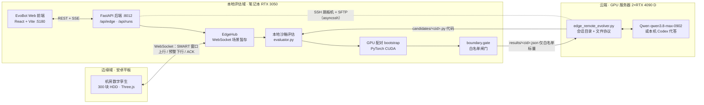

### 3.3 一个候选的完整生命周期

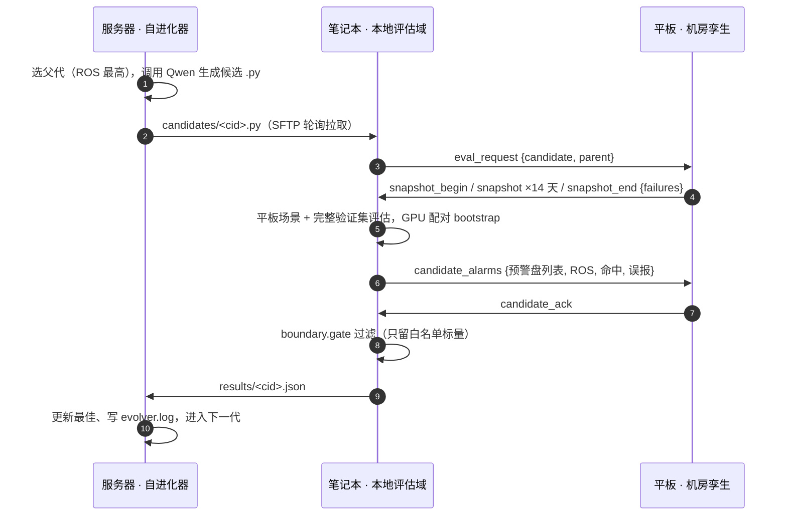

### 3.4 分层与技术栈

| 层 | 技术 | 说明 |
|---|---|---|
| 前端 | React 19、TypeScript、Vite、Tailwind CSS 4、motion、XYFlow、TanStack Router / Query | EvoBot 路演 5 幕 + 经典工作台 `/overview` |
| 平板 | Vite + Three.js、Capacitor 7（Android APK） | 机房数字孪生，环形 / 平行两种布局，WebSocket `/api/edge/ws` |
| 后端 | Python 3.12、FastAPI、Pydantic、Typer（`fe` CLI）、REST + SSE | 运行管理、回放、混合模式接口 |
| 进化引擎 | `faultevolve.cloud.*` | KGTE、J-PUCT、算子、反思、知识注入、预算 |
| 知识发现 | `faultevolve.discovery.*` | 预注册、统计检验、机制辩论、判级、晋升 |
| 混合模式 | `faultevolve.edge.*`、asyncssh | 远端会话、本地评估、平板 Hub、GPU bootstrap、白名单 |
| 大模型 | Qwen / DashScope（OpenAI 兼容、流式）、Codex CLI、MiYang Jev | 候选生成、反思、评审 |
| 算法 | NumPy、Pandas、scikit-learn、LightGBM、PyTorch CUDA | 候选程序与评估 |

### 3.5 仓库结构

```text
FaultEvolve-ResearchAssistant/
├── src/faultevolve/
│   ├── cloud/        # 进化引擎：engine / selection(J-PUCT) / operators / insights / judge(Jev) / llm / budget / tree / store
│   ├── discovery/    # 知识发现：claims / stats / novelty / tournament / certificates / grading / promotion / pipeline
│   ├── knowledge/    # 知识卡片加载与检索（ERA 注入）
│   ├── edge/         # 混合模式：remote / local_eval / hub / gpu / boundary / models
│   ├── tasks/        # 任务适配器：HDD / Backblaze / 阿里 SSD / SmartMem
│   ├── webapi/       # FastAPI：运行管理、回放、事件流、知识、服务器档案、edge 路由
│   ├── optimization/ # 超参搜索、补丁、消融、实验台账
│   ├── data/         # 时间切分、事件采样、外排序、数据清单
│   ├── worker/       # 本地评估执行器
│   └── cli.py        # fe 命令行
├── web/src/features/evodemo/   # EvoBot 路演前端（对话 / 确认 / 工作台 / 知识发现 / 结果讲解）
├── web/src/features/hybrid/    # /api/edge 客户端与混合模式组件
├── edge-tablet/                # 平板机房孪生（网页 + Android 工程）
├── scripts/                    # showcase_serve.py / edge_remote_evolver.py / edge_demo.ps1
├── benchmark/                  # 任务四件套：problem.md / prompt.md / init.py / evaluator.py
├── skill/                      # 12 个 Agent Skills
├── showcase/                   # 可回放的真实运行制品
└── docs/                       # 截图、视频、操作指南、本技术文档
```

---

## 4. 模块详解：功能与交互

本节按模块说明"做什么、怎么做、用户怎么用、和谁交互"。前端五幕（M1–M5）是用户直接看到的流程，M6–M11 是支撑它的后端、混合云与设备模块。

### M1 对话：发起进化任务

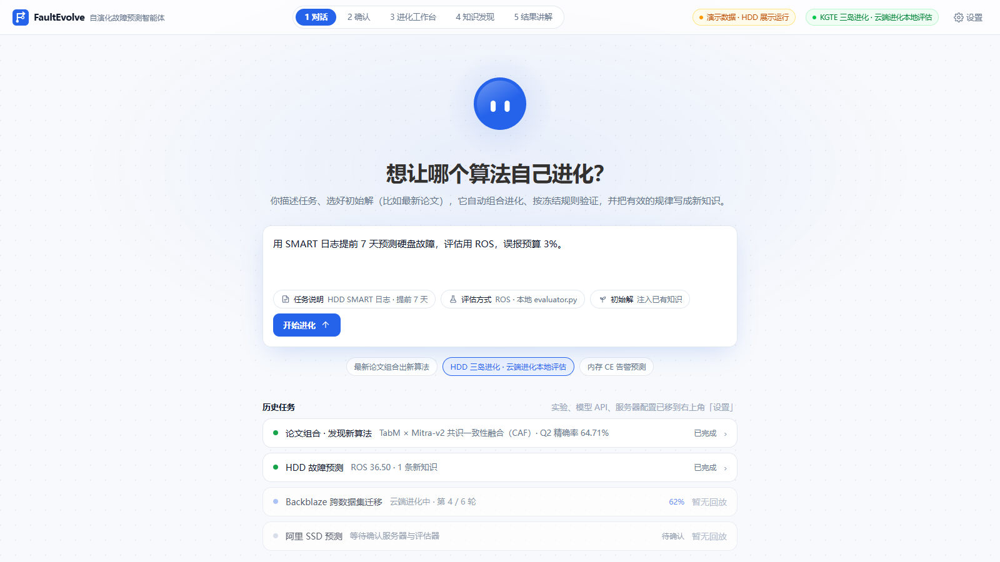

- **功能**：用一句话描述任务（例如"预测未来 7 天会故障的硬盘，误告率尽量低"），或点击示例任务（HDD 三岛进化、最新论文组合出新算法）。可选初始解来源：最新 SOTA 论文、注入已有知识、基线算法、上传代码。下方列出历史任务，可直接打开回看。
- **交互**：输入框 + 示例卡片 + "开始进化"按钮；没有回放数据的历史项显示"暂无回放"并禁用。
- **实现**：`web/src/features/evodemo/screens/HomeScreen.tsx`；任务目录遵循四件套 `problem.md` / `prompt.md` / `init.py` / `evaluator.py`（`benchmark/hdd_mvp/`）。

### M2 确认：方案核对与运行方式

| 回放真实实验 | 混合云 · 真实运行 |
|---|---|
| 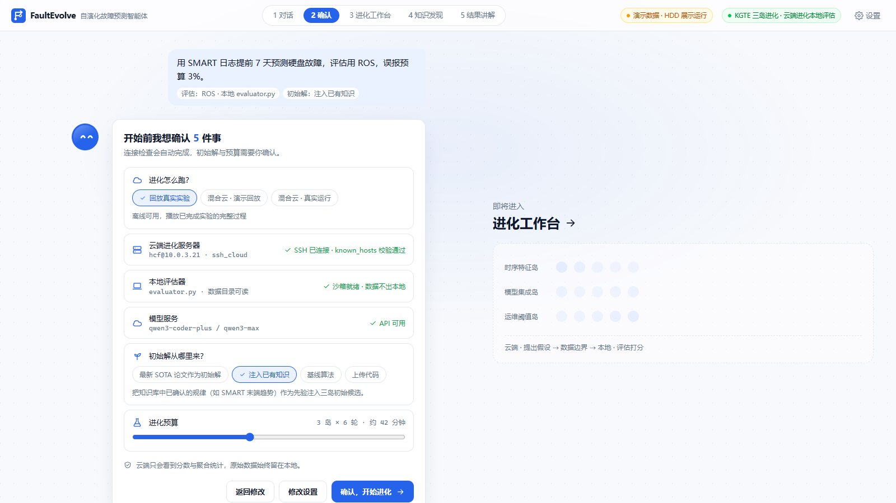 | 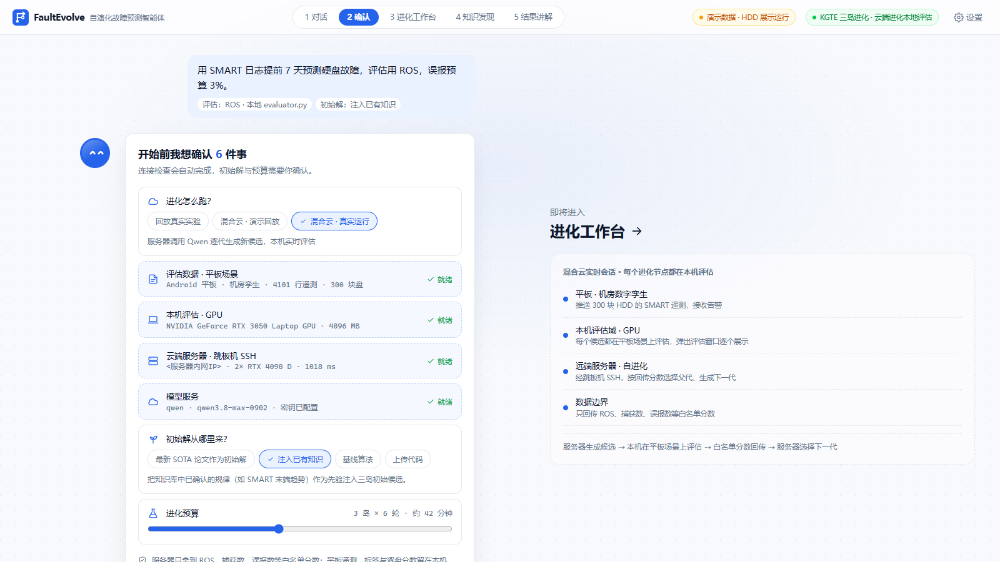 |

- **功能**：智能体把任务转成实验方案并要求用户确认 5 件事：云端进化服务器、本地评估器（沙箱就绪、数据不出本地）、模型服务、初始解来源、进化预算（3 岛 × 6 轮）。
- **运行方式三选一**：
  - **回放真实实验**：离线可用，回放已完成的真实运行。
  - **混合云 · 演示回放**：服务器按顺序回放已记录的真实候选，不调用大模型，本机仍做真实 GPU 评估。
  - **混合云 · 真实运行**：服务器调用 Qwen / Codex 逐代生成新候选。
- **实时自检**：选混合云后自动探测四项并显示状态：平板场景是否在线、本机 GPU、跳板机 SSH（含服务器 Python 与 GPU 型号）、模型服务。
- **实现**：`ConfirmScreen.tsx`、`LiveChecks.tsx`（`RunModePicker` + 自动探测），后端 `POST /api/edge/remote/probe`。

### M3 进化工作台

#### 回放模式：KGTE 三岛协同进化

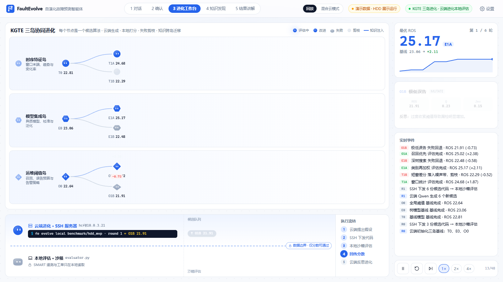

- **功能**：三条泳道分别是时序特征岛、模型集成岛、运维阈值岛，节点按轮次逐个长出。蓝线表示知识注入，红线表示注入失败回退；跨岛连线表示岛间知识交换。
- **交互**：点节点查看 ROS、Q 稳定性、Jev 评审分、采用的知识卡片、反思；底部"执行流转"展示"云端提出假设 → SSH 下发代码 → 本地沙箱评估 → 回传分数 → 云端反思"；可暂停、重播、1×–4× 倍速。
- **实现**：`WorkbenchScreen.tsx`（KGTE）与 `PaperWorkbenchScreen.tsx`（论文组合），数据由 `webapi/replay_service.py` 从运行制品只读回放。

#### 混合云模式：实时进化树 + 本地评估子窗口

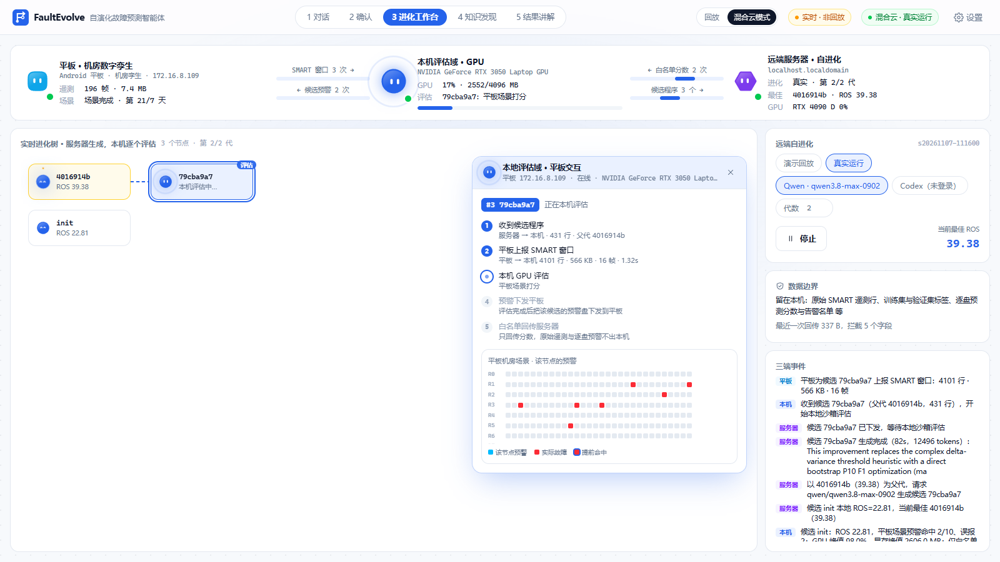

- **顶部三端状态**（`TriDomain`）：
  - **平板**：在线状态、帧数、流量、SMART 窗口上报次数、候选预警下发次数。
  - **本机评估域**：GPU 实时利用率与显存、当前评估的候选。
  - **远端服务器**：运行模式、当前代数、最佳候选、服务器 GPU。
  - 三者之间的连线在数据交换时点亮。
- **实时进化树**（`LiveTree`）：服务器每写出一个候选就长出一个节点，正在评估的节点用虚线边标出，点节点可以固定查看。
- **本地评估域 · 平板交互子窗口**（`LocalEvalWindow.tsx`）：
  - **跟随节点**：默认跟随当前正在评估的节点，点"跟随最新"恢复同步；窗口可拖动、可关闭。
  - **五步流水**：①收到候选程序（服务器 → 本机，行数、父代）→ ②平板上报 SMART 窗口（行数、KB、帧数、耗时）→ ③本机 GPU 评估（ROS、命中、误报或错误类型）→ ④预警下发平板（预警盘数、ACK）→ ⑤白名单回传服务器（回传字段数、拦截字段数）。
  - **平板机房场景**：该节点预警的盘为蓝色，真实故障为红色，提前命中为红色加环。
  - **数据边界**：分两列列出"已回传（白名单）"和"留在本机（已拦截）"的字段名。
- **右侧控制**：演示回放 / 真实运行、提供方（Qwen / Codex）、代数、启动 / 停止；三端事件流逐条记录上下行。
- **实现**：`LiveWorkbenchScreen.tsx`、`hybrid-parts.tsx`；数据来自 `GET /api/edge/remote`（每 2 秒轮询）与 `GET /api/edge/gpu`。

### M4 知识发现：机制辩论赛

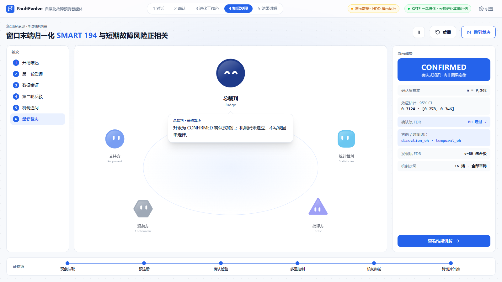

- **功能**：对进化中出现的规律（例如"窗口末端归一化 SMART 194 与短期故障正相关"）走完"现象 → 机理 → 原理"流程：预注册、确认集检验、多 Agent 辩论、对立机制对局、时间外推，最后由总裁判判级。
- **交互**：左侧 6 轮流程；中间支持方、混杂方、批评方、统计裁判、总裁判依次发言；右侧给出样本量、效应、置信区间、BH / e-BH 结果；可"跳到裁决"。
- **实现**：`TournamentScreen.tsx`；后端 `discovery/pipeline.py`、`tournament.py`，产物在 `showcase/runs/<run>/discovery/`（`phenomena.json`、`preregistration.json`、`mechanisms.json`、`tournament_results.json`、`certificates.json`、`theories.json`）。

### M5 结果讲解与导出

| 讲解 | 可复现性与导出 |
|---|---|
| 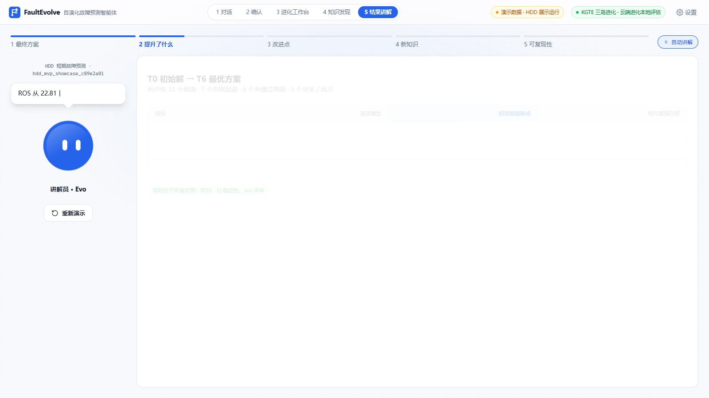 | 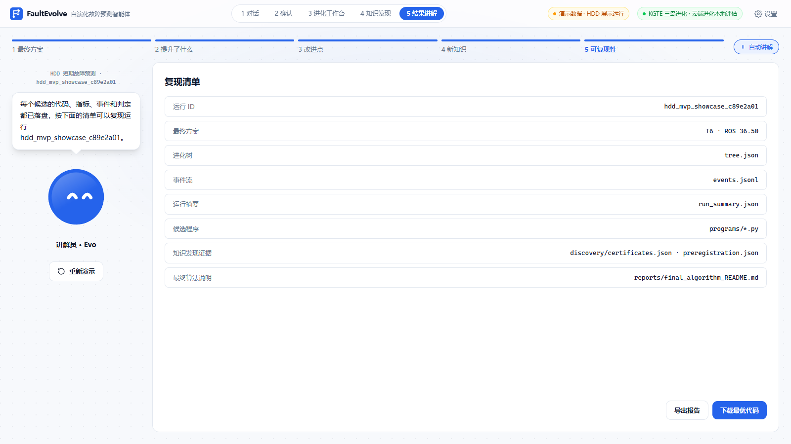 |

- **功能**：EvoBot 讲解员按五章自动讲解：最终方案、提升了什么、改进点（有机制解释时为"本质创新"）、新知识、可复现性。
- **交互**：自动翻章，也可点章节跳转；"可复现性"一章提供"导出报告"（Markdown）和"下载最优代码"（运行制品中的最佳程序）。
- **实现**：`ResultsScreen.tsx`、`report.ts`（从运行制品构建报告，`narrate()` 生成讲解词）、`report-export.ts`。

### M6 进化引擎（云端）

- **主循环**（`cloud/engine.py`）：选节点 → 选算子 → 组装提示（父代代码、分项指标、错例画像、分支记忆、已证伪假设、岛外正 / 负经验、知识卡片、约束）→ 调用大模型生成候选 → 静态检查与自动修正（`common/precheck.py`、`codecheck.py`）→ 评估 → 三层反思 → 回传分数与洞见。
- **算子**（`cloud/operators.py`）：

| 算子 | 作用 |
|---|---|
| REFINE | 针对错例画像中最主要的误告 / 漏告来源做最小必要修改 |
| RECALL_FOCUS | 只改特征工程或模型，提升漏告分组的召回，禁止动阈值 |
| THRESHOLD_CALIBRATE | 只改告警阈值决策（折外预测选阈值或分位数定比例），禁止读标签 |
| INJECT | 落地一张知识卡片，并在 `adopted_cards` 中声明 |
| TRANSPLANT | 把其他分支 / 岛的有效经验移植过来 |
| CROSSOVER | 两个父方案合成一个程序（rank-average 或 stacking） |
| REPAIR | 修复运行时错误或超时 |
| PATCH | 用 SEARCH/REPLACE 补丁做单模块最小修改 |

  算子按 Beta-Thompson 老虎机自适应选择；每个候选必须先输出 `<hypothesis>`（改什么、为什么能提分），使进化过程可解释。
- **选择**（`cloud/selection.py`）：UCT + 渐进加宽 + max-backup，Jev 先验接口（J-PUCT）。
- **预算**（`cloud/budget.py`、`common/metering.py`）：token 预算与调用计量，超预算自动停止并记录原因。
- **存储**（`cloud/store.py`）：SQLite（`fe.db`）记录节点、评估、洞见、大模型调用、卡片统计；同时写 `tree.json`、`events.jsonl`、`programs/`、`run_summary.json`。

### M7 本地评估器与沙箱

- **任务评估器**（`benchmark/hdd_mvp/evaluator.py`）：以子进程运行候选程序（`--data-dir --split --out`），校验输出覆盖、无重复、分数有限、告警为 0/1；静态检查禁止路径回溯、目录遍历、子进程、网络；超过 900 秒判无效。
- **候选在本地被评两次**（`edge/local_eval.py`）：
  1. **平板场景**：平板实时上报的 300 块盘 14 天窗口，作为 `test` 切分运行，结果是"第 15–21 天真实故障中提前预警了几块、误报几块"。
  2. **完整验证集**：官方 ROS，加上与父代逐盘预测的 GPU 配对 bootstrap。
- **GPU 配对 bootstrap**（`edge/gpu.py`）：在 GPU 上对验证集重采样数万次，得到前后指标的噪声带和 P(after > before)，作为显著性证据（标量）回传，帮助云端区分真实改进与噪声；它从不替代官方分数。
- **失败也回传**：候选崩溃时只回传 `error_kind`（异常类名 + 行号，不含消息正文），避免错误信息里夹带数据。

### M8 混合云：远端自进化器与 SSH 会话

- **服务器端**（`scripts/edge_remote_evolver.py`）：
  - **运行方式**：无第三方依赖，`setsid nohup` 后台运行，断开 SSH 也会继续。
  - **会话目录文件协议**：`candidates/<cid>.py|json`（候选与元信息）、`results/<cid>.json`（本地回传分数）、`status.json`、`events.jsonl`、`evolver.log`、`llm_requests/`、`llm_responses/`、`STOP`（写入即在当前步骤后停止）。
  - **两种模式**：`demo` 按顺序回放 `seeds/` 与 `replay/` 中的真实候选，不调用大模型；`real` 以 `init` / `4016914b` 为种子，每代选当前最佳为父代，调用 Qwen 生成新候选（超时自动重试）。
- **笔记本端**（`edge/remote.py`）：
  - **连接**：用 asyncssh 经跳板机隧道连接服务器。
  - **部署**：用 SFTP 部署会话目录，只传代码和任务说明，从不传数据。
  - **轮询与回传**：轮询新候选并本地评估，写回 `results/<cid>.json`。
  - **Codex 提供方**：服务器把提示写到 `llm_requests/`，由本机 `codex exec` 代答（ChatGPT 登录态不出本机）。
  - **错误说明**：`describe_ssh_error()` 把常见 SSH 错误（如反向隧道断开导致的 `ChannelOpenError`）翻译成可操作的中文提示。
- **密钥管理**：Qwen 密钥只在本机 `.env` 与服务器 `~/.fe_edge/<session>.env`（600 权限），不进仓库、不写 NAS。

### M9 本地评估域 EdgeHub（平板连接）

- **功能**（`edge/hub.py`）：
  - **连接**：接入平板 WebSocket，维护连接状态（`tablet_linked`）。
  - **场景暂存**：暂存平板上报的机房清单与遥测。
  - **候选交换**：为每个候选驱动一次"请求窗口 → 接收窗口 → 下发预警 → 等待 ACK"的交换。
- **跨线程设计**：远端会话运行在独立线程和事件循环中。`hub.push` 通过 `loop.call_soon_threadsafe` 把消息投进 WebSocket 发送队列；`hub.exchange` 用 `threading.Event` 等待平板响应（窗口 30 秒、ACK 10 秒超时）。平板不在线时自动改用本机已有场景评估，流程不中断。
- **模拟器**：无平板时可在子窗口点"模拟平板推送"，用同一份场景数据代替；模拟器不会覆盖真实平板。
- **测试**：`tests/edge/test_hub_exchange.py` 覆盖跨线程往返与无平板两种情况。

### M10 平板机房数字孪生（APK）

| 环形布局（初始回放） | 平行布局（冷热通道） | 故障特写 |
|---|---|---|
| 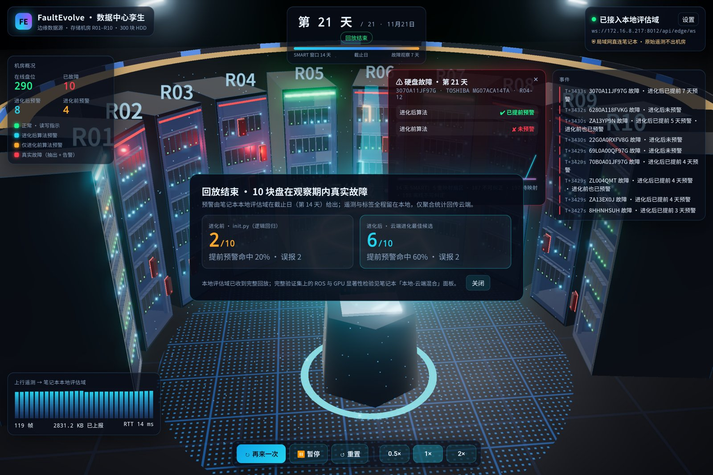 | 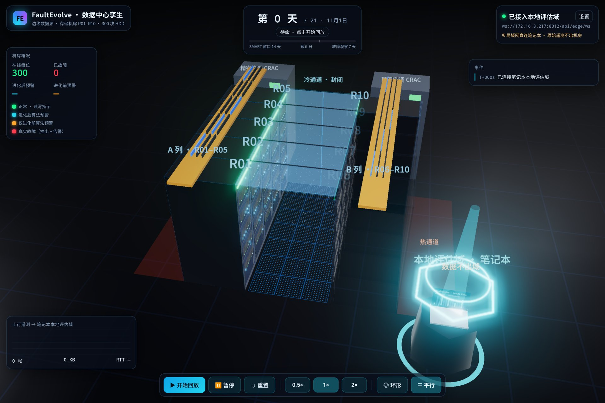 | 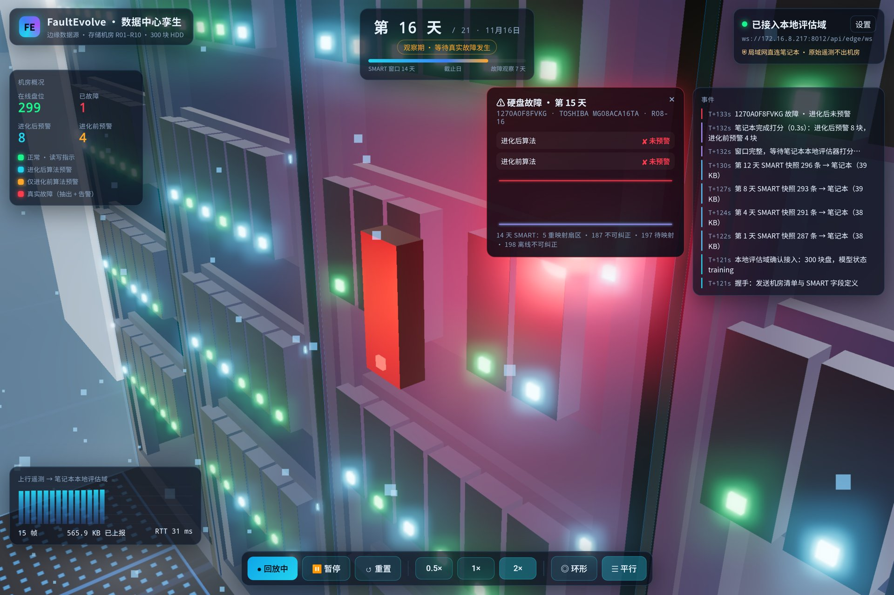 |

- **场景**：R01–R10 共 10 个机柜、300 块 HDD（30 盘位 / 柜），每块盘有托架、状态灯、告警光晕；顶部为天数时间线，左侧为机房概况，右侧为事件流，底部为控制栏。
- **两种布局**（底部"◎ 环形 / ☰ 平行"切换，带动画）：
  - **环形**：机柜围绕本地评估节点，强调"数据只在本地域流动"。
  - **平行**：贴近真实机房。A / B 两列正面相对，中间是封闭冷通道（玻璃顶、端门、地板送风），背后是热通道，上方走线架，远端精密空调。
- **视角不被遮挡**：挡在视线上的机柜、空调、走线架会自动淡化为虚影；故障特写时镜头进入冷通道，画面左移避开详情卡片；拖动视角不会误触点选。
- **两种工作方式**：
  - **初始回放**：按天推送 SMART 遥测（14 天窗口 + 7 天观察），第 14 天收到进化前 / 进化后两套算法的预警，观察期内真实故障盘抽出并红色告警，最后汇总"进化前 2/10 → 进化后 6/10"。
  - **混合云进化**：每个云端候选到来时上报一次窗口，接收并显示该候选的预警盘，顶部卡片显示"ROS · 预警 N 块 · 提前命中 x/10 · 误报 y"。
- **实现**：`edge-tablet/src/scene.ts`（Three.js 场景、布局、遮挡淡化）、`hud.ts`（界面）、`link.ts`（WebSocket，按 `ack` 测 RTT）、`main.ts`（流程编排）；Capacitor 打包 APK。

### M11 经典工作台、CLI 与 Agent Skills

- **经典工作台**（`/overview`）：任务管理、进化树、代际时间轴、知识证据链、结果与审计导出，与路演前端共用后端。
- **`fe` CLI**（`cli.py`）：`fe doctor` 自检、`fe evolve local <task>` 本地进化（`--mock` 无密钥冒烟）、运行恢复与追加轮次。
- **运行管理**（`webapi/run_control.py`）：先做就绪检查再创建进程；注册表先于响应写入；不支持安全暂停时如实返回 409，不假装暂停。
- **Agent Skills**（`skill/`）：`fe-evolve-manager`、`fe-operators`、`fe-crossover-ensemble`、`fe-jev-screening`、`fe-node-value-budget`、`fe-knowledge-injection`、`fe-knowledge-discovery`、`fe-error-analysis`、`fe-data-checkup`、`fe-dataset-adapters`、`fe-event-data-preparation`、`fe-report-generation`。

---

## 5. 模型说明

| 模型 | 位置 | 角色 | 输入 → 输出 | 约束 |
|---|---|---|---|---|
| **Qwen**（DashScope，默认 `qwen3.8-max-0902`） | 服务器（真实运行）或本机引擎 | 候选生成、三层反思、洞见抽取 | 父代代码 + 指标 + 错例画像 + 记忆 + 知识卡片 → 新候选程序与假设 | OpenAI 兼容流式接口，重试、计量、缓存（`cloud/llm.py`）；只看代码与标量 |
| **Codex CLI**（本机 ChatGPT 登录） | 本机 | 可选的候选生成提供方 | 服务器写入的提示 → 本机 `codex exec` 代答 | 登录态不出本机 |
| **MiYang Jev** | 云端评审 | J-PUCT 先验、候选预筛 | 候选摘要 → "能涨点"概率 | 失败时退化为均匀先验 |
| **候选预测模型**（进化产物） | 本机沙箱 | 硬盘故障打分与告警 | 14 天 SMART 历史 → `score` + `alarm` | 900 秒、禁网络 / 子进程 / 越权读文件 |
| `init.py` 基线 | 本机 | 进化起点 | cutoff 当天 10 个 SMART 值（log1p）+ 厂商 one-hot → 加权逻辑回归 | 验证集 ROS ≈ 22.81 |
| `rule_baseline.py` | 本机 | 对照 | SMART 5/187/197/198 非零即告警 | ROS ≈ 12.94 |
| **最佳候选 `4016914b`** | 本机 | 当前最优 | 14 天 SMART 窗口（raw 取 log1p、normalized 截断）+ 关键错误计数的窗口变化特征 → 3 折分层、多组超参的 LightGBM 集成（正样本加权）→ 折外预测选阈值并按分位数控制告警比例 | 验证集 ROS 39.38，平板场景 6/10、误报 2 |
| **混合云最佳 `52055201`** | 本机 | 当前最优（远端 Qwen 两代进化所得） | 在 4016914b 基础上：加权 bootstrap F1 第 10 百分位直接选阈值等改进 | 验证集 ROS 41.78，平板场景 5/10、误报 2 |
| **GPU 配对 bootstrap** | 本机 RTX 3050 | 显著性证据 | 前后两版逐盘预测 → 噪声带、P(提升) | 只回传标量 |

---

## 6. 接口与协议

### 6.1 REST / SSE（后端 `:8012`）

| 分组 | 接口 | 说明 |
|---|---|---|
| 运行 | `GET/POST /api/runs`、`GET /api/runs/{id}`、`/live`、`/cancel`、`/pause`、`/resume`、`/rounds` | 创建、查询、取消、恢复、追加轮次 |
| 进化树 | `GET /api/runs/{id}/tree`、`/nodes/{node_id}` | 节点结构、代码、评估、洞见 |
| 事件 | `GET /api/runs/{id}/events`、`/stream`（SSE）、`/scores`、`/leaderboard` | 事件回放与实时流 |
| 知识 | `GET /api/runs/{id}/knowledge/cards`、`/insights`、`/discovery` | 知识卡片、洞见、发现产物 |
| 制品 | `GET /api/runs/{id}/artifacts`、`/artifacts/{aid}`、`/reports/manifest` | 程序、报告下载 |
| 任务 / 服务器 | `/api/tasks`、`/readiness`、`/card`；`/api/servers`、`/probe`、`/check-path`；`/api/presets` | 任务与服务器档案 |
| 混合模式 | `GET /api/edge/state`、`/gpu`、`/cloud`、`/evaluation`、`/llm`、`/remote` | 三端状态、GPU、远端会话 |
| | `POST /api/edge/evaluate`、`/models/prepare`、`/simulate` | 本地评估、模型准备、模拟平板 |
| | `POST /api/edge/remote/probe`、`/start`、`/stop` | 探测服务器、启动 / 停止远端进化 |

### 6.2 平板 WebSocket `/api/edge/ws`

| 方向 | 消息 | 内容 |
|---|---|---|
| 平板 → 笔记本 | `hello` | 设备、SMART 字段、窗口天数、机房清单（序列号、型号、容量、机柜、盘位） |
| | `telemetry` | 某一天所有盘的 SMART 行 |
| | `failure` / `end` | 盘故障 / 回放结束 |
| | `snapshot_begin` / `snapshot` / `snapshot_end` | 候选评估窗口（清单、逐日快照、故障表） |
| | `candidate_ack` | 已显示该候选的预警 |
| 笔记本 → 平板 | `welcome` / `ack` | 握手 / 逐帧确认（平板据此测 RTT） |
| | `alarms` / `summary` | 初始回放的预警与汇总 |
| | `eval_request` | 请求为某候选上报窗口 |
| | `candidate_alarms` | 该候选的预警盘与成绩 |

### 6.3 服务器会话目录协议

```text
<FE_REMOTE_ROOT>/<session>/
├── config.json  task/  seeds/  replay/  evolver.py
├── candidates/<cid>.py, <cid>.json   # 服务器写：候选代码与元信息（父代、行数、模型、tokens）
├── results/<cid>.json                # 本机写：仅白名单标量
├── llm_requests/  llm_responses/     # 提示与回复（Codex 由本机代答）
├── status.json  events.jsonl  evolver.log
└── STOP                              # 本机写入即停止
```

---

## 7. 评估体系与实验结果

### 7.1 评估指标 ROS（稳健运维分）

```text
combined_score = 100 × (0.5 × F1_p10 + 0.3 × AUPRC + 0.2 × R@FAR) × time_factor
```

- `F1_p10`：对告警结果做 200 次分层 bootstrap，取加权 F1 的 10% 分位数，惩罚靠运气的阈值。
- `AUPRC`：分数的加权平均精度。
- `R@FAR`：误告率不超过 0.2% 时的最大召回。
- `time_factor = min(1, 600 / 运行秒数)`。
- 数据：Backblaze Drive Stats（≥ 4TB，约 44 个型号）；训练 2024Q3、验证 2024Q4、私有测试 2025Q1，严格按时间外推；负样本按机队加权（每个约代表 10 块健康盘）。

### 7.2 主要结果

| 实验 | 结果 |
|---|---|
| HDD 三岛进化 `hdd_mvp_showcase_c89e2a01` | ROS 22.81 → 36.50（+60.0%），33 个候选；Q 稳定性 0.31 → 0.91，Jev 评审 0.42 → 0.94 |
| HDD 最佳运行 `hdd_mvp_formal2b_20261009` | 最佳 `4016914b` 验证集 ROS 39.38，超过人工参考约 33.7 |
| 混合云真实自进化 `s20261107-062614` | 4016914b 39.38 → 5bb6f85a 39.62 → 52055201 **41.78** |
| 混合云真实自进化 `s20261107-124026`（录屏） | 4016914b 39.38 → 6a838741 **40.32** |
| 规则基线 → 最佳 | 12.94 → 41.78 |
| 平板场景 | 提前捕获 2/10 → 6/10，误报 2 → 2 |
| 论文组合 | TabM × Mitra-v2 · CAF：Q1 / Q2 精确率 42.82% / 64.71%，误告率 0.0402% / 0.0301%，双域检查 10/10 |
| SmartMem 跨数据集 | 引擎零改动，dev 44.16 / val 34.48 |
| 噪声控制 | 假涨点率约 15% → 约 3%；Jev 预筛节省 30%–50% 评估 |

### 7.3 新知识

1. **窗口末端归一化 SMART 194 与短期 HDD 故障正相关（CONFIRMED）**：确认集 n = 9,262，效应 0.3124，95% CI [0.278, 0.346]，BH 通过，e-BH 未升级；机制对局 16 场全部欠功率平局；时间外推符号同向但 CI 含 0。结论定位为"近端风险指示器"，不写成因果。
2. **共识一致性融合 CAF 可作为稀有故障告警的筛选信号（候选）**：本质是"共识风险 × 一致性折扣"；证据来自两个开发季度，等待未见季度独立确认。
3. **证伪记忆**：FE01 + FE03（窗口 delta + onset flag）在一次运行中 +8.22，另一次 −11.89，系统用贝叶斯评分自动降权，并作为"此路不通"在岛间传播。

### 7.4 混合云真实运行记录

| 会话 | 模式 | 结果 |
|---|---|---|
| **`s20261107-062614`** | real · Qwen（2 代，27,407 tokens，约 11 分钟） | 4016914b 39.38 → 5bb6f85a 39.62 → **52055201 41.78**（+2.40，平板场景 5/10、误报 2，本机 GPU 峰值 99%；GPU 配对 bootstrap 给出 P(提升) = 0.9925，噪声带 ±4.67） |
| `s20261107-032448` | demo | init 22.81（2/10）、rule_baseline 12.94（8/10，误报 15）、4016914b 39.38（6/10，误报 2） |
| `s20261107-041649` | real · Qwen | 新候选 21.93 / 31.93，一个运行失败（TypeError，只回传错误类型） |
| `s20261107-111600` | real · Qwen | 79cba9a7 38.69（5/10，误报 1，差值在噪声带内不晋升）；1cda104a 无效（LightGBM early stopping 缺验证集） |
| `s20261107-124026`（全程录屏） | real · Qwen（2 代，18,462 tokens，约 11 分钟） | b839195c 37.29；**6a838741 40.32**（父代 4016914b，+0.94，平板场景 6/10、误报 2，P(提升) = 0.836，噪声带 ±4.36） |

`s20261107-062614` 中，远端自进化两代把最优 ROS 从 39.38 推到 41.78：5bb6f85a 用加权 bootstrap 的 F1 第 10 百分位直接选阈值，52055201 在此基础上继续改进。`s20261107-124026` 是提交材料中混合模式录屏对应的那次运行，6a838741 在种子基础上加入更丰富的时序趋势特征（标准差、偏度、近期加速度），取得 40.32。其余会话里大模型的新候选没有超过父代，系统如实保留最优者，不美化结果。

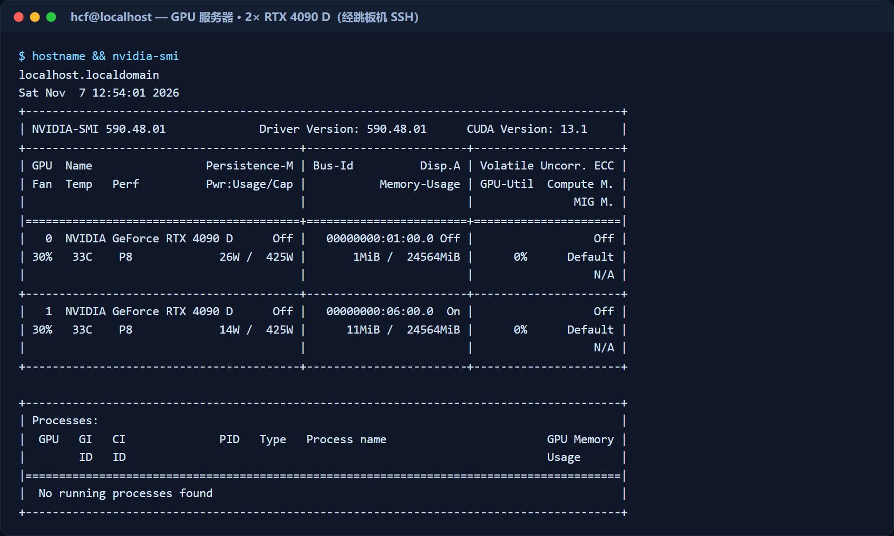

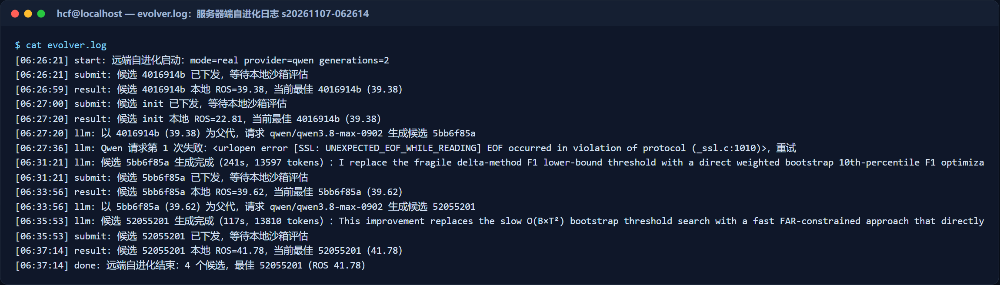

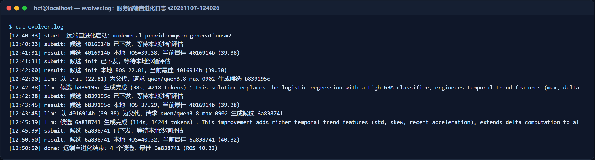

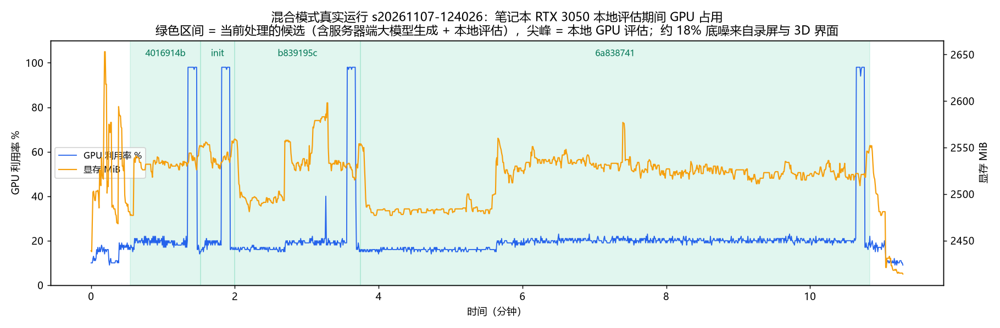完整截图、平板通信与本机 GPU 占用曲线见 `docs/guide/README.md` 第 D 节。

---

## 8. 安全与数据边界

| 原则 | 落实方式 |
|---|---|
| 数据零出域 | 原始遥测、标签、逐盘预测只在平板与笔记本之间流动；服务器只收到代码与分数 |
| 白名单闸门 | `boundary.gate()` 只放行 18 个标量字段，数组 / 嵌套对象即使键名在白名单内也拦截；每次回传记录放行与拦截明细 |
| 沙箱隔离 | 候选以子进程运行；静态检查禁止路径回溯、目录遍历、子进程、网络；900 秒超时 |
| 评分唯一来源 | 只有本地 `evaluator.py` 的分数算数；GPU bootstrap 只提供显著性证据 |
| 密钥管理 | 本机 `.env`（git 忽略）；服务器 `~/.fe_edge/<session>.env`（600 权限），不写 NAS；设置面板不回显密钥 |
| 错误信息脱敏 | 失败只回传异常类名与行号 |
| 公开材料脱敏 | 文档与截图中跳板机、服务器地址用占位符代替 |

---

## 9. 部署与运行

| 组件 | 要求 |
|---|---|
| Python | 3.12+（推荐 uv 管理），`pip install -e ".[web,edge]"` + CUDA 版 PyTorch |
| 前端 | Node.js 22+、pnpm 9.15+ |
| GPU | NVIDIA（本次为 RTX 3050 Laptop 4 GB，显存占用约 2.5–2.7 GB） |
| 平板 | Android 6+，与笔记本同一局域网（或 `adb reverse` 走 USB） |
| 服务器 | Linux + Python 3.12，经 SSH 跳板机可达 |

```powershell
# 后端（API + 平板 WebSocket + 远端会话）
$env:PYTHONUTF8='1'; .\.venv\Scripts\python.exe scripts\showcase_serve.py --host 0.0.0.0 --port 8012
# 前端
cd web; $env:VITE_API_PROXY_TARGET="http://127.0.0.1:8012"; pnpm dev --host 0.0.0.0 --port 5180
```

- Demo（无需服务器与密钥）：打开 <http://127.0.0.1:5180/>，按"对话 → 确认（回放真实实验）→ 进化工作台 → 知识发现 → 结果讲解"操作。
- 完整真实运行：配置 `.env`（Qwen 密钥、跳板机与目标服务器、远端目录），安装平板 APK，确认页选"混合云 · 真实运行"。详细步骤、验收标准与排障见 `docs/guide/README.md` 与 `docs/REAL_RUN.md`。

---

## 10. 局限与展望

- **真实运行代数偏少**：录制与验收时每轮只跑 2 代。4 次真实会话里有 2 次超过种子最佳（52055201 41.78、6a838741 40.32），其中只有 52055201 达到高置信（P(提升) = 0.99）；6a838741 的提升（+0.94）仍在噪声带内。正式实验建议跑 8 代以上，并结合 KGTE 多岛并行。
- **候选代码健壮性**：大模型偶尔写出运行即失败的代码（例如 LightGBM early stopping 缺验证集）。现在以错误类型回传、由 REPAIR 算子修复，后续可在服务器端加静态预检，减少无效评估。
- **平板为数字孪生**：当前平板回放的是真实 Backblaze 盘的 SMART 序列；接入真实机房 BMC / Redfish 遥测只需替换数据源，协议无需改动。
- **知识外推**：SMART 194 结论在时间外推上 CI 含 0，CAF 待未见季度确认，后续在更多季度、更多厂商上做独立复核。
